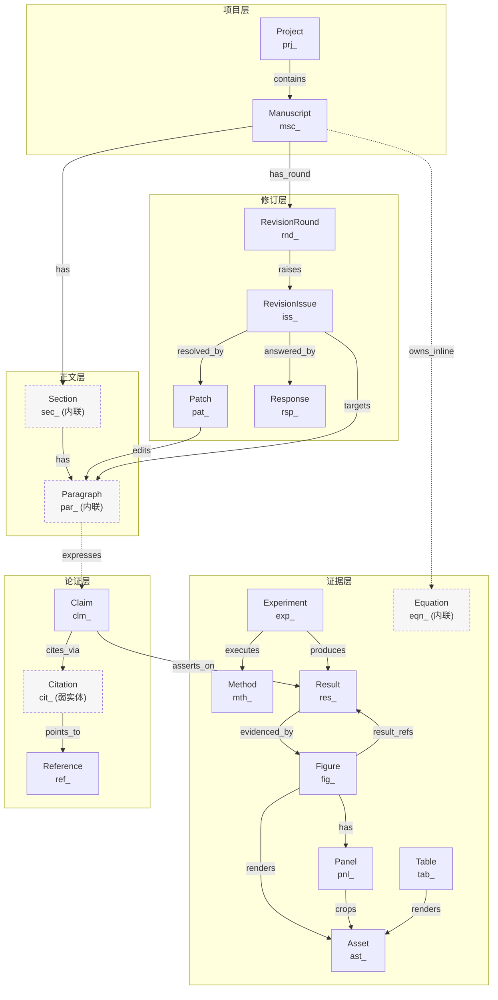

# Scientific Data Model Proposal

> 版本：`draft-2`（Phase 0 修订轮，关闭 QA 阻断项 B1–B6）
> 作者：Worker C — Scientific Modeler
> 状态：提案（Proposal），非规范（Spec）。落地前需 Worker A（Obsidian 能力审计）、Worker B（原稿转换审计）交叉确认。
> 适用范围：Obsidian 宿主 + Markdown 文件 + YAML Properties 的**纯文件**数据模型。
> 修订说明见 §13；逐条证据见 `REVISION_LOG.md`；可执行测试向量见 `tests/grammar_vectors.md`（由 `tests/run_vectors.py` 生成与执行）。

**阅读约定**

- `[待审计]` 标记：该结论依赖 Obsidian 的某项具体能力，Worker C 无法在本阶段独立验证，**必须由 Worker A 审计确认**。所有 `[待审计]` 项在 §10、§11 汇总。
- `[外部组件]` 标记：该能力无法在纯文件系统中实现，属于**可选外部组件**，缺失时系统必须仍能降级运行。
- `[取舍]` 标记：紧随其后的段落是"为什么不是另一个方案"。
- 术语：**实体（Entity）**= 可被独立引用的科研对象；**边（Edge）**= 实体间关系；**派生数据（Derived）**= 可随时重算、不作为事实落盘的数据。

---

## 1. 设计原则

### P1 — 文件是唯一事实来源（File is Truth）

任何科研事实必须能在某个 Markdown 文件（frontmatter 或正文）中被人类读到。数据库、内存索引、插件缓存一律是**派生物**，删除后系统必须能重建，且重建结果逐字节等价（除时间戳）。

否定理由：先设计关系库再映射到 Markdown，会在"多对多 + 引用完整性"上反复妥协——Markdown 没有外键、没有事务、没有 JOIN。把文件当投影而不是源，会让每一次导入导出都成为有损同步。反过来，先把文件结构设计对，索引层只是加速器。

### P2 — 单一写入点（Single Writer per Fact）

每一个事实在文件系统中**只有一个权威写入位置**，其余出现处都是链接或派生。关系（边）只由**语义归属方**单向持有：

| 关系 | 边存放在 | 为什么是这一侧 |
| --- | --- | --- |
| Figure ↔ Panel | `Panel.figure` | Panel 是子对象，生命周期依附 Figure；Panel 不可能跨图。**`Panel.derived_from` 不是边**，只记录血缘（§3.6、§4.1、B1） |
| Result ↔ Figure | `Figure.result_refs[]` | Figure 是**呈现方**，声明"我呈现了哪些 Result"；Result 是客观发现，不该知道"我被谁画进了哪张图"（§3.5、§3.7、§4.1a、B4） |
| Claim ↔ Result | `Claim.results[]` | Result 是客观发现，可被多篇稿件、多个 Claim 复用；让 Result 记录"谁引用了我"会污染客观事实 |
| Reference ↔ Citation | `Citation.reference`（Citation 弱实体，嵌在引用方） | Citation 是"某处某文引用某文献"的事件，主语是引用方 |
| RevisionIssue ↔ Paragraph | `RevisionIssue.targets[]` | 审稿意见指向正文，正文不该知道审稿意见（否则改稿痕迹污染正文） |

> **唯一权威边声明（P2 的落地形式）**：上表每一行是且仅是**一个字段**。凡文中其它字段与这些字段表达同一关系（`Figure.panels`、`Result.figures`、`RevisionRound.issues` 等），一律标注 `派生缓存`，冲突时无条件以上表字段为准（VR-46 自动重建）。

反向列表（"引用 Reference X 的所有 Claim"）**不落盘**，由 §8 的索引层派生。

### P3 — ID 与路径解耦（Identity ≠ Location）

实体身份由 frontmatter/内联的 `id` 决定，不由文件名、文件夹、标题、编号决定。因此：改标题安全、改图号安全、移动文件安全、拆分稿件安全。文件名**采用 ID 本身**（见 §3.0.3），从根本上消除"重命名断链"。

### P4 — 编号是派生的，不是存储的（Numbers are Computed）

`Figure 3` 不是数据，是视图。文件里存 `fig_7K3M9Q`，`Figure 3` 在渲染时由编号解析器算出。任何把编号硬写进正文的做法（`Figure 3` 字面量）都被视为**待迁移的遗留状态**，由校验规则 VR-07 拦截。否定理由见 §6.6。

### P5 — 原始件不可变（Originals are Immutable）

导入的 DOCX / PDF / 图片 / LaTeX 原文件一律**只读**，永不改写、永不"另存修复"。它们作为 `Asset` 以 `sha256` 内容寻址存放。所有结构化的东西都是派生视图。

### P6 — 人类可编辑优先于机器最优（Human-Editability First）

字段名用英文小写下划线，值用 YAML 基本类型与 wikilink，不引入嵌套三层以上的结构，不引入自定义 DSL 作为**唯一**表达方式。理由：作者会手改文件，手改是特性不是 bug；任何"只能通过插件编辑"的格式在插件失效时等于数据丢失。

### P7 — 弱实体与晋升（Weak Entities & Promotion）

高频、低语义、天然内联的对象（Paragraph、Citation）默认不作为独立文件存在，而是**内联标记 + 轻量元数据**；当它们获得独立生命周期（被多次引用、有独立状态、有独立修订史）时**晋升（promote）**为独立文件，ID 不变。这条原则把"每段落一个文件"的文件爆炸挡在门外（一篇 800 段的稿件会产生 800 个文件，MetadataCache 与 Git diff 均不可接受）。

### P8 — 显式版本与可拒绝加载（Versioned & Refusable）

每个文件带 `schema_version`。低于当前版本 → 按迁移链升级或按默认值读取；高于当前版本 → **只读加载并告警**，绝不猜测。理由：多设备、多版本插件共存是 Obsidian 的常态。

### P9 — 只为可验证的东西建锚点（Verifiable Anchors Only）

溯源锚点必须是**可在 1 秒内被脚本重算并比对**的量（内容哈希、页号、坐标），不能是"我记得它在第三段"这类叙述。锚点失效必须能被机器检测（§5、§9）。

### P10 — 不假设 Obsidian 能力（No Assumed APIs）

所有涉及 Obsidian API、Bases、Properties 类型系统、MetadataCache 行为的假设，一律标 `[待审计]`，并在 §11 形成清单交给 Worker A。模型设计上准备了两条路径（原生能力路径 / 插件自建路径），使审计结论为"否"时不至于推翻模型。

---

## 2. 实体总览

### 2.1 关系图



> 实线 = 强引用（目标文件必须存在）；虚线 = 弱引用/可空引用。
> `Section`、`Paragraph`、`Equation` 为弱实体（内联，非独立文件），`Citation` 为默认弱实体、可晋升。
> `FIG -->|result_refs| RES` 是 P2 表中 Result↔Figure 的**唯一权威边**（B4）。

### 2.2 实体清单与存在理由一句话表

| # | 实体 | 前缀 | 存在形态 | 不能被合并的理由（一句话） |
| --- | --- | --- | --- | --- |
| 1 | Project | `prj_` | 独立文件 | 跨稿件的元数据（作者、伦理批号、基金、共享数据）必须有归属，合并进 Manuscript 会导致多稿重复与漂移 |
| 2 | Manuscript | `msc_` | 独立文件（含正文） | 投稿单元，有自己的状态机（draft→submitted→R1…），与 Project 的生命周期不同步 |
| 3 | Section | `sec_` | 内联（标题锚点） | 结构单元，承载章节级引用与重排；合并进 Paragraph 会丢失层级与稳定排序 |
| 4 | Paragraph | `par_` | 内联（块锚点） | 修订与审稿意见的最小定位单元；用行号或文本片段定位在改稿后立刻失效 |
| 5 | Figure | `fig_` | 独立文件 | 图有独立生命周期（重绘、替换、版权、审稿意见针对图），且被正文多次引用 |
| 6 | Panel | `pnl_` | 独立文件 | 子图可被单独引用（"Figure 3B"）与单独质疑，坐标/裁切是面板级信息 |
| 7 | Result | `res_` | 独立文件 | 客观发现，独立于任何稿件存在，可被多篇稿件与多个 Claim 复用 |
| 8 | Method | `mth_` | 独立文件 | 方法可跨实验复用，且有独立描述（参数、版本、SOP），不是某次实验的字段 |
| 9 | Experiment | `exp_` | 独立文件 | "谁在何时用什么方法做了什么得到什么"是四元组，实验是连接 Method 与 Result 的执行实例 |
| 10 | Reference | `ref_` | 独立文件 | 文献是全局唯一对象，被多篇稿件的多个位置引用；合并进 Citation 会导致同一文献重复建实体 |
| 11 | Citation | `cit_` | 弱实体（嵌在引用方）；可晋升 | 引文是"某处为什么引用"的局部事件，含 locator 与引用意图，与 Reference 是一对多 |
| 12 | Claim | `clm_` | 独立文件 | 论断是论证单元，需要独立的证据链（Result）、强度（strength）、可被单向推翻 |
| 13 | Asset | `ast_` | 独立文件（伴生 note）+ 内容寻址二进制 | 二进制文件没有 frontmatter，必须有一个可承载哈希/许可/来源的伴生文件 |
| 14 | RevisionRound | `rnd_` | 独立文件 | 轮次有自己的一揽子状态（投稿日、决定、期限、快照哈希），与 Manuscript 一对一但时序独立 |
| 15 | RevisionIssue | `iss_` | 独立文件 | 审稿意见是外部输入，含原文引用与多目标定位，不能塞进 Round 的一个列表字段 |
| 16 | Patch | `pat_` | 独立文件 | 一个 Issue 可能被多个 Patch 解决，一个 Patch 可能解决多个 Issue，且 Patch 需要可回滚的 diff |
| 17 | Response | `rsp_` | 独立文件 | 回复信是独立产物（逐条回复、语气、致谢），有自己的导出格式与审稿人可见性 |
| 18 | Table | `tab_` | 独立文件 + 正文定义点 | 表有独立编号、题注、脚注与"被单独质疑"的生命周期；`{{tab:}}`/`{{tabref:}}` 已存在于正文语法（§6.0），无实体则 token 无主（B3） |
| 19 | Equation | `eqn_` | 内联（公式块锚点）+ 容器 frontmatter 承载元数据 | 公式独立编号（`(4)`）且被正文反复引用；与 Section/Paragraph 同为"高频、低语义、天然内联"的弱实体（P7），故不建独立文件 |

> **实体总数 = 19**。draft-1 原为十七个实体（Manuscript…Response）+ 本轮 B3 裁定新增的 Table、Equation（前缀 `tab_` / `eqn_`）。全文所有「十七个实体 / 十七张表 / 十七类」的旧表述均已同步为 19（见表下方清单与 §13）。
> **`eq_` 前缀不被采用**：两字母前缀会破坏 §6.0 的 `[a-z]{3}` 结构一致性，且 `eq` 与 `eqn` 并存会产生 ID 歧义；Equation 的 token 种类名仍是 `eq`/`eqref`（渲染为 `(4)`），**token 种类名 ≠ ID 前缀**，二者在 §6.0 分别定义。

---

## 3. 实体定义

### 3.0 全局约定

#### 3.0.1 ID 方案

**格式**

```
<prefix>_<8 位 Crockford Base32>
例：fig_7K3M9Q2P、clm_3XB8NRT5、par_9QK2M4XZ
```

- 字母表：`0123456789ABCDEFGHJKMNPQRSTVWXYZ`（Crockford Base32，剔除 `I L O U`，避免与 `1 0` 混淆）。
- 熵：32^8 = **1.1 × 10¹²** / 每类型。按每类型 10 万实体估算，生日碰撞概率 ≈ 4.5 × 10⁻³ —— 仍需**创建时查重**（见生成规则）。
- 前缀注册表（**唯一来源 = §6.0**，此处不另写一套；本行仅列出便于阅读）：`prj msc sec par fig pnl tab eqn res mth exp ref cit clm ast rnd iss pat rsp`（19 个）。
- 正则：**不在此重复**，见 §6.0.2 的 `ID_RE` / `ID_PATTERN`（VR-20 直接引用该定义，B3）。

**生成规则**（伪代码）

```text
function newId(prefix, vaultIndex):
    for attempt in 1..5:
        candidate = prefix + "_" + base32Crockford(randomBytes(5))   # 40 bit
        if not vaultIndex.exists(candidate):      # 全库索引，含 promoted 弱实体
            register(candidate)                    # 先占位后写文件，避免并发重名
            return candidate
    throw IdCollisionExhausted(prefix)             # 概率极低，出现即为索引损坏
```

- **不可读**（有意为之）：可读性与稳定性不可兼得。可读标识（`Figure 3`、`Table 1`）随文档顺序变化，一旦进入 ID 就与 P4 冲突。
- **是否可重命名后保持**：是。ID 存于 frontmatter `id` 或内联块锚点，重命名标题/文件/编号均不影响。
- **人类可读地址**：由 `title`、`aliases`、以及解析出的 `display_label`（如 `Figure 3B`）提供，全部为**派生或可编辑的展示层**，不参与身份。
- **弱实体 ID 的分配时机**：`par_` / `sec_` 在**导入或首次需要引用时**分配并永久保留；即使段落文本被整段重写，`par_` 不换（它是位置的身份，不是内容的身份）。内容相同的新段落是**新 ID**（内容哈希不作为段落身份，理由见 §5.4）。

#### 3.0.2 标准字段组

为避免 19 张表重复冗余，公共字段抽成三个字段组，各实体字段表通过 `继承：S1` 等方式引用；**每个实体的表仍然完整列出全部字段（含继承项）**，便于单独查阅与机器校验。

**S1 — 身份与项目归属**

| 字段名 | 类型 | 必填 | 默认值 | 约束与说明 |
| --- | --- | --- | --- | --- |
| `id` | text | 是 | 无 | 匹配 §3.0.1 正则；全库唯一；创建后永不变更 |
| `type` | text | 是 | 无 | 枚举，等于实体类型名（小写），与 ID 前缀必须一致（VR-21） |
| `schema_version` | text（`MAJOR.MINOR`） | 是 | 当前主版本，如 `"1.0"` | 只允许升级；> 当前版本时文件只读（P8） |
| `project` | wikilink | 是 | 无 | 指向 `prj_`；跨项目复用（如通用方法）允许 + 短列表，见 §4.5 |
| `title` | text | 是 | 无 | 人类可读名；无副作用，可随意改 |
| `aliases` | list<text> | 否 | `[]` | 供 wikilink 别名解析与搜索 |
| `tags` | list<text> | 否 | `[]` | 仅用于过滤；语义状态一律用专门字段，禁止用 tag 表达状态 |
| `created` | datetime | 是 | 创建时刻（ISO 8601 带偏移） | 不可变 |
| `updated` | datetime | 是 | = `created` | 每次内容变更时刷新；由插件或手工维护 |
| `status` | text | 是 | 见各实体 | 状态机见各实体生命周期；非法迁移由 VR-22 拦截 |
| `supersedes` | wikilink | 否 | 空 | 指向被本实体取代的旧实体（**同类型**）；构成链，禁止成环（VR-09） |
| `notes` | text | 否 | 空 | 自由备注，不参与任何逻辑 |

**S2 — 溯源（Provenance）**

| 字段名 | 类型 | 必填 | 默认值 | 约束与说明 |
| --- | --- | --- | --- | --- |
| `source_asset` | wikilink → `ast_` | 否 | 空 | 原始文件（DOCX/PDF/LaTeX/图片）伴生 note |
| `source_sha256` | text（64 hex） | 否 | 空 | 冗余但必填于"有 source_asset 时"；用于检测原稿是否被替换 |
| `source_anchor` | text | 否 | 空 | 结构化锚点串，语法见 §5.2；**机器可解析** |
| `source_locator_hint` | text | 否 | 空 | 人类可读提示（如 "p.12, 2nd col, para 3"）；**不可作为定位依据**，仅辅助人工核对 |
| `derived_from` | list<wikilink> | 否 | `[]` | 产物血缘（Panel→Figure、Patch→Paragraph、Citation 晋升后→原容器） |
| `content_hash` | text（16 hex） | 否 | 空 | 该实体"语义载荷"的规范化哈希，见 §5.3；用于检测漂移，不参与身份 |

**S3 — 审阅与冻结**

| 字段名 | 类型 | 必填 | 默认值 | 约束与说明 |
| --- | --- | --- | --- | --- |
| `review_state` | text | 是 | `draft` | 枚举：`draft` / `in_review` / `accepted` / `rejected` / `frozen` |
| `frozen` | checkbox | 是 | `false` | `true` 时禁止任何内容写入（投稿快照后置位） |
| `visibility` | text | 是 | `internal` | 枚举：`internal` / `author_visible` / `reviewer_visible` / `public`（用于 Response 与 RevisionIssue） |
| `x_ext` | text | 否 | 空 | **只放标量**（扩展命名空间的版本号/开关）。~~object~~ → **B5 修订**：结构化扩展一律进正文 YAML 块 `swp:meta` 的 `x_ext:` 键（§3.0.6、§7.6）；未知字段迁移时同样写入该块 |

#### 3.0.3 文件布局（Vault 目录约定）

```text
<vault>/
├── Projects/                prj_XXXXXXXX.md
├── Manuscripts/             msc_XXXXXXXX.md          # frontmatter + 正文（含内联 sec_/par_/eqn_）
│   └── _maps/               msc_XXXXXXXX.map.yaml    # 机器托管：段落↔原稿映射（§5.5）
├── Figures/                 fig_XXXXXXXX.md
├── Panels/                  pnl_XXXXXXXX.md
├── Tables/                  tab_XXXXXXXX.md
├── Results/                 res_XXXXXXXX.md
├── Methods/                 mth_XXXXXXXX.md
├── Experiments/             exp_XXXXXXXX.md
├── References/              ref_XXXXXXXX.md
├── Citations/               cit_XXXXXXXX.md          # 仅"已晋升"的 Citation
├── Claims/                  clm_XXXXXXXX.md
├── Assets/
│   ├── ast_XXXXXXXX.md                               # 伴生 note（frontmatter 载体）
│   └── files/<sha256前2>/<sha256>.<ext>              # 内容寻址的二进制原件（只读）
├── Revisions/
│   ├── rnd_XXXXXXXX.md
│   ├── iss_XXXXXXXX.md
│   ├── pat_XXXXXXXX.md
│   └── rsp_XXXXXXXX.md
├── _schema/
│   ├── SCHEMA_REGISTRY.md                            # 版本注册表（§7.2）
│   ├── types/<type>.schema.yaml                      # 每实体 JSON-Schema 子集
│   └── migrations/                                   # 迁移脚本契约（§7.5）
└── _index/                                           # 全部生成物，可整目录删除重建
    ├── backlinks.json
    ├── numbering.json
    └── lint-report.md
```

**规则**

- **文件夹按类型划分，不按项目划分**。理由：`project` 是 frontmatter 字段，可作为过滤器；若按项目建目录，跨项目复用（Method、Reference）无处安放，且移动稿件会大规模断链。（若需项目工作区，`[待审计]` 可否用 Bases 视图或 `.obsidian` workspace 实现，而非目录结构 —— 见 §10/R6。）
- **文件名 = 实体 ID**（`fig_7K3M9Q2P.md`）。`[取舍]` 备选是"人类可读文件名 + ID 字段"，但 Obsidian 的 wikilink 按**文件名**解析，`[[fig_7K3M9Q2P]]` 只有在文件名就是 ID 时才能原生解析；若用可读名，则必须依赖插件劫持链接解析（`[待审计]`，见 §10/R2）。代价是文件浏览器里看到一串 ID —— 用 `aliases` + `title` 与自定义视图缓解，且 `[待审计]` Obsidian 是否支持"文件浏览器显示 frontmatter 标题"。
- `_index/` 与 `_maps/` 是**仅有的两个非 frontmatter 落盘位置**，理由见 §5.5 与 §8.4；两者都必须可重建，且 `_maps/` 是段落身份绑定的唯一权威（例外说明见 §5.5）。
- **正文 YAML 块（`swp:` fenced block）不是第三个落盘位置**：它是 frontmatter 的替代承载，属于实体自身文件的正文档（D-04），随实体文件一起读写与备份。布局见 §3.0.6。
- Equation（`eqn_`）无目录：它是**内联弱实体**，元数据落在 Manuscript 的正文 YAML 块 `swp:equations`（§3.0.6、§3.17b）。
- 二进制资产按内容寻址（`/files/<sha256前2>/<sha256>.<ext>`），天然去重、天然防篡改：路径即校验和。

#### 3.0.4 通用状态机

```text
draft ──> in_review ──> accepted ──> frozen
  │           │            │
  └───────────┴──────────> rejected
```

- 一旦 `frozen: true`，写入被拒（VR-23），只能通过 `supersedes` 建新实体。
- 各实体可**收窄**但不能**新增**状态值。

#### 3.0.5 正文文法（唯一权威定义在 §6.0）

ID 前缀、块锚点 `^par_…`、token `{{kind:id}}`、哈希剥离用的 `ANCHOR_RE`、内联引文 `[[ref_…#locator=…|role=…]]` 的**唯一权威定义是 §6.0**。
本节的 §3.0.1、§3.18、§5.3、§6.3–§6.7、§9.2（VR-20/VR-01）**只引用 §6.0，不得各写一套正则**。可执行副本与测试向量见 `tests/run_vectors.py` / `tests/grammar_vectors.md`。

#### 3.0.6 D-04 落位：frontmatter 只放标量 / 标量列表 / wikilink 列表

**已生效裁决 D-04**：frontmatter 禁止嵌套对象。下表把 draft-1 中所有 `object` / `list<object>` 字段逐一落位。三种落位方式：

| 落位 | 含义 | 读写方 |
| --- | --- | --- |
| **F** frontmatter | 标量、标量列表（`list<text>` / `list<number>`）、wikilink、`list<wikilink>`、`list<text>` 形式的 ID 列表 | Properties 面板 / MetadataCache |
| **B(n)** 正文 YAML 块 | 本文件正文中一个 ` ```yaml swp:<name> ``` ` fenced block（整个块承载一个对象或一个对象列表） | 引擎读写；Properties 面板不可见 |
| **PL** 平行列表 | frontmatter 中若干个**等长**的标量列表，第 *i* 项共同组成一个对象；等长由引擎保证（VR-53） | Properties 面板可编辑（逐列） |

**块名注册表**（`swp:` 后的名字全局唯一，同一个文件内同名块至多 1 个）：

| 块名 | 落在哪个实体文件 | 承载内容 |
| --- | --- | --- |
| `swp:meta` | 任意实体文件 | 该实体的结构化扩展：`x_ext`（结构化部分）、Panel 的 `crop` / `crop_px` / `layout` / `canvas` / `source_size` / `transform` / `crop_history`、Figure 的 `panel_layout`（仅当列/行之外的属性出现时）、迁移保留的未知字段 |
| `swp:sections` | Manuscript | `section_meta[]`（Section 弱实体元数据） |
| `swp:equations` | Manuscript | `equation_meta[]`（Equation 弱实体元数据，§3.17b） |
| `swp:citations` | Manuscript / Paragraph 晋升文件 / Method | 段内 Citation 对象列表（`Paragraph.citations`） |
| `swp:targets` | RevisionIssue / Patch | `targets[]`（Issue 的定位边 / Patch 的被改段落） |
| `swp:params` | Method / Experiment | Method 的 `software[] / reagents[]`；Experiment 的 `conditions[]`（含可选键时） |
| `swp:checks` | Asset（可选） | `previous_sha256[]` 以对象形式保存的历史（默认仍是 `list<text>`，无需块） |

**规则**

1. **frontmatter 的值只允许四种形态**：标量（text/number/date/datetime/checkbox/枚举）、标量列表、wikilink（`[[id]]`）、wikilink 列表。出现 `{…}`、`- key: value` 或 `- {…}` 即为违规（VR-54 阻断）。
2. **正文 YAML 块必须可被纯文本解析**：以 ` ```yaml swp:<name> ` 开头、` ``` ` 结尾，块内是单个 YAML 文档；缺失或解析失败 → 对应字段视为缺失（VR-17），不得静默忽略。
3. **正文块是权威**：与任何缓存（`_index/`、平行列表）冲突时以正文块为准（P2）。
4. **`x_ext` 不再是对象**：frontmatter 的 `x_ext` 只存标量；需要键值结构时写到 `swp:meta` 的 `x_ext:` 键下（§7.6 的迁移保留规则随之改写）。
5. **兼容读**：读取器在一个 MINOR 周期内必须同时接受"字段在块里"与"字段直接平铺在 frontmatter（draft-1 旧格式）"两种形态，写入只写块；迁移脚本 `1.0_to_1.1` 负责一次性搬运（§7.6）。版本动作用 MINOR 的理由：合法值的集合不变，只改变承载位置（§7.1"字段类型变更"在此按"承载位置变更"处理，不构成 MAJOR）。

---

#### 3.0.7 逐字段落位映射表（D-04 对齐，覆盖全部 object / list<object>）

> 落位代号：**F** = frontmatter；**B(块名)** = 正文 YAML 块；**B⁺(_maps)** = `_maps/<msc>.map.yaml`（纯 YAML 文件，不是 Obsidian frontmatter，故可嵌套）；**PL** = frontmatter 平行列表（列名随附）。
> 本表是 B5 的关闭证据；`schemas/d04-compliant.example.md` 必须与本表逐行一致（由 `tests/run_vectors.py` 的 B5-01/B5-02 断言）。

| # | 字段 | 所属实体 | draft-1 类型 | 落位 | 理由 |
| --- | --- | --- | --- | --- | --- |
| 1 | `x_ext` | 全部 19 类（S3） | object | **B(`swp:meta`)** → `x_ext:` 键 | 扩展命名空间本质是嵌套字典，D-04 直接禁止；但不删除，因为 M5/M8 要求"未知字段永不丢弃"（§7.6） |
| 2 | `numbering_scheme` | Manuscript | object | **PL**：`numbering_figure` / `numbering_table` / `numbering_equation` / `numbering_supplementary_prefix` / `numbering_continue_across_sections` / `numbering_locale` | 形状固定 6 列、全是标量、用户要在面板里改；扁平后可用原生 Properties 编辑（P6） |
| 3 | `section_meta` | Manuscript | list<object> | **B(`swp:sections`)** | 每项含 `acronyms_defined: list<text>` 这一**列表子字段**，无法扁平为等长标量列表；块模式下整表机读重建（§3.3） |
| 4 | `section_order` | Manuscript | list<wikilink> | **F**（不变） | 已是 wikilink 列表，合法；仍是派生缓存 |
| 5 | `panel_layout` | Figure | object `{cols, rows}` | **PL**：`panel_layout_cols` / `panel_layout_rows` | 两列标量、手改频率高 |
| 6 | `crop` | Panel | object | **B(`swp:meta`)** → `crop:` 键 | 嵌套 rect 数组 + unit 枚举；由标注界面整体写入，不需在面板手改 |
| 7 | `crop_px` | Panel | object | **B(`swp:meta`)** | 机器重算的冗余校验值，绝不手改 |
| 8 | `layout` | Panel | object | **B(`swp:meta`)** | 同上（面板在画布上的放置矩形） |
| 9 | `canvas` | Panel | object | **B(`swp:meta`)** | 同上（画布尺寸，Figure 级覆盖优先） |
| 10 | `source_size` | Panel | object | **B(`swp:meta`)** | 同上（`w_px/h_px/dpi`，§6.8 标定用） |
| 11 | `transform` | Panel | object | **B(`swp:meta`)** | 同上（rotate/scale/flip，仅 90° 倍数） |
| 12 | `crop_history` | Panel | list<object>（append-only） | **B(`swp:meta`)** → `crop_history:` 键 | 只追加、只机读；进 frontmatter 会把每次重标定都变成属性面板噪声 |
| 13 | `targets` | RevisionIssue | list<object> | **B(`swp:targets`)** | 每项 2 必填 + 3 可选键，可选键的平行列表会产生"空串占位"歧义；块内可缺省（§3.15、§4.6） |
| 14 | `targets` | Patch | list<object> | **B(`swp:targets`)** → 每项 `{par, field?, operation?}` | 同 #13；Patch 的 targets 还带 `field` |
| 15 | `authors` | Project | list<object> | **PL**：`author_names` / `author_affiliation_keys` / `author_orcids` / `author_corresponding` | 4 列固定、作者署名是作者亲手要改的东西；等长由 VR-53 保证 |
| 16 | `affiliations` | Project | list<object> | **PL**：`affiliation_keys` / `affiliation_names` / `affiliation_departments` / `affiliation_cities` / `affiliation_countries` | 5 列固定，全部标量 |
| 17 | `funding` | Project | list<object> | **PL**：`funder_names` / `funder_grant_ids` | 2 列固定；基金信息少而稳定 |
| 18 | `abbreviations` | Project | list<object> | **PL**：`abbreviation_keys` / `abbreviation_fulls` | 2 列固定，供 VR-26 比对 |
| 19 | `parameters` | Method | list<object> | **PL**：`parameter_keys` / `parameter_values` / `parameter_units` | 3 列固定，参数微调要就地改（§3.8 生命周期） |
| 20 | `software` | Method | list<object> | **B(`swp:params`)** | `doi` 是可选键，平行列表会出现空列；软件清单通常成批导入而非逐项手改 |
| 21 | `reagents` | Method | list<object> | **B(`swp:params`)** | `lot` 可选且变更触发 VR-34 提示，需要整条对象的原子性 |
| 22 | `conditions` | Experiment | list<object> | **PL**：`condition_keys` / `condition_values` / `condition_units` | 3 列固定；与 `parameters` 同形，便于统一校验 |
| 23 | `citations` | Paragraph | list<object> | **B⁺(`_maps`)** → `entries[].citations` | 段落元数据本就不在 frontmatter（§3.4，800 段的 frontmatter 不可接受）；`_maps` 是纯 YAML，可嵌套 |
| 24 | `acronyms_defined` | Section（存于 `section_meta`） | list<text> | **B(`swp:sections`)** → 每项 `acronyms_defined:` | 随 #3 一起进块（列表子字段） |
| 25 | `resolution_note` / `planned_patch` / `body` | RevisionIssue / Patch / Response | text（正文） | **F** + 正文（不变） | 已是标量或正文，不涉及嵌套 |
| 26 | `diff` | Patch | text（code fence） | 正文 ` ```diff ` 块（不变） | 已在正文，不受 D-04 影响 |

**覆盖性声明**：draft-1 / draft-2 全部 `object` 与 `list<object>` 字段 = 上表 #1–#24（`x_ext` 计 1 项跨 19 类；#25–#26 为对照项，无需改动）。其余字段类型为标量 / 标量列表 / wikilink / wikilink 列表，**本就合法**，不经改动即可留在 frontmatter。
**验证**：`tests/run_vectors.py` 的 `B5-01`（示例文件 frontmatter 零嵌套）+ `B5-02`（`swp:meta` / `swp:citations` 等登记块齐备）。

---

### 3.1 Project（`prj_`）

**语义**：一个科研项目的元容器，承载跨稿件的稳定信息（作者身份、单位、基金、伦理审批、数据可用性声明、共用缩写表）。
**存在理由**：这些信息在多篇稿件间**必须一致**；若复制进每个 Manuscript，就会出现"伦理批号在两篇稿子里不一致"这类不可自动发现的错误。Project 是唯一的对齐点。

**ID**：`prj_` + 8 位；随机生成；可读性无；重命名无关。

**存放位置**：独立文件 `Projects/prj_XXXXXXXX.md`（frontmatter 承载全部**标量/标量列表**字段——按 D-04，B5 起作者/单位/基金/缩写均为平行列表，见 `author_*` / `affiliation_*` / `funder_*` / `abbreviation_*`；结构化扩展走正文 `swp:meta` 块；正文其余部分为空或放项目级说明）。

| 字段名 | 类型 | 必填 | 默认值 | 约束与说明 |
| --- | --- | --- | --- | --- |
| `id` | text | 是 | — | `prj_[0-9A-HJKMNP-TV-Z]{8}` |
| `type` | text | 是 | `project` | 固定值 |
| `schema_version` | text | 是 | `"1.0"` | §7 |
| `project` | wikilink | 是 | 自身 | 自指，保持字段组一致（校验时豁免自指循环，见 VR-24） |
| `title` | text | 是 | — | 项目名 |
| `aliases` | list<text> | 否 | `[]` | 项目简称 |
| `tags` | list<text> | 否 | `[]` | — |
| `created` | datetime | 是 | 创建时刻 | 不可变 |
| `updated` | datetime | 是 | =`created` | — |
| `status` | text | 是 | `active` | `active` / `archived` |
| `supersedes` | wikilink | 否 | 空 | — |
| `notes` | text | 否 | 空 | — |
| `review_state` | text | 是 | `draft` | 项目级一般恒为 `draft` |
| `frozen` | checkbox | 是 | `false` | — |
| `visibility` | text | 是 | `internal` | — |
| `x_ext` | text | 否 | 空 | **B5**：只放标量；结构化扩展 → `swp:meta` 的 `x_ext:` 键 |
| `short_name` | text | 否 | 空 | 用于文件前缀/导出命名 |
| `principal_investigator` | text | 是 | — | 姓名（不建 Person 实体，Phase 0 无需求） |
| `author_names` | list<text> | 是 | `[]` | **B5 · PL**：作者姓名列（`authors` 的第 1 列）；ORCID 等其余列见下三行，四列等长（VR-53） |
| `author_affiliation_keys` | list<text> | 是 | `[]` | PL：每项对应 `affiliation_keys` 中的 key；允许空串（无单位） |
| `author_orcids` | list<text> | 否 | `[]` | PL：ORCID，允许空串；非空时校验 `^\d{4}-\d{4}-\d{4}-\d{3}[\dX]$` |
| `author_corresponding` | list<checkbox> | 否 | `[]` | PL：通讯作者标记 |
| `affiliation_keys` | list<text> | 否 | `[]` | **B5 · PL**：单位 key（被 `author_affiliation_keys` 引用） |
| `affiliation_names` | list<text> | 否 | `[]` | PL：单位全名 |
| `affiliation_departments` | list<text> | 否 | `[]` | PL：院系，允许空串 |
| `affiliation_cities` | list<text> | 否 | `[]` | PL：城市，允许空串 |
| `affiliation_countries` | list<text> | 否 | `[]` | PL：国家（ISO 3166-1 alpha-2），允许空串 |
| `funder_names` | list<text> | 否 | `[]` | **B5 · PL**：基金机构 |
| `funder_grant_ids` | list<text> | 否 | `[]` | PL：基金编号，允许空串 |
| `ethics_approval` | text | 否 | 空 | 伦理批号/IRB 编号；Manuscript 只能**引用**不得覆盖（VR-25） |
| `data_availability` | text | 否 | 空 | 数据可用性声明模板 |
| `competing_interests` | text | 否 | 空 | 利益冲突声明 |
| `abbreviation_keys` | list<text> | 否 | `[]` | **B5 · PL**：缩写 key |
| `abbreviation_fulls` | list<text> | 否 | `[]` | PL：缩写全称，供缩写一致性校验（VR-26） |
| `citation_style` | text | 是 | `vancouver` | 枚举：`vancouver` / `apa7` / `nature` / `custom` |
| `default_locale` | text | 是 | `en-US` | 影响编号词形（`Figure` vs `图`，§6.4） |

**生命周期**
- 创建：项目初始化向导（人工或一次性脚本），必须至少 1 位作者。
- 修改：加作者/基金可随时；改 `ethics_approval` 视为**重大变更**，需同时检查所有关联 Manuscript 的 `[待补]` 引用并记录到 `notes` 的变更日志段。
- 废弃：`status: archived`；不删除文件（历史稿件会引用它）。

---

### 3.2 Manuscript（`msc_`）

**语义**：一次投稿单元——包含正文（Section/Paragraph 内联）、稿件级元数据与投稿状态机。
**存在理由**：稿件有独立的生命周期（draft → submitted → R1 → accepted），且导出、编号、修订都以稿件为作用域。Project 不能承担，因为一个项目常常同时有 2–3 篇在投稿件，各自状态不同。

**ID**：`msc_` + 8 位；随机；可读性无；重命名/改标题不影响。

**存放位置**：独立文件 `Manuscripts/msc_XXXXXXXX.md`，**frontmatter + 正文同一文件**。正文中使用内联块锚点承载 `sec_` / `par_`（§3.3、§3.4）。

| 字段名 | 类型 | 必填 | 默认值 | 约束与说明 |
| --- | --- | --- | --- | --- |
| `id` | text | 是 | — | `msc_...` |
| `type` | text | 是 | `manuscript` | 固定 |
| `schema_version` | text | 是 | `"1.0"` | — |
| `project` | wikilink | 是 | — | 必须指向存在且 `status: active` 的 `prj_` |
| `title` | text | 是 | — | 稿件标题（≠ 文件标题） |
| `aliases` | list<text> | 否 | `[]` | 简称、投稿系统编号 |
| `tags` | list<text> | 否 | `[]` | — |
| `created` | datetime | 是 | — | — |
| `updated` | datetime | 是 | =`created` | — |
| `status` | text | 是 | `draft` | `draft` / `submitted` / `under_review` / `revision` / `accepted` / `in_production` / `published` / `withdrawn` |
| `supersedes` | wikilink | 否 | 空 | 指向同题旧稿（重写而非修订时用） |
| `notes` | text | 否 | 空 | — |
| `review_state` | text | 是 | `draft` | — |
| `frozen` | checkbox | 是 | `false` | 投稿时置 `true`（§7.4 快照） |
| `visibility` | text | 是 | `internal` | — |
| `x_ext` | text | 否 | 空 | **B5**：只放标量；结构化扩展 → `swp:meta` |
| `source_asset` | wikilink | 否 | 空 | 导入来源 DOCX/TeX 的 `ast_` |
| `source_sha256` | text | 否 | 空 | — |
| `source_anchor` | text | 否 | 空 | 稿件级锚点（如 `docx:<sha>#whole`），段落级锚点在 `_maps/` |
| `source_locator_hint` | text | 否 | 空 | — |
| `derived_from` | list<wikilink> | 否 | `[]` | 上一版快照 / 拆分来源 |
| `content_hash` | text | 否 | 空 | 规范化正文哈希（§5.3） |
| `journal` | text | 否 | 空 | 目标期刊 |
| `article_type` | text | 是 | `research_article` | `research_article` / `review` / `letter` / `methods` / `case_report` |
| `target_length_words` | number | 否 | 空 | 用于进度统计 |
| `section_meta` | list<object> → **正文块 `swp:sections`** | 是 | 导入时生成 | **B5**：Section 弱实体的元数据载体（§3.3），每项 `{id, role, status, frozen, acronyms_defined[], notes}`；`title`/`level` **不在块内**（以正文标题为准）；**权威**（Section 的附加属性只存于此）。`id`/`role`/`level` 的派生缓存见 `section_order` 行 |
| `section_order` | list<wikilink> | 否 | `[]` | **派生缓存**：权威顺序 = 正文中标题出现顺序（§6.3）；此字段仅用于离线工具对账，冲突时以正文为准（VR-46） |
| `numbering_figure` | text | 是 | `arabic` | **B5 · PL**：`numbering_scheme.figure` 的第 1 列（枚举 `arabic` / `romanlower` / `romanupper`） |
| `numbering_table` | text | 是 | `arabic` | PL：`numbering_scheme.table` |
| `numbering_equation` | text | 是 | `arabic` | PL：`numbering_scheme.equation` |
| `numbering_supplementary_prefix` | text | 是 | `S` | PL：`numbering_scheme.supplementary_prefix` |
| `numbering_continue_across_sections` | checkbox | 是 | `true` | PL：`numbering_scheme.continue_across_sections` |
| `numbering_locale` | text | 是 | `inherit` | PL：`numbering_scheme.locale`（`inherit` 时取 `Project.default_locale`） |
| `equation_meta` | list<object> → **正文块 `swp:equations`** | 否 | `[]` | **B5**：Equation 弱实体元数据（§3.17b），每项 `{id, number?, anchor?, source?, notes}`。`number` 只作派生值缓存（权威由 §6.3 计算），`anchor` 与正文行尾 `^eqn_…` 必须一致（VR-29） |
| `supplementary_of` | wikilink | 否 | 空 | 若本稿是某稿的补充材料，指向主稿 |
| `current_round` | wikilink → `rnd_` | 否 | 空 | 指向最新 `RevisionRound`；`status: revision` 时必填（VR-27） |
| `claims` | list<wikilink> | 否 | `[]` | 本稿主张的 Claim（冗余缓存，派生自 Claim.manuscript，见 §4.6） |
| `figures` | list<wikilink> | 否 | `[]` | 冗余缓存（同上） |
| `reference_style_note` | text | 否 | 空 | 期刊特例说明 |

**生命周期**
- 创建：导入管道（Worker B 的 DOCX→MD）或"新建空稿"；创建时同步生成 `_maps/msc_x.map.yaml`。
- 修改：正文编辑自由；`status` 迁移必须符合状态机；`submitted` 时生成快照哈希写 `_index/` 并在 `RevisionRound` 中登记。
- 废弃：`status: withdrawn` 或 `supersedes` 链；不删除（Reference/Citation 指向它）。

---

### 3.3 Section（`sec_`）

**语义**：稿件中的一个结构化章节（标题 + 其下内容），是重排、交叉引用（"Section 2.1"）与章节级统计的最小单位。
**存在理由**：Paragraph 无层级（标题与正文是两类块）；若把章节信息压进标题文本（`## 2.1 Introduction`），则章节号无法随重排更新（违反 P4），且标题改名即断引用。

**ID**：`sec_` + 8 位；在导入或建节时分配；存于**块锚点**中，随段落移动而移动，不随标题文字变化。

**存放位置**：**内联**于 Manuscript 正文，作为标题行的块锚点：

```markdown
## Introduction ^sec_4M2P8QKT

正文第一段…… ^par_9QK2M4XZ

### 2.1 结果小节示例 ^sec_7B3N5RTW
```

- `[待审计]` Obsidian 的块 ID 允许字符集是否为 `[A-Za-z0-9-]`，是否允许下划线 `_`。若**不允许**下划线，则改用连字符写法 `^sec-4M2P8QKT`，ID 值本身不变（仅锚点前缀符改变），由 §5.6 的锚点编解码器统一处理。**这是本提案唯一一处"取决于审计结论"的语法细节，模型语义不受影响。**
- 章节级**附加元数据**不写进标题行（否则污染正文），而是写在 Manuscript 正文的 ```` ```yaml swp:sections ```` 块中（B5 / D-04 落位；块结构见 §3.0.6，字段见 §3.2 的 `section_meta` 行）。这是 §3.0.2 中"内联弱实体 + 容器承载元数据"的统一模式。

| 字段名 | 类型 | 必填 | 默认值 | 约束与说明 |
| --- | --- | --- | --- | --- |
| `id` | text | 是 | — | `sec_...`；权威来源 = 标题行块锚点；`section_meta[].id`（`swp:sections` 块内）为镜像（VR-29 保证一致） |
| `type` | text | 是 | `section` | 固定；在 `section_meta` 内可省略（由宿主推断） |
| `title` | text | 是 | 标题文本 | 权威值 = 标题行文本；不进 `swp:sections` 块（避免双权威） |
| `level` | number | 是 | 由 `#` 数量派生 | 1–6；权威值 = 标题的 `#` 数量；与 `swp:sections` 块中显式写的 `level` 不一致时 VR-28 报警 |
| `order` | number | 是 | 行号顺序 | 显式排序键；不在正文中冗余存储，由解析器按行序计算 |
| `number` | text | 否 | 派生 | 派生字段（`2.1`）；不落盘 |
| `status` | text | 是 | `active` | `active` / `deprecated`（保留占位，如"待补充"） |
| `role` | text | 是 | `body` | `abstract` / `body` / `methods` / `results` / `discussion` / `conclusion` / `supplementary` / `acknowledgement` / `reference_list`；用于导出模板与编号分段 |
| `word_count` | number | 否 | 派生 | 派生，缓存于 `_index/`，不落盘 |
| `acronyms_defined` | list<text> | 否 | `[]` | 本节首次定义的缩写，供 VR-26 使用 |
| `anchors` | list<text> | 否 | `[]` | 该节内所有 `par_` ID（派生缓存，用于快速对账） |
| `frozen` | checkbox | 否 | `false` | 冻结节（如已定稿的 Methods） |
| `notes` | text | 否 | 空 | — |

> `section_meta` 的承载形式**已定为正文 `swp:sections` 块**（§3.0.6，D-04 ACCEPTED），不再是 `[待审计]` 项；§10/R4 由"风险"降为"已裁定"。
> `[待审计]` Obsidian 是否会改写正文中的 fenced code block（D-04 成立的前提，见 §10/C4，属 Worker A 的交叉确认项）；若结论为"会改写"，退路是 `swp:sections` 迁到 `_maps/`（与 `entries` 同级），语义不变。

**生命周期**
- 创建：导入时按 Heading 样式生成；手写时输入标题 + 锚点。
- 修改：正文可改；`role` 变更影响导出模板；`level` 变更触发编号全量重算（§6.5 失效集合）。
- 废弃：删节前必须检查 `sec_` 是否被 Citation/Cross-ref/RevisionIssue 引用（VR-01 的块级版本）；有引用则只能 `status: deprecated`（保留空标题占位）。

---

### 3.4 Paragraph（`par_`）

**语义**：正文中的一个可寻址文本块（段落、列表、表题注、图题注），是修订定位、审稿意见瞄准与溯源锚定的**最小单元**。
**存在理由**：所有外部审阅（审稿人、合作者、Track Changes）都指向"某段话"。用行号定位在插入一段后全错；用文本片段定位在改写后失配；用标题+序号定位在重排后失效。必须给每个块一个稳定身份。

**ID**：`par_` + 8 位；在导入或首次需要引用时分配；**永久保留**（段落被整体改写也不换 ID，因为它标识"位置"）。段落被删除并重建时为新 ID。

**存放位置**：**内联块锚点**（行尾 `^par_XXXXXXXX`），以及 **`_maps/<msc_id>.map.yaml`** 中的结构化条目（溯源锚点 + 内容哈希）。**不写进 frontmatter**——一篇 800 段的稿件若把 800 个段落对象写进 frontmatter，Obsidian 的属性面板与每次保存的解析成本都不可接受，且 Git diff 噪声极大。

```markdown
The initial dose of 10 mg/kg produced a 42% reduction in tumour volume ^par_9QK2M4XZ
```

| 字段名 | 类型 | 必填 | 默认值 | 约束与说明 |
| --- | --- | --- | --- | --- |
| `id` | text | 是 | — | `par_...`；块锚点与 map 条目必须一致（VR-29） |
| `type` | text | 是 | `paragraph` | 固定 |
| `manuscript` | wikilink | 是 | — | 所属稿件（由宿主文件推断，map 中显式记录） |
| `section` | wikilink/ID | 是 | — | 所属 `sec_`；由其前最近一个标题锚点推断 |
| `order` | number | 是 | 行序 | 显式排序键，map 中记录；允许 `1.5` 这类浮点值用于无重排插入 |
| `kind` | text | 是 | `body` | `body` / `list_item` / `figure_caption` / `table_caption` / `equation` / `quote` / `table` / `callout` |
| `text_hash` | text（16 hex） | 是 | 计算 | 规范化文本的哈希；仅用于漂移检测，**不是身份**（§5.4） |
| `source_anchor` | text | 否 | 空 | DOCX `w:p` 级锚点，见 §5.2 |
| `source_locator_hint` | text | 否 | 空 | 页码等人类提示 |
| `track_change_state` | text | 否 | `clean` | `clean` / `inserted` / `deleted` / `moved_from` / `moved_to`；由导入器写入（依赖 Worker B 的 Track Changes 承载方案） |
| `citations` | list<object> → **`_maps` 条目字段** | 否 | `[]` | **B5**：内联 Citation 对象数组（§3.11），落在 `_maps/<msc>.map.yaml` 的 `entries[i].citations`（`_maps` 是纯 YAML 文件，不受 D-04 约束）；正文只保留 `[[ref_…#locator=…\|role=…]]` 内联标记 |
| `claim_refs` | list<wikilink> | 否 | `[]` | 本段表达的 Claim（显式声明优先于解析推断） |
| `status` | text | 是 | `active` | `active` / `deleted`（软删除，保留占位供修订追踪） |
| `frozen` | checkbox | 是 | `false` | — |
| `notes` | text | 否 | 空 | — |

> 字段来源说明：`id`、`kind`、`status`、`frozen` 可从正文内联推断（锚点后缀）；`order`、`section`、`source_anchor`、`text_hash`、`track_change_state` 落在 `_maps/`；`claim_refs` 可通过正文中的 `[[clm_...]]` 内联链接表达（**首选**），仅在无法内联时落 map。

**生命周期**
- 创建：导入器按 DOCX 段落生成；手写新段落由"分配锚点"命令生成。
- 修改：改写文本 → `text_hash` 更新 → `[待审计]` 不触发口径见 §5.4（漂移是**信息**，不是错误）。
- 废弃：删除段落时优先 `status: deleted` 保留一个周期（供 Patch/Issue 回滚）；`_maps/` 中保留 `tombstone: true` 条目至少到下一轮 RevisionRound 结束。

---

### 3.5 Figure（`fig_`）

**语义**：稿件中一张独立呈现的多面板/单面板图形，拥有题注、编号、与正文的引用点。
**存在理由**：图是科研传播的主要载体，有独立生命周期（重绘、被期刊要求改尺寸、版权声明、审稿意见只针对图）；并且图号必须随正文顺序重排（§6）。塞进 Paragraph 的 `kind: figure_caption` 会丢失这些。

**ID**：`fig_` + 8 位；随机；与图号（`Figure 3`）**无关**；重排、换图、改题注都不换 ID。

**存放位置**：独立文件 `Figures/fig_XXXXXXXX.md`（frontmatter 承载元数据，正文为题注与可选备注）；正文中通过**内联引用块**出现：

```markdown
{{fig:fig_7K3M9Q2P}}        <!-- 渲染为 ![[fig_7K3M9Q2P]] + 自动题注 "Figure 3. ..." -->
```

| 字段名 | 类型 | 必填 | 默认值 | 约束与说明 |
| --- | --- | --- | --- | --- |
| `id` | text | 是 | — | `fig_...` |
| `type` | text | 是 | `figure` | 固定 |
| `schema_version` | text | 是 | `"1.0"` | — |
| `project` | wikilink | 是 | — | — |
| `title` | text | 是 | — | 图的短名（"肿瘤体积随时间变化"），非题注 |
| `aliases` | list<text> | 否 | `[]` | — |
| `tags` | list<text> | 否 | `[]` | — |
| `created` | datetime | 是 | — | — |
| `updated` | datetime | 是 | =`created` | — |
| `status` | text | 是 | `draft` | 通用状态机 + `retired`（被新图取代） |
| `supersedes` | wikilink | 否 | 空 | 同类型 |
| `notes` | text | 否 | 空 | — |
| `review_state` | text | 是 | `draft` | 图常需 `in_review` |
| `frozen` | checkbox | 是 | `false` | — |
| `visibility` | text | 是 | `internal` | — |
| `x_ext` | text | 否 | 空 | **B5**：只放标量；结构化扩展 → `swp:meta` 的 `x_ext:` 键 |
| `source_asset` | wikilink | 否 | 空 | 原始图文件（PDF/EPS/PNG/TIFF）伴生 note |
| `source_sha256` | text | 否 | 空 | — |
| `source_anchor` | text | 否 | 空 | 原稿中的图引用位置，如 `docx:<sha>#p:214` |
| `source_locator_hint` | text | 否 | 空 | 如 "DOCX page 7, figure 2" |
| `derived_from` | list<wikilink> | 否 | `[]` | **纯血缘，不是边**（B1/B4 统一语义，见 §3.6）：记录"本实体由哪些对象加工而来"（如拼版图的来源 Panel、旧 Figure）。**不承担、也不得被解释为任何权威边**；图↔面板关系一律以 `Panel.figure` 为准 |
| `content_hash` | text | 否 | 空 | 题注 + 面板组成 + 渲染资产的组合哈希 |
| `manuscript` | wikilink | 是 | — | 主归属稿件（一期一稿；跨稿复用见 §4.5） |
| `caption` | text | 是 | — | 题注全文（不含图号前缀；图号由渲染器加，§6.6） |
| `caption_title` | text | 否 | 空 | 题注中的加粗短标题（`**Title.** rest...`） |
| `display_order_key` | number | 否 | 空 | 显式排序键，仅在"不想按正文位置排"时使用；默认空=按正文首次引用位置 |
| `panels` | list<wikilink> | 是 | `[]` | **派生缓存**（权威边：`Panel.figure`，P2 表 / §4.1）；由索引层重建，冲突时无条件以 `Panel.figure` 为准（VR-46） |
| `render_asset` | wikilink | 是 | — | 该图最终渲染图像的 `ast_`（拼版后的单张图或 SVG 合成） |
| `panel_layout_cols` | number | 否 | 空 | **B5 · PL**：`panel_layout.cols`；无 Panel 对象时的简易版式（列数），有 Panel 时以 Panel 为准 |
| `panel_layout_rows` | number | 否 | 空 | **B5 · PL**：`panel_layout.rows`（行数） |
| `width_mm` | number | 否 | 空 | 目标印刷宽度（期刊列宽：单栏 84–90，双栏 170–180）；导出用 |
| `alt_text` | text | 否 | 空 | 无障碍/导出用替代文本 |
| `label_prefix` | text | 是 | `figure` | 编号前缀类型：`figure` / `supp_figure`；决定是否走 `S` 前缀（§6.3） |
| `credit` | text | 否 | 空 | 版权/绘图者署名 |
| `permissions` | text | 否 | 空 | 复用的第三方图的许可说明 |
| `result_refs` | list<wikilink> | 否 | `[]` | **唯一权威边**（B4，P2 表决）：该图呈现的 Result（`res_`）。Figure 是呈现方，所以边归 Figure；反向查询 `Result → Figure` 由索引层派生，**不落盘**（`Result.figures` 仅为缓存） |

> **B4 边归属**：本表的 `result_refs` 是 Result↔Figure 关系的**唯一权威写入点**（P2 表第 2 行）。`Result.figures` 是同名的派生缓存，只由索引层重建。`panels` 同理，是 Figure↔Panel 的派生缓存，权威边在 `Panel.figure`。
> 正文中的图不通过 `[[fig_…]]` 建立任何关系——关系只来自 frontmatter，正文只有 token（§6.0）。

**生命周期**
- 创建：从 Asset 提升（"这是图 3，题注是……"）或新建。
- 修改：换图 → 更新 `render_asset`，Panel 坐标需重标定（§6.8）；改题注自由；重排无需操作（§6）。
- 废弃：`status: retired` + `supersedes` 指向新图；旧图文件保留（历史稿件引用它）。

---

### 3.6 Panel（`pnl_`）

**语义**：多面板图中的单个子图（A/B/C），可单独被正文引用、单独被审稿意见点名、单独替换。
**存在理由**：审稿意见经常是"Figure 3B 的误差棒不可见"。若面板只是 Figure 的一个坐标数组字段，就**无法给它独立身份**去挂接 RevisionIssue、独立溯源、独立编号 `Figure 3B`。

**ID**：`pnl_` + 8 位；随机；**面板标签（A/B/C）不是 ID**，可重排重标。

**存放位置**：独立文件 `Panels/pnl_XXXXXXXX.md`（面板元数据量较大且需要独立引用，不宜内联进 Figure frontmatter）。

| 字段名 | 类型 | 必填 | 默认值 | 约束与说明 |
| --- | --- | --- | --- | --- |
| `id` | text | 是 | — | `pnl_...` |
| `type` | text | 是 | `panel` | 固定 |
| `schema_version` | text | 是 | `"1.0"` | — |
| `project` | wikilink | 是 | — | 必须与 `figure.project` 一致（VR-30） |
| `title` | text | 是 | — | 面板短名 |
| `aliases` | list<text> | 否 | `[]` | — |
| `tags` | list<text> | 否 | `[]` | — |
| `created` | datetime | 是 | — | — |
| `updated` | datetime | 是 | =`created` | — |
| `status` | text | 是 | `draft` | 通用状态机（Panel 的 `accepted` 表示坐标已定稿） |
| `supersedes` | wikilink | 否 | 空 | — |
| `notes` | text | 否 | 空 | — |
| `review_state` | text | 是 | `draft` | — |
| `frozen` | checkbox | 是 | `false` | 坐标冻结后置 `true`，防止拼版后误改 |
| `visibility` | text | 是 | `internal` | — |
| `x_ext` | text | 否 | 空 | **B5**：只放标量；结构化扩展 → `swp:meta` 的 `x_ext:` 键 |
| `source_asset` | wikilink | 是 | — | **面板自己的源图**（原始绘制导出，非裁切结果） |
| `source_sha256` | text | 是 | — | 用于检测面板源图替换（§6.8） |
| `source_anchor` | text | 否 | 空 | 若面板来自 PDF 拼版图：`pdf:<sha>#p:3&xywh=120,230,410,180`（§5.2） |
| `source_locator_hint` | text | 否 | 空 | — |
| `derived_from` | list<wikilink> | 否 | `[]` | **纯血缘，不是边**（B1）：记录该面板由哪些对象加工而来（例：从 PDF 拼版图裁出时记原 Figure 或原 Asset）。**不承担、也不得被解释为 Figure↔Panel 的边**；早先"必须含 figure"的要求已撤销（那会造成双权威） |
| `content_hash` | text | 否 | 空 | 源图 sha + 坐标 + 标签的组合哈希 |
| `figure` | wikilink | 是 | — | **唯一权威边**（P2 表决）：指向所属 `fig_`。Figure↔Panel 关系的唯一写入点；`Figure.panels` 是它的缓存（VR-46） |
| `panel_label` | text | 是 | — | 面板字母 `A`–`Z`（也允许 `A1` 这类两级，语法见 §6.0 `PANEL_LETTER`）；渲染时可能被重派 |
| `panel_order` | number | 是 | — | 拼版顺序；与 `panel_label` 独立，允许"标签按行优先、拼版按列优先" |
| `crop` | object → **`swp:meta` 块** | 是 | — | **B5**：`{unit: rel\|px\|mm\|pt, rect: [x, y, w, h]}`；源图中的裁切矩形（§6.8）。块内键名 `crop:` |
| `crop_px` | object → **`swp:meta` 块** | 否 | 空 | **B5**：`{rect: [x, y, w, h]}` 冗余像素校验（由 `crop × source_size` 算出，VR-50） |
| `layout` | object → **`swp:meta` 块** | 是 | — | **B5**：`{unit, rect: [x, y, w, h]}`，面板在 Figure 画布上的放置矩形 |
| `canvas` | object → **`swp:meta` 块** | 否 | 空 | **B5**：`{w_pt, h_pt}`（或 `{w, h, unit}`）；Figure 级覆盖优先 |
| `source_size` | object → **`swp:meta` 块** | 是 | 空 | **B5**：`{w_px, h_px, dpi}`；标定与 `crop_px` 重算的唯一依据（§6.8） |
| `transform` | object → **`swp:meta` 块** | 否 | 空 | **B5**：`{rotate: 0, scale: 1.0, flip: false}`，把裁切结果映射到放置框 |
| `calibration_state` | text | 是 | `uncalibrated` | `uncalibrated` / `calibrated` / `stale`；由 §6.8.2 的 `validatePanelCalibration()` 写入（补齐 draft-1 缺表字段） |
| `stale_since` | datetime | 否 | 空 | 进入 `stale` 的时刻（§6.8.2） |
| `crop_history` | list<object> → **`swp:meta` 块** | 否 | `[]` | **B5**：append-only 重标定历史 `{at, sha, crop, layout}`（§6.8.2 第 3 步） |
| `scale_bar_um` | number | 否 | 空 | 显微图比例尺（µm），用于尺寸一致性校验（VR-31） |
| `unit_label` | text | 否 | 空 | 坐标轴单位标注 |
| `caption_part` | text | 否 | 空 | 该面板在共用题注中的句子（如 "**(B)** Dose–response curve."） |
| `source_checksum_expected` | text | 否 | 空 | 重标定后写入的"预期 sha"；源图替换且哈希不符时置 `calibration_state: stale` |

**生命周期**
- 创建：从 Figure 拆分（"这张拼版图有 4 个子图"）或由单张源图新建。
- 修改：改坐标 → `calibration_state: calibrated`；换源图 → `stale`（§6.8）。
- 废弃：`status: retired`；若被正文引用过，需先改正文引用。

**B5 承载**：上表 `crop / crop_px / layout / canvas / source_size / transform / crop_history` 七项全部落在本文件正文的单个 `swp:meta` 块中（§3.0.6）；frontmatter 只保留 `calibration_state`、`stale_since` 等标量。例：

```yaml swp:meta
crop:        {unit: rel, rect: [0.062, 0.045, 0.39, 0.31]}
crop_px:     {rect: [410, 230, 2560, 1580]}
layout:      {unit: rel, rect: [0.0, 0.0, 0.5, 0.5]}
canvas:      {w_pt: 510, h_pt: 380}
source_size: {w_px: 6600, h_px: 5100, dpi: 300}
transform:   {rotate: 0, scale: 1.0, flip: false}
crop_history:
  - {at: 2026-10-02T10:00:00+08:00, sha: "ab12cd34", crop: {unit: rel, rect: [0.06, 0.04, 0.39, 0.31]}, layout: {unit: rel, rect: [0, 0, 0.5, 0.5]}}
```

---

### 3.7 Result（`res_`）

**语义**：一个客观的实验发现（含数值、统计量、条件），独立于任何稿件表述存在。
**存在理由**：同一条发现会被多个 Claim 支撑、被多篇稿件（主稿 + 会议摘要 + 综述）引用；若 Result 是 Manuscript 的子对象，跨稿复用时只能复制，于是"两处数字不一致"无法被发现。

**ID**：`res_` + 8 位；随机；数值修改**不换 ID**（同一发现的更正，历史由 `supersedes` 与被引用记录决定）。

**存放位置**：独立文件 `Results/res_XXXXXXXX.md`。正文不承载 Result 的权威数据，只通过内联 `[[res_...]]` 或 `{{res:res_...|format}}` 占位符引用（§6.9 数值注入）。

| 字段名 | 类型 | 必填 | 默认值 | 约束与说明 |
| --- | --- | --- | --- | --- |
| `id` | text | 是 | — | `res_...` |
| `type` | text | 是 | `result` | 固定 |
| `schema_version` | text | 是 | `"1.0"` | — |
| `project` | wikilink | 是 | — | — |
| `title` | text | 是 | — | 发现的陈述式短名（"10 mg/kg 组瘤体积减少 42%"） |
| `aliases` | list<text> | 否 | `[]` | — |
| `tags` | list<text> | 否 | `[]` | — |
| `created` | datetime | 是 | — | — |
| `updated` | datetime | 是 | =`created` | — |
| `status` | text | 是 | `draft` | 通用状态机 + `refuted`（被后续实验否定，**不删**，保留引用点） |
| `supersedes` | wikilink | 否 | 空 | — |
| `notes` | text | 否 | 空 | — |
| `review_state` | text | 是 | `draft` | — |
| `frozen` | checkbox | 是 | `false` | 冻结 = 数据不再可改，引用它的稿件仍可写 |
| `visibility` | text | 是 | `internal` | — |
| `x_ext` | text | 否 | 空 | **B5**：只放标量；结构化扩展 → `swp:meta` 的 `x_ext:` 键 |
| `source_asset` | wikilink | 否 | 空 | 原始数据/统计输出文件 |
| `source_sha256` | text | 否 | 空 | — |
| `source_anchor` | text | 否 | 空 | `xlsx:<sha>#sheet=Sheet1&cell=B12` / `pdf:<sha>#p:5&line=3` |
| `source_locator_hint` | text | 否 | 空 | — |
| `derived_from` | list<wikilink> | 否 | `[]` | 原始数据 → 计算结果的血缘 |
| `content_hash` | text | 否 | 空 | 数值 + 条件 + 统计量的规范化哈希 |
| `experiments` | list<wikilink> | 是 | `[]` | 产生本结果的一个或多个 `exp_`（≥1，VR-32） |
| `metric` | text | 是 | — | 测量量名（"tumour volume"） |
| `value` | number/text | 是 | — | 点估计；无点估计时用 `direction` |
| `unit` | text | 否 | 空 | 必须与 `metric` 一致的单位口径（VR-33 跨 Result 单位一致性） |
| `error_type` | text | 否 | 空 | `sd` / `sem` / `ci95` / `iqr` / `none` |
| `error_value` | number | 否 | 空 | `error_type ≠ none` 时必填 |
| `n` | number | 否 | 空 | 样本量 |
| `direction` | text | 否 | 空 | `increase` / `decrease` / `no_change`（无点估计时必填其一） |
| `p_value` | number | 否 | 空 | 0–1；`null` 与"未计算"区分：未计算用 `p_value_state: not_computed` |
| `p_value_state` | text | 是 | `not_computed` | `reported` / `not_computed` / `not_applicable` |
| `test` | text | 否 | 空 | 统计检验名（"two-sided t-test"） |
| `figures` | list<wikilink> | 否 | `[]` | **派生缓存**（B4）：**权威边**：`Figure.result_refs`（P2 表 / §4.1a）；即本字段的权威来源是 `Figure.result_refs`（缓存可整体重建，写法见 VR-46）。本字段由索引层重建、可整体删除；冲突时无条件以 `Figure.result_refs` 为准（VR-46）。不承担任何权威语义 |
| `reproducible` | checkbox | 否 | 空 | — |
| `raw_data_ref` | wikilink | 否 | 空 | 原始数据集 `ast_` |

**生命周期**
- 创建：从 Experiment 产出（或手工录入）。
- 修改：更正数值需同时刷新 `content_hash`，并使所有引用它的 Manuscript 的 `_index/` 摘要失效；改动后 `review_state` 退化到 `in_review`。
- 废弃：`refuted`（保留）或 `supersedes` 链；不物理删除。

---

### 3.8 Method（`mth_`）

**语义**：可复用的方法/协议描述（统计方法、实验方案、软件工具与参数）。
**存在理由**：同一个方法在多个实验中复用，且有独立版本（试剂批号、软件版本、参数调整）；作为 Experiment 的字段会导致跨实验漂移且无法单独溯源。

**ID**：`mth_` + 8 位；随机；方法版本升级时 `supersedes` 指向旧方法。

**存放位置**：独立文件 `Methods/mth_XXXXXXXX.md`；正文中引用 `[[mth_...]]`（正文的方法描述段落是 Paragraph，非 Method 本体）。

| 字段名 | 类型 | 必填 | 默认值 | 约束与说明 |
| --- | --- | --- | --- | --- |
| `id` | text | 是 | — | `mth_...` |
| `type` | text | 是 | `method` | 固定 |
| `schema_version` | text | 是 | `"1.0"` | — |
| `project` | wikilink | 是 | — | 跨项目复用时见 §4.5 |
| `title` | text | 是 | — | 方法名 |
| `aliases` | list<text> | 否 | `[]` | — |
| `tags` | list<text> | 否 | `[]` | — |
| `created` | datetime | 是 | — | — |
| `updated` | datetime | 是 | =`created` | — |
| `status` | text | 是 | `draft` | 通用状态机 + `deprecated` |
| `supersedes` | wikilink | 否 | 空 | — |
| `notes` | text | 否 | 空 | — |
| `review_state` | text | 是 | `draft` | — |
| `frozen` | checkbox | 是 | `false` | — |
| `visibility` | text | 是 | `internal` | — |
| `x_ext` | text | 否 | 空 | **B5**：只放标量；结构化扩展 → `swp:meta` 的 `x_ext:` 键 |
| `source_asset` | wikilink | 否 | 空 | SOP PDF、软件输出 |
| `source_sha256` | text | 否 | 空 | — |
| `source_anchor` | text | 否 | 空 | — |
| `source_locator_hint` | text | 否 | 空 | — |
| `derived_from` | list<wikilink> | 否 | `[]` | — |
| `content_hash` | text | 否 | 空 | — |
| `category` | text | 是 | — | `assay` / `imaging` / `statistics` / `software` / `protocol` / `synthesis` |
| `protocol_ref` | wikilink | 否 | 空 | 外部方案登记号（如 protocols.io）——仅记录 URL/编号字符串 |
| `parameter_keys` | list<text> | 否 | `[]` | **B5 · PL**：`parameters[].key`（第 1 列） |
| `parameter_values` | list<text> | 否 | `[]` | PL：`parameters[].value`（值统一存文本，数值由读取器解析；避免混合类型列表） |
| `parameter_units` | list<text> | 否 | `[]` | PL：`parameters[].unit`，允许空串 |
| `software` | list<object> → **`swp:params` 块** | 否 | `[]` | **B5**：`software:` 列表，每项 `{name, version, doi?}`（`doi` 可选，故用块而非平行列表） |
| `reagents` | list<object> → **`swp:params` 块** | 否 | `[]` | **B5**：`reagents:` 列表，每项 `{name, vendor, catalog, lot?}`；`lot` 变更 → 建议新版本（VR-34 提示） |
| `cites` | list<wikilink> | 否 | `[]` | 方法出处的 Citation（晋升后）或 `[[ref_...]]` |
| `implemented_by` | list<wikilink> | 否 | `[]` | 派生（`exp_.methods` 反查），可选缓存 |

**生命周期**
- 创建：新建或从参考文献方法段导入。
- 修改：参数微调就地改；版本跃迁建新 `mth_` + `supersedes`。
- 废弃：`deprecated`；被 Experiment 引用期间不得物理删除。

---

### 3.9 Experiment（`exp_`）

**语义**：一次具体执行的连接点——"在何时，用哪些 Method，对哪些样本，做了什么，产出了哪些 Result"。
**存在理由**：Method 是"怎么做的"（可复用），Result 是"得到了什么"（客观数据），两者之间缺少"这次执行"的连接与条件（批次、日期、操作者、偏差）。把三者合并会让复用例与回溯能力同时丧失。

**ID**：`exp_` + 8 位；随机；重做实验是新实体。

**存放位置**：独立文件 `Experiments/exp_XXXXXXXX.md`。

| 字段名 | 类型 | 必填 | 默认值 | 约束与说明 |
| --- | --- | --- | --- | --- |
| `id` | text | 是 | — | `exp_...` |
| `type` | text | 是 | `experiment` | 固定 |
| `schema_version` | text | 是 | `"1.0"` | — |
| `project` | wikilink | 是 | — | — |
| `title` | text | 是 | — | 批次名（"2024-03 剂量反应批次"） |
| `aliases` | list<text> | 否 | `[]` | 内部批次号 |
| `tags` | list<text> | 否 | `[]` | — |
| `created` | datetime | 是 | — | — |
| `updated` | datetime | 是 | =`created` | — |
| `status` | text | 是 | `planned` | `planned` / `running` / `completed` / `aborted` / `archived` |
| `supersedes` | wikilink | 否 | 空 | 重做实验指向被替代的实验 |
| `notes` | text | 否 | 空 | — |
| `review_state` | text | 是 | `draft` | — |
| `frozen` | checkbox | 是 | `false` | — |
| `visibility` | text | 是 | `internal` | — |
| `x_ext` | text | 否 | 空 | **B5**：只放标量；结构化扩展 → `swp:meta` 的 `x_ext:` 键 |
| `source_asset` | wikilink | 否 | 空 | 实验记录、仪器输出 |
| `source_sha256` | text | 否 | 空 | — |
| `source_anchor` | text | 否 | 空 | — |
| `source_locator_hint` | text | 否 | 空 | — |
| `derived_from` | list<wikilink> | 否 | `[]` | — |
| `content_hash` | text | 否 | 空 | — |
| `methods` | list<wikilink> | 是 | `[]` | ≥1 |
| `results` | list<wikilink> | 否 | `[]` | 派生缓存（权威边在 `Result.experiments`） |
| `performed_on` | date | 否 | 空 | ISO `YYYY-MM-DD` |
| `operator` | text | 否 | 空 | 姓名 |
| `condition_keys` | list<text> | 否 | `[]` | **B5 · PL**：`conditions[].key`（第 1 列） |
| `condition_values` | list<text> | 否 | `[]` | PL：`conditions[].value` |
| `condition_units` | list<text> | 否 | `[]` | PL：`conditions[].unit`，允许空串 |
| `sample_size` | number | 否 | 空 | — |
| `controls` | text | 否 | 空 | 对照组描述 |
| `deviations` | text | 否 | 空 | 方案偏离（对方法部分的诚信关键） |
| `outcome` | text | 否 | 空 | `success` / `partial` / `failed` |

**生命周期**
- 创建：预注册（`planned`）或事后录入。
- 修改：`running → completed` 时冻结基本字段并生成 `content_hash`。
- 废弃：`aborted` / `archived`；`archived` 的实验仍被 Result 引用。

---

### 3.10 Reference（`ref_`）

**语义**：一篇被引文献的**全局唯一**书目记录（作者、年份、标题、期刊、DOI/PMID 等）。
**存在理由**：文献被多篇稿件、多个位置引用。若把书目信息随 Citation 复制，同一文献会出现 N 份副本并各自漂移（"同一篇文献在两篇稿里作者年份不一致"）。

**ID**：`ref_` + 8 位；随机；**DOI 不参与身份**（因为 DOI 可能补登、可能错误、预印本可能随后有 DOI）。`doi` 字段做唯一性**软约束**（VR-35：重复 DOI 报警，不阻塞）。

**存放位置**：独立文件 `References/ref_XXXXXXXX.md`；`aliases` 中可加 `citekey`（如 `Smith2023`）供 BibTeX 导出。

| 字段名 | 类型 | 必填 | 默认值 | 约束与说明 |
| --- | --- | --- | --- | --- |
| `id` | text | 是 | — | `ref_...` |
| `type` | text | 是 | `reference` | 固定 |
| `schema_version` | text | 是 | `"1.0"` | — |
| `project` | wikilink | 否 | 空 | 文献库是**全局**的（跨项目共享）；仅当文献是本项目特有（如内部报告）时填 |
| `title` | text | 是 | — | 文献标题 |
| `aliases` | list<text> | 否 | `[]` | citekey、短标题 |
| `tags` | list<text> | 否 | `[]` | — |
| `created` | datetime | 是 | — | — |
| `updated` | datetime | 是 | =`created` | — |
| `status` | text | 是 | `active` | `active` / `retracted` / `duplicate` / `unverified` |
| `supersedes` | wikilink | 否 | 空 | 合并重复条目时指向保留者外的旧条目（此处反向：被合并者填 `supersedes: 保留者`） |
| `notes` | text | 否 | 空 | — |
| `review_state` | text | 是 | `draft` | — |
| `frozen` | checkbox | 是 | `false` | — |
| `visibility` | text | 是 | `internal` | — |
| `x_ext` | text | 否 | 空 | **B5**：只放标量；结构化扩展 → `swp:meta` 的 `x_ext:` 键 |
| `source_asset` | wikilink | 否 | 空 | 原文 PDF 的 `ast_`（只读） |
| `source_sha256` | text | 否 | 空 | PDF 哈希（防替换） |
| `source_anchor` | text | 否 | 空 | — |
| `source_locator_hint` | text | 否 | 空 | — |
| `derived_from` | list<wikilink> | 否 | `[]` | 由 BibTeX/DOI 导入时的来源 |
| `content_hash` | text | 否 | 空 | — |
| `citekey` | text | 是 | 由作者+年+首词生成 | `^[A-Za-z][A-Za-z0-9_:-]*$`；全局唯一（VR-36）；BibTeX 导出用 |
| `entry_type` | text | 是 | `article` | `article` / `book` / `chapter` / `conference` / `thesis` / `preprint` / `dataset` / `software` / `web` / `patent` |
| `authors` | list<text> | 是 | `[]` | `"Last, First"` 形式；`et_al: false` 时用于格式化 |
| `et_al` | checkbox | 是 | `false` | 作者超过阈值时为 `true` |
| `year` | number | 是 | — | 4 位；`in_press` 时允许 `year: null` 且 `status: unverified` |
| `container_title` | text | 否 | 空 | 期刊/书名（`entry_type=preprint` 时为仓库名） |
| `volume` | text | 否 | 空 | — |
| `issue` | text | 否 | 空 | — |
| `pages` | text | 否 | 空 | `123-130` 或 `e12345` |
| `publisher` | text | 否 | 空 | — |
| `doi` | text | 否 | 空 | `^10\.\d{4,9}/\S+$`；软唯一 |
| `pmid` | text | 否 | 空 | `^\d+$` |
| `arxiv_id` | text | 否 | 空 | — |
| `url` | text | 否 | 空 | — |
| `accessed` | date | 否 | 空 | `entry_type=web` 时必填 |
| `language` | text | 否 | `en` | BCP-47 |
| `abstract` | text | 否 | 空 | 长文本；来自导入，仅用于检索 |
| `keywords` | list<text> | 否 | `[]` | — |
| `retracted` | checkbox | 是 | `false` | `true` 时 `status` 必须为 `retracted`（VR-37） |
| `verified_against` | text | 否 | 空 | 校对来源：`crossref` / `pubmed` / `manual`；**书目真实性**依赖此项 |

**生命周期**
- 创建：BibTeX 导入 / DOI 查询（`[外部组件]` 可选：Crossref 查询器）/ 手工录入。
- 修改：校对更正；重复合并（`status: duplicate` + 指向保留条目）。
- 废弃：`retracted`（保留并让所有引用它的 Claim 报警，VR-38）；不物理删除。

---

### 3.11 Citation（`cit_`）

**语义**：一次具体的"在某处、为某种论证目的、引用某文献的某个位置"的**事件**（弱实体）。
**存在理由**：同一文献在不同位置承担不同作用（支持 vs 对比 vs 方法出处 vs 反驳）；引文需要 locator（"p. 42, Fig. 2"）与引用意图。把 Citation 合并进 Reference 会丢失全部上下文；合并进 Paragraph 会丢失可独立检索的引用关系。

**ID**：`cit_` + 8 位；**默认不落盘**，仅在**晋升**时分配（被多段引用、有独立审阅状态、或需要 RevisionIssue 点名）。晋升前用**确定性派生 ID** 表示：`cit_` + hash(容器id + 偏移)[0:8]，由解析器计算（`[待审计]`：若需前缀冲突校验，派生 ID 也纳入 ID 正则）。

**存放位置**：

1. **默认（弱实体）**：内联于段落正文，作为 `citations` 数组条目存在于 `_maps/`，或正文中的显式标记：

   ```markdown
   Tumour volume decreased by 42% [[ref_2ABCDEFG#locator=p7|locus=fig2|role=support]]^par_9QK2M4XZ
   ```

   `[取舍]` 用 wikilink 的 `#locator` 段携带元数据，而不是自定义语法 `{{cite:...}}`：wikilink 是 Obsidian 原生可解析的，保证"不装插件也能看到并跳转"（P6）。代价是 `#` 段在 Obsidian 里会被当作标题锚点处理，`[待审计]` 跳转行为是否符合预期。
2. **晋升后**：独立文件 `Citations/cit_XXXXXXXX.md`，正文用 `[[cit_...]]` 引用。

| 字段名 | 类型 | 必填 | 默认值 | 约束与说明 |
| --- | --- | --- | --- | --- |
| `id` | text | 是 | — | 晋升后为 `cit_...`；晋升前为派生 ID |
| `type` | text | 是 | `citation` | 固定 |
| `schema_version` | text | 否 | `"1.0"` | 仅晋升后的文件需要 |
| `project` | wikilink | 否 | 空 | 继承宿主稿件 |
| `title` | text | 否 | 派生 | `Cite: <container> <year>`，自动生成 |
| `aliases` | list<text> | 否 | `[]` | — |
| `tags` | list<text> | 否 | `[]` | — |
| `created` | datetime | 否 | 晋升时刻 | — |
| `updated` | datetime | 否 | =`created` | — |
| `status` | text | 是 | `active` | `active` / `promoted` / `orphaned` |
| `supersedes` | wikilink | 否 | 空 | — |
| `notes` | text | 否 | 空 | — |
| `review_state` | text | 是 | `draft` | — |
| `frozen` | checkbox | 是 | `false` | — |
| `visibility` | text | 是 | `internal` | — |
| `x_ext` | text | 否 | 空 | **B5**：只放标量；结构化扩展 → `swp:meta` 的 `x_ext:` 键 |
| `derived_from` | list<wikilink> | 否 | `[]` | 晋升前所在段落 |
| `reference` | wikilink | 是 | — | 指向 `ref_`（**权威边**） |
| `cited_in` | wikilink | 是 | — | 宿主 Manuscript（或晋升后的宿主段落）；权威边由**容器反向持有**，此项为缓存 |
| `container_paragraph` | text | 是 | — | 宿主 `par_` ID |
| `char_offset` | number | 否 | 空 | 在该段中的字符偏移；用于精确定位引用点 |
| `locator` | text | 否 | 空 | 引出文中的具体位置：`p. 42` / `Fig. 2B` / `Table 1` |
| `role` | text | 是 | `support` | `support` / `contrast` / `method_source` / `background` / `refute` / `data_source` |
| `prefix` | text | 否 | 空 | 引文前的自然语言（"as shown in"） |
| `suffix` | text | 否 | 空 | 引文后的自然语言 |
| `suppress_author` | checkbox | 是 | `false` | 排版控制（APA 的 "in-text" 与 "parenthetical"） |
| `claim` | wikilink | 否 | 空 | 若该引文服务于某个 Claim，则显式指向 |
| `supports` | list<wikilink> | 否 | `[]` | 该 Citation 支撑的 `clm_` 列表（多对多，见 §4.4） |
| `quote` | text | 否 | 空 | 若为直接引用，原文摘录（不得超过合理引用长度） |
| `page_of_quote` | text | 否 | 空 | — |
| `verified` | checkbox | 是 | `false` | 是否已核对原文；导出前建议全 `true`（VR-39） |

**生命周期**
- 创建：随引用插入（内联或命令插入）；派生 ID 即时计算。
- 修改：改 locator / role 自由；改 `reference` 目标需检查是否构成"引用篡改"（记录到 `notes`）。
- 晋升：出现 ≥3 处引用 / 被 RevisionIssue 点名 / 需要独立 `review_state` → 生成 `cit_` 文件，正文已显式写的 `[[cit_...]]` 指向新文件（**文本不变**，因为晋升前的 wikilink 也可以直接指向派生 ID —— 若派生 ID 不作为文件，则晋升时批量改写；`[取舍]` 选用"晋升时才改写"：绝大多数 Citation 永不晋升，避免每次插入都建文件）。
- 废弃：`orphaned`（宿主段落已删）；保留一个 RevisionRound 周期后归档。

---

### 3.12 Claim（`clm_`）

**语义**：稿件中主张的一个**可被判真假的论断**，以及它被哪些 Result/Figure/Citation 支撑。
**存在理由**：论证结构（论断 → 证据 → 文献）是科研写作的核心骨架，也是审稿意见的首要攻击对象。若 Claim 只是段落里的句子，就无法"验证每个论断都有证据"、"找出所有无引用的事实陈述"、"在被引文献撤稿时定位受影响论断"。

**ID**：`clm_` + 8 位；随机；改写措辞不换 ID（同一论断的精炼），换成不同论断则用 `supersedes`。

**存放位置**：独立文件 `Claims/clm_XXXXXXXX.md` 承载身份与关系；正文段落通过内联 `[[clm_...]]` 或段末 `^clm-xxx` 声明"本段表达此论断"。**引用关系（Citation）留在正文**，不复制进 Claim。

| 字段名 | 类型 | 必填 | 默认值 | 约束与说明 |
| --- | --- | --- | --- | --- |
| `id` | text | 是 | — | `clm_...` |
| `type` | text | 是 | `claim` | 固定 |
| `schema_version` | text | 是 | `"1.0"` | — |
| `project` | wikilink | 是 | — | — |
| `title` | text | 是 | — | 论断的短陈述（≤160 字） |
| `aliases` | list<text> | 否 | `[]` | — |
| `tags` | list<text> | 否 | `[]` | — |
| `created` | datetime | 是 | — | — |
| `updated` | datetime | 是 | =`created` | — |
| `status` | text | 是 | `draft` | 通用状态机 + `withdrawn`（作者主动撤回该论断） |
| `supersedes` | wikilink | 否 | 空 | — |
| `notes` | text | 否 | 空 | — |
| `review_state` | text | 是 | `draft` | — |
| `frozen` | checkbox | 是 | `false` | — |
| `visibility` | text | 是 | `internal` | — |
| `x_ext` | text | 否 | 空 | **B5**：只放标量；结构化扩展 → `swp:meta` 的 `x_ext:` 键 |
| `source_anchor` | text | 否 | 空 | 原稿中的论断句锚点 |
| `source_locator_hint` | text | 否 | 空 | — |
| `derived_from` | list<wikilink> | 否 | `[]` | — |
| `content_hash` | text | 否 | 空 | 陈述句的规范化哈希 |
| `statement` | text | 是 | — | 完整陈述句（可含内联 `{{res:...}}` 数值占位，§6.9） |
| `manuscript` | wikilink | 是 | — | 主归属稿件 |
| `expressed_in` | list<text> | 否 | `[]` | 表达本论断的 `par_` ID 列表（多对多，§4.4） |
| `section_context` | text | 否 | 空 | `abstract` / `results` / `discussion` 等 |
| `results` | list<wikilink> | 否 | `[]` | 支撑结果（**权威边**，§4.3） |
| `figures` | list<wikilink> | 否 | `[]` | 冗余缓存（由 `results → figures` 推导，便于检索） |
| `citations` | list<wikilink> | 否 | `[]` | 冗余缓存（由 `Citation.supports` 派生，§4.4） |
| `depends_on` | list<wikilink> | 否 | `[]` | 依赖的其他 Claim（论证链）；禁止成环（VR-09） |
| `strength` | text | 是 | `moderate` | `strong` / `moderate` / `weak` / `speculative`；`strong` 要求 ≥1 条 `status: accepted` 的 Result（VR-40） |
| `hedging` | text | 否 | 空 | 原句中的限定词（"suggests"），用于语气一致性检查 |
| `novelty_claim` | checkbox | 是 | `false` | 是否为新颖性主张（需重点引用支撑） |
| `contradicts` | list<wikilink> | 否 | `[]` | 与本论断冲突的其他 Claim（**允许非自反的对称关系只单向记录**，见 VR-10） |

**生命周期**
- 创建：写作时显式声明，或由从句标注工具辅助。
- 修改：措辞微调就地改；**论断实质变化**应新建 Claim 并 `supersedes`（保留旧引用链）。
- 废弃：`withdrawn`（作者放弃）/ `rejected`（审稿否定）；被 Patch 处理时通过 `RevisionIssue.targets → par_ → expressed_in` 关联。

---

### 3.13 Asset（`ast_`）

**语义**：一个**不可变的二进制/外部文件**（原始 DOCX、PDF、图片、原始数据表、BibTeX、软件安装包等）及其元数据。
**存在理由**：Obsidian 只能给 `.md` 写 frontmatter；二进制文件没有可承载哈希、许可、来源的元数据位置。必须有一个**伴生 note**作为元数据载体，理由与 `.xmp` sidecar 相同。

**ID**：`ast_` + 8 位；随机；**与内容哈希解耦**（同一文件被替换后仍是同一 Asset 的"新版本"，由 `content_sha256` 变化表示，并保留 `previous_sha256`）。

**存放位置**：伴生 note `Assets/ast_XXXXXXXX.md` + 实体文件 `Assets/files/<sha256[:2]>/<sha256>.<ext>`（内容寻址，只读）。

| 字段名 | 类型 | 必填 | 默认值 | 约束与说明 |
| --- | --- | --- | --- | --- |
| `id` | text | 是 | — | `ast_...` |
| `type` | text | 是 | `asset` | 固定 |
| `schema_version` | text | 是 | `"1.0"` | — |
| `project` | wikilink | 否 | 空 | 全局文献原文可空 |
| `title` | text | 是 | 原文件名 | — |
| `aliases` | list<text> | 否 | `[]` | 原文件名（含扩展名），便于反查 |
| `tags` | list<text> | 否 | `[]` | — |
| `created` | datetime | 是 | 入库时刻 | — |
| `updated` | datetime | 是 | =`created` | — |
| `status` | text | 是 | `active` | `active` / `missing`（磁盘文件已不存在）/ `replaced` |
| `supersedes` | wikilink | 否 | 空 | — |
| `notes` | text | 否 | 空 | — |
| `review_state` | text | 是 | `accepted` | 资产默认已验收 |
| `frozen` | checkbox | 是 | `true` | **默认冻结**（P5：原件不可变） |
| `visibility` | text | 是 | `internal` | 第三方图版权场景用 `public` |
| `x_ext` | text | 否 | 空 | **B5**：只放标量；结构化扩展 → `swp:meta` 的 `x_ext:` 键 |
| `derived_from` | list<wikilink> | 否 | `[]` | 上游 Asset（转换产物，如 DOCX→MD） |
| `content_hash` | text | 否 | 空 | 与 `content_sha256` 相同（保持字段组一致） |
| `path` | text | 是 | — | Vault 相对路径 `Assets/files/ab/ab12….png` |
| `content_sha256` | text | 是 | 计算 | 64 hex；入库时计算并**只读固存** |
| `previous_sha256` | list<text> | 否 | `[]` | 历史上出现过的哈希（检测"被替换"） |
| `size_bytes` | number | 是 | 计算 | — |
| `mime_type` | text | 是 | 由扩展名推断 | — |
| `original_filename` | text | 是 | — | 导入时的文件名（含路径脱敏） |
| `imported_from` | text | 否 | 空 | 来源描述（用户选择的文件绝对路径的**脱敏**形式，如 `…/Downloads/paper.docx`） |
| `license` | text | 否 | `unknown` | `CC-BY-4.0` / `CC-BY-NC` / `proprietary` / `unknown` 等；第三方图必填（VR-41） |
| `attribution` | text | 否 | 空 | `license ≠ unknown` 且非自有时的署名要求 |
| `read_only` | checkbox | 是 | `true` | 系统永不写入；导入器只读打开 |
| `page_count` | number | 否 | 空 | PDF/DOCX 页数（若有） |
| `text_layer` | checkbox | 否 | 空 | PDF 是否有文本层（决定 OCR 路径） |
| `bin_ref` | embed | 是 | — | `![[Assets/files/ab/ab12….png]]`，用于预览 |

**生命周期**
- 创建：导入（复制 → 计算 sha → 去重（同 sha 已存在则复用）→ 写伴生 note）。
- 修改：**禁止**。需替换时新建 Asset，旧 Asset `status: replaced` 且被新 Asset `supersedes`。`path` 变化（用户移动文件）由校验 VR-42 报 `missing` 并可一键修复。
- 废弃：不删除（有引用即不可删）。

---

### 3.14 RevisionRound（`rnd_`）

**语义**：一轮完整的"投稿 / 审稿 / 修改"周期，绑定一份稿件**快照**与一组 RevisionIssue。
**存在理由**：一个稿件有多轮（R1、R2、R3），每轮有独立的截止日、决定信、快照基线；审稿意见只在轮内有意义（R1 的 Issue 被 R2 的 Patch 关闭）。Round 也是 JSON 层的组织单元。

**ID**：`rnd_` + 8 位；随机；**轮次号（R1）是派生**（按 `Manuscript` 下的创建顺序计算，§6.10）。

**存放位置**：独立文件 `Revisions/rnd_XXXXXXXX.md`。

| 字段名 | 类型 | 必填 | 默认值 | 约束与说明 |
| --- | --- | --- | --- | --- |
| `id` | text | 是 | — | `rnd_...` |
| `type` | text | 是 | `revision_round` | 固定 |
| `schema_version` | text | 是 | `"1.0"` | — |
| `project` | wikilink | 是 | — | — |
| `title` | text | 是 | 派生 | `R1`、`R2`……自动生成，可覆盖 |
| `aliases` | list<text> | 否 | `[]` | 期刊系统编号 |
| `tags` | list<text> | 否 | `[]` | — |
| `created` | datetime | 是 | — | — |
| `updated` | datetime | 是 | =`created` | — |
| `status` | text | 是 | `open` | `open` / `responded` / `closed` / `cancelled` |
| `supersedes` | wikilink | 否 | 空 | 指向被本轮回滚到的那轮（极少） |
| `notes` | text | 否 | 空 | — |
| `review_state` | text | 是 | `in_review` | — |
| `frozen` | checkbox | 是 | `false` | `closed` 后置 `true` |
| `visibility` | text | 是 | `reviewer_visible` | — |
| `x_ext` | text | 否 | 空 | **B5**：只放标量；结构化扩展 → `swp:meta` 的 `x_ext:` 键 |
| `manuscript` | wikilink | 是 | — | — |
| `round_index` | number | 是 | 派生 | 1,2,3…；按 `opened_on` 排序时计算；落盘仅作对账 |
| `opened_on` | date | 是 | — | 收到决定信日期 |
| `due_on` | date | 否 | 空 | 回复截止 |
| `decision` | text | 否 | 空 | `accept` / `minor_revision` / `major_revision` / `reject` / `resubmit` |
| `base_snapshot` | text | 是 | — | 本轮开始时稿件快照的 `content_hash`（§7.4） |
| `snapshot_asset` | wikilink | 否 | 空 | 导出的快照 DOCX/PDF `ast_` |
| `result_snapshot` | text | 否 | 空 | 本轮结束（提交回复）时稿件的 `content_hash` |
| `issues` | list<wikilink> | 否 | `[]` | 派生缓存（权威边在 `RevisionIssue.round`） |
| `patches` | list<wikilink> | 否 | `[]` | 派生缓存 |
| `responses` | list<wikilink> | 否 | `[]` | 派生缓存 |
| `reviewer_count` | number | 否 | 空 | — |
| `deadline_risk` | text | 否 | 空 | `on_track` / `at_risk` / `overdue`（派生） |

**生命周期**
- 创建：收到决定信时；`base_snapshot` 记录当前稿件 `content_hash`。
- 修改：`decision` 与 `due_on` 在开轮时填入；期间 Issue/Patch/Response 增删。
- 关闭：全部 Issue 为 `resolved` 或被显式 `waived` → `responded` → 提交 → `closed` + `frozen: true`。

---

### 3.15 RevisionIssue（`iss_`）

**语义**：一条**原文可追溯**的审稿意见（或作者待办），带原文引用、定位目标与严重度。
**存在理由**：审稿意见是外部输入，必须**原样保留**（可供申诉），同时要映射到内部段落。若塞进 Round 的列表字段，就丢失了"一条意见 → 多个段落 → 多个 Patch → 一段回复"的结构化闭环，也就无法统计"还剩几条未处理"。

**ID**：`iss_` + 8 位；随机；**审稿人编号 + 意见序号（R1.2.3）是派生的展示标签**，不是 ID（审稿意见可能被合并或拆分）。

**存放位置**：独立文件 `Revisions/iss_XXXXXXXX.md`。

| 字段名 | 类型 | 必填 | 默认值 | 约束与说明 |
| --- | --- | --- | --- | --- |
| `id` | text | 是 | — | `iss_...` |
| `type` | text | 是 | `revision_issue` | 固定 |
| `schema_version` | text | 是 | `"1.0"` | — |
| `project` | wikilink | 是 | — | — |
| `title` | text | 是 | 由原文截断生成 | ≤80 字，可编辑 |
| `aliases` | list<text> | 否 | `[]` | `R1.2.3` 这类标签 |
| `tags` | list<text> | 否 | `[]` | — |
| `created` | datetime | 是 | — | — |
| `updated` | datetime | 是 | =`created` | — |
| `status` | text | 是 | `open` | `open` / `in_progress` / `resolved` / `wont_fix` / `waived` / `disputed` |
| `supersedes` | wikilink | 否 | 空 | 拆分的原型 |
| `notes` | text | 否 | 空 | — |
| `review_state` | text | 是 | `draft` | — |
| `frozen` | checkbox | 是 | `false` | — |
| `visibility` | text | 是 | `internal` | — |
| `x_ext` | text | 否 | 空 | **B5**：只放标量；结构化扩展 → `swp:meta` 的 `x_ext:` 键 |
| `round` | wikilink | 是 | — | 所属 `rnd_`（**权威边**） |
| `reviewer` | text | 是 | — | `R1` / `R2` / `editor` / `self`（作者自记待办） |
| `issue_label` | text | 否 | 派生 | `R1.2.3` 展示标签；派生自 `reviewer` + 轮内序号 |
| `source_text` | text | 是 | — | 审稿意见**原文**，逐字保留，不可编辑（只可追加 `[转录更正]` 段） |
| `source_asset` | wikilink | 否 | 空 | 决定信 PDF/邮件导出 |
| `source_sha256` | text | 否 | 空 | — |
| `source_anchor` | text | 否 | 空 | `pdf:<sha>#p:2&xywh=...` 定位决定信中的位置 |
| `source_locator_hint` | text | 否 | 空 | `Reviewer 2, comment 3` |
| `derived_from` | list<wikilink> | 否 | `[]` | 拆分自哪条 |
| `content_hash` | text | 否 | 空 | `source_text` 的哈希（防止"改审稿意见"） |
| `category` | text | 是 | — | `science` / `methods` / `statistics` / `writing` / `figures` / `references` / `ethics` / `formatting` |
| `severity` | text | 是 | `major` | `critical` / `major` / `minor` |
| `targets` | list<object> → **`swp:targets` 块** | 是 | `[]` | **B2 唯一形态（B5 落位）**：定位目标（**权威边**，P2 表 / §4.6）。每项 `{par: "par_...", manuscript: "msc_...", section?: "sec_...", quote_hint?: "...", patch?: "pat_..."}`——**必填仅 `par` 与 `manuscript`**，其余三项可选；未给出的可选键**缺省而不是空串**。`targets: []` 表示"全局意见"，VR-43 允许但需 `scope: global`。块结构见 §4.6；schema 见 §9.2 VR-17 |
| `scope` | text | 是 | `localized` | `localized` / `global` / `structural` |
| `patches` | list<wikilink> | 否 | `[]` | 派生缓存（权威边在 `Patch.issues`） |
| `response` | wikilink | 否 | 空 | 指向 `rsp_`（若非 1:1 则用 `responses[]`） |
| `responses` | list<wikilink> | 否 | `[]` | 派生缓存 |
| `resolution_note` | text | 否 | 空 | 处理说明（写给合作者） |
| `planned_patch` | text | 否 | 空 | 未建 Patch 前的意图描述 |
| `blocks_submission` | checkbox | 是 | `true` | `severity ≠ minor` 时默认 `true` |

**生命周期**
- 创建：从决定信逐条录入（人工或 PDF 文本辅助切分）；`source_text` 一次性写入后不可改。
- 修改：`targets`、`severity`、`category` 可改；`source_text` 不可（VR-44）。
- 关闭：`resolved`（至少一个 Patch 且已被接受）或 `wont_fix` / `disputed`，均需 `resolution_note`。

---

### 3.16 Patch（`pat_`）

**语义**：一次可重放、可回滚的**结构化正文修改**，用于解决一个或多个 Issue。
**存在理由**：审稿回复要求"逐条说明改了什么、改在哪"。若只有最终文本，就无法证明"这条意见我改了"。Patch 把 diff 与 Issue 绑定，是申诉与内部复盘的基础。同时 Patch 让"先改后想清楚要不要"成为可能（可回滚）。

**ID**：`pat_` + 8 位；随机；**与时间、序号无关**（作者可能乱序应用）。

**存放位置**：独立文件 `Revisions/pat_XXXXXXXX.md`；diff 内容以正文形式存放（`\`\`\`diff` 代码块），便于人读与 Git 追踪。

| 字段名 | 类型 | 必填 | 默认值 | 约束与说明 |
| --- | --- | --- | --- | --- |
| `id` | text | 是 | — | `pat_...` |
| `type` | text | 是 | `patch` | 固定 |
| `schema_version` | text | 是 | `"1.0"` | — |
| `project` | wikilink | 是 | — | — |
| `title` | text | 是 | — | 一句话说明改了什么 |
| `aliases` | list<text> | 否 | `[]` | — |
| `tags` | list<text> | 否 | `[]` | — |
| `created` | datetime | 是 | — | — |
| `updated` | datetime | 是 | =`created` | — |
| `status` | text | 是 | `proposed` | `proposed` / `applied` / `reverted` / `superseded` |
| `supersedes` | wikilink | 否 | 空 | 被本 Patch 取代的旧 Patch |
| `notes` | text | 否 | 空 | — |
| `review_state` | text | 是 | `in_review` | — |
| `frozen` | checkbox | 是 | `false` | `applied` 后可冻结 |
| `visibility` | text | 是 | `internal` | — |
| `x_ext` | text | 否 | 空 | **B5**：只放标量；结构化扩展 → `swp:meta` 的 `x_ext:` 键 |
| `round` | wikilink | 是 | — | 所属轮回 |
| `issues` | list<wikilink> | 是 | `[]` | 解决的 Issue（**权威边**，多对多，§4.6） |
| `manuscript` | wikilink | 是 | — | — |
| `targets` | list<object> → **`swp:targets` 块** | 是 | `[]` | **B5**：被改段落，每项 `{par: "par_...", field?: "body\|caption", operation?: <本条的操作覆盖>}`；`par` 必填，`field` 缺省 = `body`。块名与 Issue 的 `swp:targets` 相同但**不同文件**，不冲突 |
| `operation` | text | 是 | `replace` | `replace` / `insert_before` / `insert_after` / `delete` / `move` / `split` / `merge` / `add_citation` / `add_figure_ref` |
| `diff` | text（code fence） | `replace/delete` 时必填 | 空 | 统一 diff 格式，针对规范化文本（§5.3） |
| `before_hash` | text | 是 | — | 应用前目标段落 `text_hash`（并发保护：不符则拒绝应用） |
| `after_hash` | text | 是 | — | 应用后预期 `text_hash` |
| `applied_at` | datetime | 否 | 空 | `applied` 时必填 |
| `reverted_at` | datetime | 否 | 空 | — |
| `revert_of` | wikilink | 否 | 空 | 回滚记录指向原 Patch |
| `reviewer_visible` | checkbox | 是 | `true` | 是否在回复信中引用 |

**生命周期**
- 创建：从 Issue 派生（选中段落 → 改写 → 记录 diff）或手工编写。
- 修改：`proposed` 期间可改；`applied` 后不可改（只能新建 revert Patch）。
- 应用：校验 `before_hash` 一致 → 应用 → 更新 `text_hash` → 更新 `Document.content_hash` → 相关 Issue 转 `in_progress`。
- 回滚：`reverted` + `revert_of`；不接受"就地改回而不留记录"。

---

### 3.17 Response（`rsp_`）

**语义**：一段**面向审稿人的正式答复**，通常逐条对应 Issue，并在多段合并成回复信。
**存在理由**：回复信是独立产物，有独立的语气/格式要求（期刊模板）、独立的导出（DOCX/PDF）与独立的审阅状态（合作者先审）；且一条 Issue 可能出现"接受"与"部分接受"两段答复。

**ID**：`rsp_` + 8 位；随机。

**存放位置**：独立文件 `Revisions/rsp_XXXXXXXX.md`；`body` 用正文承载（Markdown），frontmatter 存结构化元数据。

| 字段名 | 类型 | 必填 | 默认值 | 约束与说明 |
| --- | --- | --- | --- | --- |
| `id` | text | 是 | — | `rsp_...` |
| `type` | text | 是 | `response` | 固定 |
| `schema_version` | text | 是 | `"1.0"` | — |
| `project` | wikilink | 是 | — | — |
| `title` | text | 是 | 派生 | `Response to R1.2.3` |
| `aliases` | list<text> | 否 | `[]` | — |
| `tags` | list<text> | 否 | `[]` | — |
| `created` | datetime | 是 | — | — |
| `updated` | datetime | 是 | =`created` | — |
| `status` | text | 是 | `draft` | `draft` / `reviewed` / `approved` / `submitted` |
| `supersedes` | wikilink | 否 | 空 | — |
| `notes` | text | 否 | 空 | — |
| `review_state` | text | 是 | `in_review` | — |
| `frozen` | checkbox | 是 | `false` | 提交后 `true` |
| `visibility` | text | 是 | `reviewer_visible` | — |
| `x_ext` | text | 否 | 空 | **B5**：只放标量；结构化扩展 → `swp:meta` 的 `x_ext:` 键 |
| `round` | wikilink | 是 | — | 所属轮回 |
| `issues` | list<wikilink> | 是 | `[]` | 被答复的 Issue（**权威边**，一个 Response 可答复多条合并意见） |
| `patches` | list<wikilink> | 否 | `[]` | 本答复引用的 Patch（用于自动生成"改动位置"引用） |
| `stance` | text | 是 | `accepted` | `accepted` / `partially_accepted` / `disagreed` / `clarified` |
| `body` | text（正文） | 是 | — | 答复正文；可内联 `{{pat:pat_...}}`（渲染为"见修订 X，第 N 段"） |
| `letter_group` | text | 否 | 空 | 归入回复信的哪个章节（`common` / `R1` / `R2` / `editor`） |
| `letter_order` | number | 否 | 派生 | 回复信中的排序；由所属 Issue 的 `issue_label` 排序派生 |
| `tone` | text | 否 | 空 | 自评语气标签，用于一致性检查（不出现在正式答复里） |
| `mentions_ethics` | checkbox | 是 | `false` | 若涉及伦理/数据可用性，导出前必须与 Project 一致（VR-25） |

**生命周期**
- 创建：从 Issue 一键生成骨架（自动带入 `source_text` 作为引用块）。
- 修改：`draft → reviewed → approved`；`submitted` 后冻结。
- 废弃：删除前必须检查是否被 `RevisionRound.responses` 缓存引用；建议保留。

---

### 3.17a Table（`tab_`）—— 本轮新增（B3）

> 编号说明：§3.17 已占用 Response；为保留既有章节号，Table 与 Equation 作为 **3.17a / 3.17b** 插入，实体清单序号为 **18 / 19**（§2.2）。§2.2 中 Table 排第 18、Equation 排第 19。

**语义**：稿件中一张独立编号的表（数据表、参数表、量表），拥有题注、表号、脚注与来源。
**存在理由**：`{{tab:}}` / `{{tabref:}}` 在 draft-1 的正文语法的词汇表与 TOKEN 正则中**已经存在**（§6.3、§6.4、§6.7），却没有对应实体——token 指向了一个不存在的对象，VR-20 的前缀注册表也不含 `tab`。表与图一样有独立编号、独立题注、可被单独质疑（"Table 2 的行 3 数据不对"），且 Markdown 表格本身无法承载表号/题注/来源元数据（P4：编号是派生的）。

**ID**：`tab_` + 8 位 Crockford Base32（§6.0.2）；**与表号（`Table 2`）无关**；重排、换数据、改题注都不换 ID。
**存放位置**：独立文件 `Tables/tab_XXXXXXXX.md`；frontmatter 承载元数据，正文承载**题注**与**表体**（表体是普通 Markdown 表格，不是嵌套 YAML）。

| 字段名 | 类型 | 必填 | 默认值 | 约束与说明 |
| --- | --- | --- | --- | --- |
| `id` | text | 是 | — | 匹配 §6.0.2 `ID_RE`，前缀 `tab_`；创建后不变 |
| `type` | text | 是 | `table` | 固定；与 `tab_` 前缀一致（VR-21） |
| `schema_version` | text | 是 | `"1.0"` | §7 |
| `project` | wikilink | 是 | — | 指向 `prj_`；跨稿复用时配合 `shared_with`（§4.5） |
| `title` | text | 是 | — | 表的短名（"各剂量组瘤体积原始数据"），**非题注** |
| `aliases` | list<text> | 否 | `[]` | — |
| `tags` | list<text> | 否 | `[]` | — |
| `created` / `updated` | datetime | 是 | 见 S1 | — |
| `status` | text | 是 | `draft` | 通用状态机（§3.0.4）+ `retired`（被新表取代） |
| `supersedes` | wikilink | 否 | 空 | 同类型；指向上一个版本的 Table |
| `notes` | text | 否 | 空 | — |
| `review_state` | text | 是 | `draft` | S3 |
| `frozen` | checkbox | 是 | `false` | S3 |
| `visibility` | text | 是 | `internal` | S3 |
| `x_ext` | text | 否 | 空 | **B5**：只放标量；结构化扩展 → `swp:meta` |
| `source_asset` | wikilink | 否 | 空 | 原始表（XLSX/CSV/DOCX 内嵌表）的 `ast_` |
| `source_sha256` | text | 否 | 空 | 有 `source_asset` 时必填 |
| `source_anchor` | text | 否 | 空 | 如 `xlsx:ab12cd34#sheet:Sheet1&cell:B2` / `docx:ab12cd34#tbl:5`（§5.2） |
| `source_locator_hint` | text | 否 | 空 | — |
| `derived_from` | list<wikilink> | 否 | `[]` | 纯血缘（同上，不是边） |
| `content_hash` | text | 否 | 空 | 表体规范化 + 题注的组合哈希（§5.3） |
| `manuscript` | wikilink | 是 | — | 主归属稿件（一期一稿；跨稿复用见 §4.5） |
| `caption` | text | 是 | — | 题注全文（**不含表号前缀**；表号由渲染器加，§6.6） |
| `caption_title` | text | 否 | 空 | 题注中的加粗短标题（`**Title.** rest...`） |
| `number` | text | 否 | 派生 | **不落盘**：由 §6.3 `resolveNumbering()` 计算的 `Table 2` / `Table S1`；只出现在导出物与 `_index/numbering.json`（P4） |
| `anchor` | text | 否 | 派生 | **不落盘**：本文正文中 `{{tab:tab_x}}` 定义点的块 ID（渲染时由解析器绑定到 HTML `id`，用于 PDF/HTML 内部跳转） |
| `label_prefix` | text | 是 | `table` | `table` / `supp_table`；决定是否走 `S` 前缀（§6.3） |
| `display_order_key` | number | 否 | 空 | 显式排序键；默认按正文定义点顺序 |
| `body_columns` | list<text> | 否 | `[]` | 表头列名（标量列表，供校验"表格列数与表头一致"） |
| `footnotes` | list<text> | 否 | `[]` | 表注（按出现顺序），标量列表 |
| `width_mm` | number | 否 | 空 | 目标印刷宽度；导出用 |

**正文承载**（D-04）：正文只写**定义点 token**，表体与题注由渲染器从本文件（`Tables/tab_x.md`）的正文拼装：

```markdown
<!-- 在 Manuscript 正文中，定义点决定表号（§6.3） -->
{{tab:tab_4XQ7NWKB}}

<!-- 在 Tables/tab_4XQ7NWKB.md 的正文中：题注段落 + 表体 -->
| Dose (mg/kg) | Tumour volume (mm³) | n |
| --- | --- | --- |
| 10 | 412 ± 38 | 8 |
```

**生命周期**
- 创建：从 Asset 导入（"这是 Table 2，题注是……"）或新建。
- 修改：换数据 → 更新 `content_hash`；改题注自由；重排无需操作（§6）。
- 废弃：`status: retired` + `supersedes`；文件保留（历史稿件引用它）。

---

### 3.17b Equation（`eqn_`）—— 本轮新增（B3）

**语义**：稿件中一个独立编号的公式（display equation），可被正文以 `(4)` 形式引用。
**存在理由**：`{{eq:}}` / `{{eqref:}}` 在 draft-1 已存在于词汇表与 TOKEN 正则（§6.4、§6.7），同样没有实体；公式独立编号并由正文反复引用，且 Markdown 的 `$$…$$` 块无法承载编号/来源等元数据。
**为什么是内联弱实体（P7）**：公式数量多（几十到上百）、语义载荷低（一个 LaTeX 字符串 + 一个编号）、几乎不被单独审阅；为每个公式建一个文件会造成文件爆炸，而「内联弱实体 + 容器承载元数据」正是 §3.3 Section 的既有模式。**`eqn_` 与 Section / Paragraph 一样不建独立文件**（19 个实体中仅此三者内联），区别是它的元数据寄生在宿主稿件而非自身文件。

**ID**：`eqn_` + 8 位；**前缀不是 `eq_`**（两字母前缀破坏 §6.0 的 `[a-z]{3}` 结构，且 `eq`/`eqn` 并存会产生歧义；token 种类名 `eq`/`eqref` 保留，见 §6.0.4）。

**存放位置**：

1. 正文：公式块行尾的内联块锚点 `^eqn_XXXXXXXX`（**唯一的 ID 权威来源**，与 `par_`/`sec_` 同一机制）：

   ```markdown
   $$ \Delta V = V_0 \left(1 - e^{-kt}\right) $$ ^eqn_2VH8RTMW
   ```

2. 元数据：Manuscript 正文的 ```` ```yaml swp:equations ```` 块（§3.0.6），每项 `{id, number?, anchor?, source?, notes}`。**`id` 必须与正文锚点一致**（VR-29 的块级版本）。

| 字段名 | 类型 | 必填 | 默认值 | 约束与说明 |
| --- | --- | --- | --- | --- |
| `id` | text | 是 | — | `eqn_` + 8 位；权威来源 = 公式块行尾的块锚点；`swp:equations[].id` 为镜像 |
| `type` | text | 是 | `equation` | 固定；由宿主推断（无需写在块里） |
| `manuscript` | wikilink | 是 | — | 宿主稿件（由所在文件推断） |
| `section` | wikilink/ID | 是 | — | 所在 `sec_`；由其前最近标题锚点推断（同 Paragraph） |
| `order` | number | 是 | 行序 | 显式排序键；由解析器按行序计算，不落盘 |
| `latex` | text | 是 | — | 公式源码；**权威值 = 正文 `$$…$$` 的内容**，`swp:equations` 中不重复存储（避免双权威） |
| `caption` | text | 否 | 空 | 公式的说明文字（如 "where k is the decay constant"）；落 `swp:equations[].caption` |
| `number` | text | 否 | 派生 | **不落盘**：由 §6.3 计算，渲染为 `(4)` / `(S2)` |
| `number_mode` | text | 是 | `arabic` | `arabic`（`(4)`）/ `none`（不编号的中间推导行）；落 `swp:equations[].number_mode` |
| `label_prefix` | text | 是 | `equation` | `equation` / `supp_equation`（`S` 前缀与所属稿件一致） |
| `anchor` | text | 否 | 派生 | **不落盘**：正文块锚点本身（`^eqn_…`），用于 `[[#^eqn_…]]` 跳转 |
| `source` | text | 否 | 空 | 出处（"adapted from Smith 2023, Eq. 2"）；落 `swp:equations[].source` |
| `content_hash` | text | 否 | 空 | 规范化 LaTeX 的哈希（§5.3） |
| `status` | text | 是 | `active` | `active` / `deprecated`（保留占位） |
| `notes` | text | 否 | 空 | 落 `swp:equations[].notes` |
| `frozen` | checkbox | 是 | `false` | 随宿主稿件冻结（不单独冻结） |

**示例 `swp:equations` 块**

```yaml swp:equations
- {id: eqn_2VH8RTMW, caption: "where k is the decay constant", number_mode: arabic, label_prefix: equation, source: "adapted from Smith 2023, Eq. 2"}
- {id: eqn_7QMP2XKD, number_mode: none}
```

**生命周期**
- 创建：手写公式时输入 `$$…$$` + 分配锚点；导入时按 OMML→LaTeX 转换生成（`[待审计]` Worker B：`m:oMath` 转换保真度）。
- 修改：改公式文本自由；**改 `number_mode` 会改变全文 (n) 编号**，触发 §6.5 全量重算。
- 废弃：`status: deprecated`（保留锚点占位，避免正文断链 VR-01）；晋升条件见 §4.9。

---

### 3.18 内联标记词汇表（正文层语法汇总）

正文层（Manuscript 的 body）只允许以下"机器学习得到、人类读得懂"的标记，其余一律视为普通 Markdown。

> **词汇表不重复定义文法**（B3）：本表只列**用途与归属**；前缀、字母表、`#panel` 片段、`opts` 的形状**一律以 §6.0 为唯一权威定义**。表中任一条与本表下方"与 §6.0 的一致性断言"冲突时，以 §6.0 与测试向量（`tests/grammar_vectors.md`）为准。

| 标记 | 用途 | 归属实体 | 示例 |
| --- | --- | --- | --- |
| `^sec_XXXXXXXX` | 标题块锚点 | Section | `## Introduction ^sec_4M2P8QKT` |
| `^par_XXXXXXXX` | 段落块锚点 | Paragraph | `…text… ^par_9QK2M4XZ` |
| `^eqn_XXXXXXXX` | 公式块锚点（新增，B3） | Equation | `$$ E = mc^2 $$ ^eqn_2VH8RTMW` |
| `[[ref_XXXXXXXX#locator=…\|role=…]]` | 引文（弱 Citation） | Citation/Reference | `[[ref_2ABCDEFG#locator=p42\|role=support]]` |
| `[[clm_XXXXXXXX]]` | 段落表达的论断 | Claim | `… as we argue [[clm_3XB8NRT5]]` |
| `[[mth_XXXXXXXX]]` / `[[exp_XXXXXXXX]]` | 方法/实验指涉（**先查存在性，见下**） | Method/Experiment | — |
| `{{fig:fig_XXXXXXXX}}` | 图**定义点**（带自动题注；决定图号） | Figure | `{{fig:fig_7K3M9Q2P}}` |
| `{{figref:fig_XXXXXXXX}}` / `{{figref:fig_XXXXXXXX#B}}` | 图号**引用点**（渲染为 `Figure 3` / `Figure 3B`；`#B` 为可选面板片段） | Figure / Panel | `As shown in {{figref:fig_7K3M9Q2P}}…` / `panel {{figref:fig_7K3M9Q2P#B}}` |
| `{{pnl:pnl_XXXXXXXX}}` | 面板级引用（按 Panel ID；渲染为 `Figure 3B`） | Panel | `{{pnl:pnl_4ZQ7NWKB}}` |
| `{{tab:tab_XXXXXXXX}}` | 表**定义点**（渲染为表体 + 题注；决定表号） | Table | `{{tab:tab_4XQ7NWKB}}` |
| `{{tabref:tab_XXXXXXXX}}` | 表号**引用点**（渲染为 `Table 2`） | Table | `as listed in {{tabref:tab_4XQ7NWKB}}` |
| `{{eq:eqn_XXXXXXXX}}` | 公式**定义点**（渲染为公式 + 右侧编号 `(4)`） | Equation | `{{eq:eqn_2VH8RTMW}}` |
| `{{eqref:eqn_XXXXXXXX}}` | 公式号**引用点**（渲染为 `(4)`） | Equation | `see {{eqref:eqn_2VH8RTMW}}` |
| `{{sec:sec_XXXXXXXX}}` | 章节号引用（渲染为 `Section 2.1`） | Section | `in {{sec:sec_4M2P8QKT}}` |
| `{{res:res_XXXXXXXX\|fmt=31.0}}` | 数值注入（渲染为带单位的数值） | Result | `a {{res:res_5RTV2WQK\|fmt=31.0}}% reduction` |
| `{{pat:pat_XXXXXXXX}}` | 修订引用（回复信用） | Patch | `见 {{pat:pat_8KHJ3MNQ}}` |
| `%%…%%` | Obsidian 注释（隐藏的机器标记） | — | `%%@generated by figlist%%` |

**与 §6.0 的一致性断言**（`tests/run_vectors.py` 的 B3-02/B3-03 校验本表与 §6.0 不漂移）：

1. 本表出现的每个 `kind` ∈ §6.0.4 `TOKEN_KINDS`；每个 ID 前缀 ∈ §6.0.2 的 19 个前缀。
2. `{{pnl:…}}` **保留**（裁定：补入词汇表而非删除），理由见 §6.0.4 规则 4：Panel 有独立 ID，删除将失去"按 ID 指涉一个具体面板"的能力。
3. `{{figref:…}}` 的 `#panel` 片段由 §6.0.4 接受；`{{pnl:…}}` 同样接受 `#panel`（用于"面板 ID + 显式字母覆盖"的归一化场景）。
4. `{{tab:}}`/`{{tabref:}}` 归属 **Table（`tab_`）**；`{{eq:}}`/`{{eqref:}}` 归属 **Equation（`eqn_`）**——token 种类名与 ID 前缀的映射表在 §6.0.2，不在本表。
5. 多目标引用（`Figures 3 and 4`）不扩展 TOKEN，写并列 token（§6.0.4 规则 3、§6.7）。
6. **`[[mth_…]]` / `[[exp_…]]` 的取舍（B3 自查）**：§6.0.4 的 `TOKEN_KINDS` 中**没有** `mth`/`exp`，因此正文里写 `{{mth:…}}`/`{{exp:…}}` 不会被识别为 token（按 §6.0.4 规则 5 视为普通文本）。方法/实验的正文指涉走 **wikilink**（`[[mth_x]]`，Obsidian 原生可跳转），与 §6.0.2 表中「`mth`/`exp` 无 token」一致。本条是 draft-1 遗留的一处过度声明，draft-2 明确为 wikilink。

**为什么用 `{{type:id}}` 而不是纯 wikilink**：wikilink 只能表达"链接到对象"，无法表达"以某种格式渲染的数值/编号"；`[待审计]` Obsidian 的嵌入语法 `![[fig_x]]` 只能嵌入整页。`{{...}}` 需要在渲染时被插件转换为链接或文本 —— 见 §6.6 的"渲染时解析"路径，以及"写入时固化"降级路径。

---

## 4. 关系建模（多对多方案对比与选型）

### 4.0 三种候选方案的共同基线

纯文件系统中表达一对多/多对多，只有三条路：

- **方案 A — 单向 wikilink 列表（带归一化）**：边存放在语义归属方的一个 `list<wikilink>` 字段里；反向查询靠索引派生。
- **方案 B — 中间实体文件（link entity / join note）**：每条边一个文件（或每条边在专门目录里一行），携带边属性。
- **方案 C — 双向冗余（双写）**：两边各存一份列表，写入时保持一致。

下面按题目要求的四组关系逐一比较，并在 §4.9 给出**统一选型和"何时晋升到方案 B"的量化判据**。

### 4.1 Figure ↔ Panel

- 基数：Figure 1 : 0..N Panel；Panel 恰属 1 Figure。
- 边的属性：`panel_label`、`panel_order`、`crop`、`layout` —— **属性很多**，且都属于 Panel 自身（不是"图-面板关系"的属性）。

| 方案 | 表达 | 一致性维护成本 | 断链风险 | 属性放哪 |
| --- | --- | --- | --- | --- |
| A | `Panel.figure` 单值；`Figure.panels[]` 为派生缓存 | 低：一个写入点 | 中：Panel 删了 Figure 缓存过期 | Panel 自身 |
| B | `FigPanel/pnl_x--fig_y.md` | 高：24 个面板 = 24 个边文件 | 低 | 边文件 |
| C | 双方都写列表 | 高：每次增删面板改两个文件 | 低（但可能不一致） | 双方重复 |

**选型：A**。理由：关系是**函数依赖**（每个 Panel 有且仅有一个 Figure），不存在"边属性"，方案 B 只会制造文件；方案 C 的双写必然在"先建 Panel 再挂 Figure"的中间态产生不一致。

**B1 修订（唯一权威边）**：本关系的**唯一权威边字段是 `Panel.figure`**。

| 字段 | 归属 | 角色 | 说明 |
| --- | --- | --- | --- |
| `Panel.figure` | Panel | **权威边（唯一写入点）** | 指向所属 `fig_`；必填；创建 Panel 时写入 |
| `Panel.derived_from` | Panel | **纯血缘，不是边** | 只记录"由哪些对象加工而来"；draft-1 中"必须含 figure"的要求已撤销。携带 Figure 也不构成第二条边 |
| `Figure.panels` | Figure | 派生缓存 | 由 `Panel.figure` 反查重建；可整体删除（VR-46） |

> 仲裁规则：任意时刻 `Panel.figure` 与 `Figure.panels` 不一致 → 以 `Panel.figure` 为准，自动重建 `Figure.panels`，不询问、不回滚。`Panel.derived_from` 既不参与一致性检查，也不参与孤儿判定。

### 4.1a Result ↔ Figure（P2 表补录，B4）

- 基数：Figure N : M Result（一张图可呈现多个结果；一个结果可被多张图呈现）；Panel 级呈现不单独建模（Panel 随 Figure）。
- 边属性：无（呈现是布尔事实）。若需"该图只呈现某结果的一部分"，用 `Figure.result_refs` 的多值 + Panel `caption_part` 表达，不新增字段。

| 方案 | 表达 | 一致性维护成本 | 风险 |
| --- | --- | --- | --- |
| A | `Figure.result_refs[]` 单向；`Result.figures[]` 为派生缓存 | 低（单写入点） | 反向查询需索引 |
| B | `ResultFigure/res_x--fig_y.md` 边文件 | 高（边数=图×结果） | 边无属性，纯文件爆炸 |
| C | 双方皆权威 | 高 | 冲突不可判定 |

**选型：A**，且**权威在 Figure 侧**（总控裁定，B4）：Figure 是**呈现方**，"我呈现了哪些 Result" 属于图的声明；Result 是客观发现，"我被画进了哪张图" 是稿件层的呈现决策，不该污染客观事实（与 `Claim.results` 归 Claim 的理由同构）。

| 字段 | 归属 | 角色 |
| --- | --- | --- |
| `Figure.result_refs` | Figure | **权威边（唯一写入点）** |
| `Result.figures` | Result | **派生缓存**（注释已标注；由索引层重建；VR-46） |

> draft-1 的两处互指（`Result.figures` 说"权威见 `Figure.result_refs` 的规定"、`Figure.result_refs` 说"边归属方为 Result 时此项为派生"）**已废止**，统一为上表。

### 4.2 Claim ↔ Result

- 基数：Claim N : M Result（一个论断由多个结果支撑；一个结果支撑多个论断）。
- 边属性：`relevance`（直接/间接）、`is_primary`（主要证据）—— **轻量**。

| 方案 | 表达 | 一致性维护成本 | 查询"哪些 Claim 用了 Result X" | 风险 |
| --- | --- | --- | --- | --- |
| A | `Claim.results[]`，Result 不存反向 | 低（单写入点） | 需索引（§8） | Result 无法提示"我支撑了哪些论断" |
| B | `ClaimResult/clm_x--res_y.md` 携带 `relevance` | 中（每对一条边，边数 = 实际对数） | 直接 grep 边目录 | 文件爆炸：20 Claim × 5 Result = 100 个文件；**边属性改变需改 100 个文件** |
| C | 双写 | 高 | 双向 O(1) | 不一致无法自动发现（无事务） |

**选型：A**。理由：边属性轻量，且 Result 无论如何都需要索引层（§8 的 inverted index 会自然产生 `res → claims` 反向表）。方案 B 的唯一优势（边成为一等公民）在属性少于 3 个时不成立。**当边需要承载审阅状态（"这条证据链被审稿人质疑"）时，晋升为 Claim 的 `evidence_links[]` 内嵌对象**（`{result, relevance, edge_status, edge_notes}`）—— 这是 A 的扩展，而非 B。`[取舍]` 为什么不直接跳到 B：内嵌对象保持了"一条边 = 一个列表项"的原子性，避免 100 个文件的 MetadataCache 压力。

### 4.3 Reference ↔ Citation

- 基数：Reference 1 : 0..N Citation；Citation 恰好引用 1 Reference。
- 边属性：`locator`、`role`、`prefix/suffix`、`quote` —— **丰富**，但全部属于 Citation 事件本身。

| 方案 | 表达 | 一致性维护成本 | 优点 | 缺点 |
| --- | --- | --- | --- | --- |
| A | `Citation.reference`（内联/弱实体） | 极低 | 引用点即数据，改文本不改关系 | 反向查询要索引 |
| B | `Citation` 本身就是方案 B 的"边实体" | 中 | 引用事件本就可被审阅 | 文件数 = 引用次数，一篇 80 引用的稿件 = 80 文件 |
| C | `Reference.cited_by[]` 双写 | **极高** | 反向 O(1) | 每次删段落都要同步；断链后无法分辨"引用真的不存在"还是"忘了写" |

**选型：A + 按需晋升（弱→强）**。Citation 已设计为弱实体；晋升阈值见 §4.9。**明确否定 C**：这是本模型中最危险的双写 —— Reference 是全局共享的，双写意味着编辑任何一篇稿件都会修改全局文献库，多人协作时冲突几乎必然。

### 4.4 Claim ↔ Citation ↔ Paragraph

- Claim ↔ Citation：N : M（一个论断由多条文献支撑；一条引文可能支撑论断 A 与推断 B）。边属性极轻（无）。
- Claim ↔ Paragraph：N : M（一个论断横跨多段；一段含多个论断）。
- Citation ↔ Paragraph：1 : 1（每条引文有唯一插入点）。

**选型**

| 关系 | 方案 | 边存放 | 反查 |
| --- | --- | --- | --- |
| Citation → Claim | `Citation.supports[]` | Citation（段落内联） | 索引 |
| Claim → Paragraph | `Claim.expressed_in[]`（`par_` ID 列表，**不是文件链接**） | Claim 文件 | 索引 |
| Paragraph → Claim | 正文内 `[[clm_...]]` 内联 | 正文（自然溢出，零冗余） | MetadataCache 免费获得 |

**关键取舍**：`Claim.expressed_in` 与正文内联 `[[clm_...]]` 是**同一关系的两种视图**，存在双写。为什么接受这唯一的双写？因为段落是弱实体：若只靠内联，Claim 文件在"没有被任何段落链接"时无法知道自己在哪表达；若只靠 `expressed_in`，则正文里读者看不到论断边界。缓解：`expressed_in` 标记为**可重建（rebuildable）**—— 校验器以正文内联为**权威**，`expressed_in` 为缓存，冲突时以正文为准并修复 Claim（VR-45）。这与 C 方案（双写、双方皆权威）有本质区别。

### 4.5 跨项目复用（Project ↔ Method/Figure/Result/Reference）

- 基数：Project N : M Method/Result/Figure；Reference 实际是全局的。
- 方案 A 的 `project` 字段是**列表**时，可按"主项目 + 从属项目"解释：`project: [[prj_A]]` 单值 = 归属 A；`project: [[prj_A]]` + `shared_with: [prj_B, prj_C]` = A 拥有，B/C 可读引用。
- **否决**把 `project` 改为自由列表：会让"谁是所有者、谁有权冻结"变得不确定。

**选型**：`project`（单值，所有者）+ `shared_with`（list，可选，§3.0.2 扩展字段，所有含 `project` 的实体都可使用）。Reference 例外：`project` 可空（全局库）。

### 4.6 RevisionIssue ↔ Paragraph（与 Patch、Response）

- 基数：Issue N : M Paragraph（一条意见针对多段；一段被多条意见针对）。**边属性**：`quote_hint`（意见里引用的原文片段）、`resolved_by_patch`。
- Patch ↔ Issue：N : M；Patch ↔ Paragraph（targets）：N : M。
- Response ↔ Issue：N : M（合并答复）。

| 方案 | 表达 | 维护成本 | 优势 | 劣势 |
| --- | --- | --- | --- | --- |
| A | `Issue.targets[]` 内嵌对象；`Patch.issues[]` | 低 | 单写入点 | 段落被删时 Issue 指向失效（需 VR-01） |
| B | 每条 Issue-Paragraph 边一个文件 | 高（审稿平均 40 条意见 × 2.5 目标 = 100 边文件） | 边可独立审阅 | 文件与其宿主 Issue 生命周期耦合，弊大于利 |
| C | 双向 | 高 | — | 冲突 |

**选型：A**，且**边属性内嵌**。理由：审稿场景要求"一条意见一眼看到它压在哪些段上"，内嵌对象在 Issue 文件里就能完整呈现，无需跳转。

**B2 修订（唯一形态）**：`RevisionIssue.targets[]` 的元素形态**只有一种**——唯一形态见 §3.15 字段表，本节只展开其键语义与校验。draft-1 §3.15 与 §4.6 的两个版本在此合并为下表形态 `{par, manuscript, section?, quote_hint?, patch?}`，任何其它写法（旧版 `{par, para_ref, quote, note}` 等多键变体）一律不为本模型认可：

```yaml
# RevisionIssue 文件正文的 swp:targets 块（D-04 落位，§3.0.6）
targets:
  - {par: par_9QK2M4XZ, manuscript: msc_5TQ8WZRK, section: sec_4M2P8QKT}
  - {par: par_6YH2NQWP, manuscript: "[[msc_5TQ8WZRK]]", quote_hint: "the effect was not dose-dependent", patch: "[[pat_8KHJ3MNQ]]"}
```

| 键 | 必填 | 取值 | 语义 |
| --- | --- | --- | --- |
| `par` | **是** | `par` ID | 被瞄准的段落；必须在 `_maps` 中有非 tombstone 条目（VR-01） |
| `manuscript` | **是** | `msc` ID 或 wikilink `[[msc_…]]` | 段落所属稿件（冗余但必填：`par_` 是块内 ID，跨文件不可解析，必须给出容器）；两种写法等价，索引层统一归一化为 ID |
| `section` | 否 | `sec` ID | 段落所属章节；**缺省时由 `_maps` 的 `entries[].section` 补齐**，不写空串 |
| `quote_hint` | 否 | text | 意见原文引用的片段（边属性，用于人工核对"压在哪句话上"） |
| `patch` | 否 | wikilink `[[pat_…]]` | 单独解决本条目标的 Patch；**不是** `Patch.issues` 的反向重复权威（`Patch.issues` 仍是 Patch↔Issue 的权威边；此键只把"某条目标由哪个 Patch 处理"挂在边上，见 §4.8） |

- **缺省的键一律省略，不写 `null` / 空串**（否则 YAML 布尔/数值解析会产生歧义）。
- `Patch.targets` 复用同一块名 `swp:targets`，但元素形态是 `{par, field?, operation?}`（见 §3.16），**与 Issue 的 targets 不是同一 schema**，两者互不引用。
- VR-17 的校验实现：对块内每项做**闭集**校验（允许键 = 上表 5 个，未知键 → 错误；缺 `par`/`manuscript` → 错误）。

### 4.7 方案比较总表（一致性维护成本量化）

定义一致性维护成本 = **一次关系变更需要触及的文件数 × 冲突概率**：

| 关系 | A（归一化单向） | B（中间实体） | C（双写） | 选型 |
| --- | --- | --- | --- | --- |
| Figure↔Panel | 1 文件 / 低 | 3 文件（删 Panel） / 中 | 2 文件 / 中 | **A** |
| Result↔Figure | 1 / 低 | 1 / 低（但文件多） | 2 / 高 | **A（Figure 侧权威）** |
| Claim↔Result | 1 / 低 | 2 / 低 | 2 / 中 | **A** |
| Reference↔Citation | 1（引用点） / 低 | 1 / 低（但文件多） | 3（含全局库） / **高** | **A + 晋升** |
| Claim↔Paragraph | 1（正文） + 缓存 / 低 | 2 / 低 | 2 / 中 | **A + 缓存** |
| Issue↔Paragraph | 1 / 低 | 1 / 中 | 2 / 中 | **A（内嵌边属性）** |
| Patch↔Issue | 1 / 低 | 1 / 低 | — | **A** |

### 4.8 选型结论（明确）

> **统一采用方案 A：单向 wikilink 列表 + 语义归属方持有 + 反向关系全部由索引层派生。**
> **权威边一览（与 P2 表一一对应，共 6 条）**：`Panel.figure`、`Figure.result_refs[]`、`Claim.results[]`、`Citation.reference`、`RevisionIssue.targets[]`、`Patch.issues[]`。除此之外不存在任何"权威"字段。
> 唯一的双写是 `Claim.expressed_in`，且明确降级为"以正文为权威的可重建缓存"。
> **方案 B 只在一个条件下启用：当某条边的属性需要独立生命周期**（独立的审阅状态、独立文件、被第三方引用）。当前 19 个实体中**没有任何一条边满足**该条件；`Citation` 已通过"弱实体晋升"机制预置了这条路。
> **方案 C（双向冗余）在本模型中一律不使用**，包括 `Figure.panels`、`Manuscript.figures`、`RevisionRound.issues` 等"派生缓存"字段——它们**不是双写关系**，而是索引投影，可由 `_index/` 重建，冲突时无条件以权威边为准（VR-46）。

### 4.9 晋升判据（弱实体 → 独立文件）

任一条件满足即晋升，且晋升后 ID 保持不变（新文件使用原派生 ID）：

| 弱实体 | 晋升条件 |
| --- | --- |
| Citation | 被 ≥3 处引用 / 被 RevisionIssue 直接在 `targets` 中引用 / 需要独立 `verified` 与 `quote` 的审阅流程 |
| Section | `swp:sections` 块中的元数据超过 2 层（需独立元数据）/ 被 ≥5 个 Cross-ref 引用 / 需要独立冻结 |
| Equation | 被 ≥5 处 `{{eqref:}}` 引用 / 需要独立的 `source` 溯源与 `frozen` / 公式本体需版本化（`supersedes`）。晋升后新建 `Equations/eqn_*.md`，ID 不变 |
| Paragraph | 被 ≥3 个 Patch 修改 / 需要独立的修订讨论线程 / 段落成为 `Figure` 的题注宿主 |
| 任意边 | 边需要独立的 `review_state`、`visibility` 或独立文件（如"证据强度争议"） |

---

## 5. 文件溯源与锚点

### 5.1 溯源的目标与分层

溯源的验收标准是：**给定任意实体，能在不打开原文件的情况下，1 秒内由一个脚本算出它在原稿中的位置，并与记录比对**。分三层：

| 层 | 存什么 | 作用 | 失败时暴露方式 |
| --- | --- | --- | --- |
| L1 文件层 | `source_asset` + `source_sha256` | 证明"基于哪一版原稿" | 哈希不符 → `stale_source` |
| L2 结构层 | `source_anchor`（机器可解析） | 精确定位（段落索引、页、坐标、单元格） | 无法解析 → `anchor_unresolvable` |
| L3 语义层 | `content_hash` / `text_hash` | 证明"这段内容没被改过" | 不符 → `drift`（信息，不是错误） |
| L4 人类层 | `source_locator_hint` | 人工核对时的提示 | 不参与机器校验 |

### 5.2 锚点语法（URI-like，可版本化）

```
anchor   := "<scheme>:<hash8>" "#" <fragment>
scheme   := docx | pdf | tex | xlsx | md | img | email
hash8    := source_sha256 的前 8 位（用于快速校验锚点归属）
fragment := 见下表

# DOCX
docx:<sha8>#p:214                    第 214 个 <w:p>（按 document.xml 文档序遍历，含表格内）
docx:<sha8>#p:214@t:3                第 214 段的第 3 个 <w:r>（run）
docx:<sha8>#p:214#hash:ab12cd34      附加内容哈希（w:p 文本的规范化哈希前 8 位）
docx:<sha8>#tbl:5/r:2/c:1            第 5 个表格的第 2 行第 1 列
docx:<sha8>#p:214+docPr:12           Drawing（图片）在段内的 docPr id
docx:<sha8>#cm-id:17                 批注锚点（comments.xml 的 w:id）
docx:<sha8>#footnote:3               脚注

# PDF
pdf:<sha8>#p:7                       第 7 页（1-based）
pdf:<sha8>#p:7&xywh=120,230,410,180  像素矩形（左上原点，pt 或 px 由 `unit` 指定，默认 px@150dpi）
pdf:<sha8>#p:7&q:"tumour volume"     文本片段（辅助；**不可独立作为定位依据**，只用于人机共同核对）

# TeX
tex:<sha8>#label:fig:result-1        \label
tex:<sha8>#line:412                  行号（仅导入瞬间有效，重排后作废）

# XLSX
xlsx:<sha8>#sheet:Sheet1&cell:B12&range:Sheet1!B12:C13

# 图片
img:<sha8>#xywh=0,0,410,180          面板裁切（原图像素）
```

**规则**
1. **锚点必须"自校验哈希前缀"**：`<sha8>` 与 `source_sha256` 前 8 位不符 → 锚点提示源文件已换（VR-47）。
2. **文本片段 `q:` 永不单独使用**：它是"人机共同核对"的辅助，不能作为定位依据（PDF 文本提取不稳定，Worker B 审计会给出实测）。
3. **行号/字符偏移永不作为唯一锚点**：行号是导入瞬间的快照值，写入时附带在前，仅供 Worker B 的导入器短期使用。
4. **每个实体至少要有一个 L1 + 一个 L2**（除非该实体是原生新建，`source_anchor` 可为空）。VR-48 检查。

### 5.3 规范化与 content_hash（确定性算法契约）

所有哈希必须是**跨平台确定性的**，否则多设备/多语言环境会误报漂移。

```text
normalizeText(s):
  s = unicode NFKC(s)
  s = replace CRLF/CR with LF
  s = strip trailing whitespace per line
  s = collapse runs of spaces/tabs to one space
  s = trim leading/trailing blank lines
  s = 剥离行尾 Obsidian 块锚点（文法见 §6.0.5 / ANCHOR_RE；^sec_… / ^par_… / ^eqn_…，`_` 与 `-` 两种拼写都剥离）
  s = 保留 {{...}} 占位符源码（其文法见 §6.0.4）
  return s

text_hash(par)   = sha256(normalizeText(parText))[0:16]
content_hash(e)  = sha256(canonicalYaml(subsetOf(entity, e.contentFields)) + "\n" + normalizeText(bodyIfAny))[0:16]

canonicalYaml(o):
  keys sorted (codepoint order), no anchors/aliases, no inline comments
  dates as ISO 8601, numbers without trailing zeros, booleans true/false
  lists order-preserving (order IS semantic for most fields)
  wikilinks normalized to target id only（剥离 display text 与 #fragment，除非字段本身是 locator）
```

**关于 `{{...}}` 占位符**：`normalizeText` 中**保留**占位符源码（而非解析后的值），因为"图号从 3 变 4"不应该改变段落内容哈希 —— 哈希追踪的是**作者写的字**，不是渲染结果。这一条避免"重排导致全库漂移"的假警报。`[取舍]` 若保留渲染值，重排一次会让 800 段全部标红，不可用。

**伪代码实现（Python）**：

```python
import hashlib, re, unicodedata, yaml
from swp.grammar import ANCHOR_RE, BLOCK_ANCHOR_RE, TOKEN_RE   # 定义在 §6.0.8，此处不重复声明

def normalize_text(s: str) -> str:
    s = unicodedata.normalize("NFKC", s)
    s = s.replace("\r\n", "\n").replace("\r", "\n")
    s = "\n".join(line.rstrip() for line in s.split("\n"))
    s = re.sub(r"[ \t]+", " ", s)
    s = ANCHOR_RE.sub("", s)                 # 剥离块锚点（锚点不是内容）：^sec_/^par_/^eqn_，_ 与 - 皆可
    return "\n".join(l for l in s.strip("\n").split("\n") if l.strip())

def text_hash(s: str) -> str:
    return hashlib.sha256(normalize_text(s).encode("utf-8")).hexdigest()[:16]

def canonical_yaml(obj: dict) -> str:
    return yaml.safe_dump(obj, sort_keys=True, allow_unicode=True,
                          default_flow_style=False, width=10**6)
```

**B6 修订（锚点拼写不影响哈希）**：旧版 `ANCHOR_RE` 只认 `^[a-z]{3}-?`，导致锚点写成 `^par_7K3M9Q2P` 时**不被剥离**，同一段落同锚点的 `text_hash` 与 `^par-7K3M9Q2P` 写法不同，全库漂移。现统一为 §6.0.5 的 `ANCHOR_RE = re.compile(rf"\s+\^(?:sec|par|eqn)[_-]{B32}{{8}}\s*$")`：同一段落**有锚点 / 无锚点**、**`_` / `-` 两种拼写**四组输入归一化后字节相同，`text_hash` 相同。可执行证明见 `tests/grammar_vectors.md` 的 B6-01 ~ B6-06 与 `tests/run_vectors.py`。

### 5.4 段落身份 vs 内容哈希（为什么不把哈希当 ID）

| 方案 | 优势 | 致命问题 |
| --- | --- | --- |
| 内容哈希作 ID | 自动去重、天然可校验 | 改一个字即换 ID → 所有 Patch/Issue/Track Changes 全部断链 |
| 顺序索引作 ID（`p214`） | 可读、可复现 | 插入一段，其后全部错位；"段落身份"实际是"位置"而非"内容" |
| **随机 ID + 锚点分离**（选型） | 身份稳定；位置可变；漂移可测 | 需要一次性的 ID 分配步骤（导入时完成） |

**结论**：ID = 身份（永不变）；`source_anchor` = 位置（可随原稿重导入而更新）；`text_hash` = 漂移度量（变了就报 drift，供人工裁决"这是改写还是对齐错误"）。

### 5.5 段落 ↔ 原稿映射的存储（`_maps/`）

```yaml
# Manuscripts/_maps/msc_XXXXXXXX.map.yaml
map_version: 1
manuscript: msc_XXXXXXXX
source_asset: ast_XXXXXXXX
source_sha256: <64 hex>
generated_at: 2026-11-06T12:00:00+08:00
entries:
  - par: par_9QK2M4XZ
    order: 12
    section: sec_4M2P8QKT
    anchor: "docx:ab12cd34#p:214#hash:77e0aa11"
    text_hash: 77e0aa11
    track_change_state: clean
    tombstone: false          # 段落已从正文删除，但保留映射供回滚
import_runs:
  - at: 2026-11-01T09:00:00+08:00
    tool: docx-import/0.1
    source_sha256: <64 hex>
    stats: {matched: 812, inserted: 9, updated: 21, deleted: 3}
```

**为什么要单独的 map 文件**：
1. 段落数 × 字段量放进 frontmatter 会让 Obsidian 属性面板不可用，且每次编辑保存都要重写大块 YAML。
2. 机器写入的映射需要**整文件原子替换**；frontmatter 由编辑器部分改写，二者写同一文件会互相覆盖。
3. Git 中 `_maps/` 的 diff 是纯增删行，易审阅。

**它是否为"文件即真"的例外**：不是。`_maps/` 是**段落身份与溯源锚点的唯一权威**（因为段落本身只有锚点，没有其他字段可存），因此必须纳入数据而非缓存。**它必须被同步、被备份、被校验（VR-49）**；删除它等同于丢失段落与原稿的对应关系（但正文与所有 `par_` 锚点仍在，可从哈希重建，只是原稿对应失效）。

### 5.6 锚点编解码器（统一入口）

所有锚点的写入/解析必须走同一个函数的两个方向，避免各处自行拼字符串：

```text
encodeAnchor(kind, fields) -> string      # 例：encodeAnchor("docx", {sha, p:214, hash:"77e0aa11"})
decodeAnchor(s) -> {kind, sha8, ...} | AnchorError(kind, reason)
validateAnchor(s, expectedSha) -> ok | mismatch | unresolvable
```

- 若 Obsidian 块 ID 不允许下划线（`[待审计]`），编解码器内部把 `sec_`/`par_`/`eqn_` 映射为 `sec-`/`par-`/`eqn-`，对上层透明。**两种拼写都是合法块锚点**（§6.0.3 的 `BLOCK_ANCHOR_RE` 只匹配 ID 本体；§6.0.5 的 `ANCHOR_RE` 两种拼写都剥离），因此改写拼写不改变 `text_hash`（B6）。编解码器是**唯一**产出锚点字符串的地方，其余模块只消费 `encodeAnchor` / `decodeAnchor`，不得手拼 `"^" + kind + "_" + id`。

---

## 6. Figure / Panel 编号与坐标

### 6.0 编号 token 与 ID 文法（唯一权威定义）

> **本节是全文 ID 前缀、块锚点、token、哈希剥离锚点四类文法的唯一权威定义。**
> §3.0.1（ID 方案）、§3.18（词汇表）、§5.3（ANCHOR_RE）、§6.3/§6.7（编号解析与归一化）、§9.2（VR-01/VR-20）**只引用本节，不得各写一套正则**。修改本节 = 修改文法，必须同步 `tests/run_vectors.py` 与 `_schema/`（VR-20/VR-17 由此解释）。

#### 6.0.1 设计目标

1. **一一对应**：正文里出现的每一种 token，都能找到一个实体类型承载其 ID；每个实体前缀，在正文中至多对应一种 token 种类。draft-1 违反此条（`tab`/`eq` 有 token 无实体、`pnl` 有 token 无词汇表条目），B3 即由此产生。
2. **单一定义**：前缀、字母表、片段语法只在 §6.0 写一次。
3. **可执行**：本节的每条正则都有等价 Python 代码（`tests/run_vectors.py`），并有输入→期望向量（`tests/grammar_vectors.md`）。

#### 6.0.2 ID 文法

```
ID        := <prefix> "_" <B32>{8}
prefix    := prj | msc | sec | par | fig | pnl | tab | eqn | res | mth | exp
           | ref | cit | clm | ast | rnd | iss | pat | rsp            (19 个)
B32       := [0-9A-HJKMNP-TV-Z]          # Crockford Base32，剔除 I L O U
```

| 前缀 | 实体 | 形态 | 正文 token 种类 |
| --- | --- | --- | --- |
| `prj` | Project | 独立文件 | 无（只被其它实体 `project` 字段引用） |
| `msc` | Manuscript | 独立文件 + 正文 | 无（被 `targets[].manuscript` 等字段引用） |
| `sec` | Section | 内联块锚点 | `{{sec:}}`（章节号引用） |
| `par` | Paragraph | 内联块锚点 | 无（被 `targets[].par`、`expressed_in` 引用） |
| `fig` | Figure | 独立文件 | `{{fig:}}`（定义点）、`{{figref:}}`（引用点，可带 `#panel`） |
| `pnl` | Panel | 独立文件 | `{{pnl:}}`（面板级引用） |
| `tab` | Table | 独立文件 | `{{tab:}}`（定义点）、`{{tabref:}}`（引用点） |
| `eqn` | Equation | 内联块锚点 + 容器元数据 | `{{eq:}}`（定义点）、`{{eqref:}}`（引用点） |
| `res` | Result | 独立文件 | `{{res:}}`（数值注入） |
| `mth` | Method | 独立文件 | 无（被 `implemented_by` 等字段引用） |
| `exp` | Experiment | 独立文件 | 无（被 `experiments` 字段引用） |
| `ref` | Reference | 独立文件 | `[[ref_…#locator=…\|role=…]]`（内联引文） |
| `cit` | Citation | 弱实体 / 可晋升 | `[[cit_…]]`（晋升后） |
| `clm` | Claim | 独立文件 | `[[clm_…]]` |
| `ast` | Asset | 独立文件 + 二进制 | `![[ast_…]]` / `![[Assets/files/…]]` |
| `rnd` / `iss` / `pat` / `rsp` | RevisionRound / Issue / Patch / Response | 独立文件 | `{{pat:}}`（修订引用）；其余无 token |

**锚点 ID 子集**：只有 `sec`、`par`、`eqn` 可以出现在**块锚点**中（`^sec_…` / `^par_…` / `^eqn_…`），因为它们是被写在正文行尾的弱实体。Figure/Table 等独立文件不得使用块锚点（否则同一对象有两个 ID 载体）。

**kind 与前缀解耦（B3 关键一致点）**：token 的 `kind` 是**渲染种类**，ID 的前缀是**实体类型**，两者由上表固定映射，但**不同名**：`fig→fig`、`tab→tab`、`eq→eqn`、`figref→fig`、`tabref→tab`、`eqref→eqn`、`pnl→pnl`、`sec→sec`、`res→res`、`pat→pat`。`TOKEN_RE`（§6.0.8）的 `kind` 枚举与 `ID_PREFIX`（19 个前缀）是**两张表**，不得合并成一个正则组；对应关系只在本表维护。draft-1 的 `figref` 正则把 ID 写死为 `[a-z]{3}_…`，恰好与 `eq_`（两字母）冲突——这正是审计 B3 报错的根因，本轮以 `eqn_` + 解耦映射消除。

#### 6.0.3 块锚点文法

```
BLOCK_ANCHOR_ID := (sec | par | eqn) "_" <B32>{8}
写进正文的形式   := (空格)+ "^" BLOCK_ANCHOR_ID
连字符降级形式   := (空格)+ "^" (sec|par|eqn) "-" <B32>{8}       # Obsidian 块 ID 若不允许 "_"（U2）
```

主语法用下划线 `^par_9QK2M4XZ`；`^par-9QK2M4XZ` 是**同一 ID 的另一种写法**（值不变、前缀符改变），由 §5.6 锚点编解码器统一处理。两者在任何哈希计算中等价（§5.3、§6.0.5）。

#### 6.0.4 Token 文法

```
TOKEN        := "{{" kind ":" ID [ "#" PANEL ] [ "|" opts ] "}}"
kind         := fig | figref | tab | tabref | eq | eqref | sec | pnl | res | pat
PANEL        := [A-Z] [0-9]?              # A .. Z，或两级 A1 .. Z9；与 Panel.panel_label 同集
opts         := 首个字符不能是 "|" 或空白；不含 "|" 与 "}"
ID           := 见 §6.0.2
```

**规则**

1. `#panel` 片段**只允许出现在 `figref` 与 `pnl`**（对 `figref` 表示渲染成 `Figure 3B`）；其它 kind 带 `#` 即为语法错误。
2. `{{fig:…}}` 是**定义点**（决定编号，§6.3），`{{figref:…}}` 是**引用点**；同理 `{{tab:}}` / `{{tabref:}}`、`{{eq:}}` / `{{eqref:}}`。
3. **多目标引用不扩展 TOKEN**：`Figures 3 and 4` 写成并列 token `{{figref:fig_a}}–{{figref:fig_b}}`；`expandRange` 只在 §6.7 的**导入归一化**阶段把旧字面量展开成这种并列形式。
4. **`{{pnl:…}}` 保留（不删除）**：它有自己的 ID（`pnl_`），可以被 `RevisionIssue.targets`、`derived_from`、索引直接引用；`{{figref:fig_7K3M9Q2P#B}}` 只是**渲染便捷写法**，不产生 Panel ID。若删除 `{{pnl:}}`，正文将无法指涉一个已有 `pnl_` 实体（只能写 `[[pnl_…]]`，丢失"渲染为 Figure 3B"的语义）。两者的选择规则：**知道面板 ID 时用 `{{pnl:pnl_…}}`；只知道图号+面板字母（例如从旧稿归一化而来）时用 `{{figref:fig_…#B}}`**。渲染结果相同，VR-03 去重时按解析出的 (fig, panel) 对比较。
5. token 两侧不要求空格；token **不得嵌套**；未能匹配 TOKEN 的 `{{…}}` 视为普通文本（VR-06 仅在"形如 token 但 ID 非法"时才报错，见 §9.2）。

#### 6.0.5 哈希剥离锚点文法（§5.3 的 `ANCHOR_RE`）

```
ANCHOR_SUFFIX := \s+ \^ (sec|par|eqn) [_-] <B32>{8} \s* $
```

- 必须**同时**接受 `_` 与 `-`（draft-1 的 `[a-z]{3}-?` 只接受连字符，对主语法 `^par_…` 完全失效 → B6）。
- 必须是**行尾**锚点（`$`）；正文中间出现的 `^par_…` 不剥离（宁可报漂移，不可误删内容）。
- `eqn_` 纳入（新增实体，否则公式块锚点会污染 `text_hash`）。

#### 6.0.6 内联引文文法（`[[ref_…#locator=…|role=…]]`）

```
INLINE_CITE := "[[" "ref_" <B32>{8} [ "#locator=" locator ] [ "|role=" ROLE ] "]]"
locator     := [^|\\]]+                  # 不含 "|" 与 "]"
ROLE        := support | contrast | method_source | background | refute | data_source
```

- `role` 不在枚举内 → 该 `[[…]]` **不是**引文标记，按普通 wikilink 处理（不报错，但 VR-12 会提示"疑似引文缺角色"）。
- `locator` 与 `role` 的顺序固定：先 `#locator` 后 `|role`。

#### 6.0.7 正文 YAML 块文法（D-04 配套，§3.0.6）

```
FENCE_OPEN := 行首 0–3 个空格 + "```yaml" + 空格+ + "swp:" <block-name> + 行尾
block-name := [a-z][a-z0-9-]*           # 登记名见 §3.0.6
FENCE_CLOSE:= 行首 0–3 个空格的 "```"
```

同一文件内同名块至多 1 个；块内必须是单个 YAML 文档；缺失 → 对应字段视为缺失（VR-17）。

#### 6.0.8 可执行定义（与本节逐字一致）

```python
# §6.0 grammar — single source of truth (executable copy)
ID_PREFIX = (
    r"prj|msc|sec|par|fig|pnl|res|mth|exp|ref|cit|clm|ast|rnd|iss|pat|rsp|tab|eqn"
)
B32 = r"[0-9A-HJKMNP-TV-Z]"          # Crockford Base32 body alphabet (I L O U excluded)
PANEL_LETTER = r"[A-Z][0-9]?"        # A .. Z, or two-level A1 .. Z9

ID_PATTERN = rf"(?:{ID_PREFIX})_{B32}{{8}}"          # 供 VR-20 使用（^…$ 由调用方加）
ID_RE = re.compile(ID_PATTERN)
BLOCK_ANCHOR_RE = re.compile(rf"(?:sec|par|eqn)_{B32}{{8}}")
TOKEN_KINDS = "fig|figref|tab|tabref|eq|eqref|sec|pnl|res|pat"
TOKEN_RE = re.compile(
    r"\{\{(?P<kind>" + TOKEN_KINDS + r")"
    rf":(?P<id>(?:{ID_PREFIX})_{B32}{{8}})"
    rf"(?:\#(?P<panel>{PANEL_LETTER}))?"
    r"(?:\|(?P<opts>[^}|\s][^}|]*))?\}\}"
)
ANCHOR_RE = re.compile(rf"\s+\^(?:sec|par|eqn)[_-]{B32}{{8}}\s*$")
INLINE_CITE_ROLES = "support|contrast|method_source|background|refute|data_source"
INLINE_CITE_RE = re.compile(
    rf"\[\[(?P<ref>ref_{B32}{{8}})"
    r"(?:\#locator=(?P<locator>[^|\]]+))?"
    rf"(?:\|role=(?P<role>{INLINE_CITE_ROLES}))?\]\]"
)
FENCE_OPEN_RE = re.compile(r"^ {0,3}```yaml[ ]+swp:(?P<block>[a-z][a-z0-9-]*)[ ]*$")
```

> **kind 与前缀的解耦**：token 种类 `eq`/`eqref` 对应前缀 `eqn`；其余 1:1。上一行是 §6.0.2 表中"token 种类"列的机器可读来源，校验器不得假设 `kind == prefix`。

#### 6.0.9 测试向量

见 `tests/grammar_vectors.md`（由 `tests/run_vectors.py` 生成），覆盖：合法/非法 ID、合法/非法 token（含 `#B`、`#BC`、多目标）、两种锚点写法、`text_hash` 不变量、内联引文、`swp:` 块识别。`python -I tests/run_vectors.py` 全绿方可合入本节改动。

### 6.1 问题定义

图号在正文中有多种写法：`Figure 3`、`Fig. 3`、`Figure3`、`FIG. 3`、`图 3`、`图3`、`Fig 3A`、`Figures 3 and 4`、`Figure 3–5`、`Figure S2`。重排（新增一幅图、把图从 Result 移到 Discussion、合并两幅图）后**所有**这些引用都必须自动跟随。

同时，编号本身是**有作用域**的：主文图 1–N、补充材料 S1–M、附录 A1–K；公式独立计数器；表格独立计数器；章节号是多级计数器。

### 6.2 编号作用域与计数器

| 计数器 | 作用域 | 前缀 | 例子 | 定义点 token / 引用点 token（B3） |
| --- | --- | --- | --- | --- |
| `section` | 单篇 Manuscript（多级） | — | `2.1.3` | 无定义点（标题块锚点 `^sec_…` 即身份）/ `{{sec:sec_…}}` |
| `figure` | 单篇 Manuscript 的正文部分 | `Figure ` | `Figure 3` | `{{fig:fig_…}}` / `{{figref:fig_…}}`（可带 `#B`） |
| `supp_figure` | 补充材料稿件（`supplementary_of` 指向主稿） | `Figure S` | `Figure S2` | 同上（由 `Figure.label_prefix` 决定计数器） |
| `panel` | 父 Figure 内 | 父图号 + 字母 | `Figure 3B` | 无独立定义点（Panel 是 Figure 的弱实体，按 `panel_order` 编）；引用 `{{pnl:pnl_…}}` 或 `{{figref:fig_…#B}}` |
| `table` | 单篇 Manuscript | `Table ` | `Table 1` | `{{tab:tab_…}}` / `{{tabref:tab_…}}` |
| `equation` | 单篇 Manuscript | `(` `)` | `(4)` | `{{eq:eqn_…}}` / `{{eqref:eqn_…}}` |
| `scheme` | 单篇 Manuscript（可选） | `Scheme ` | `Scheme 1` | 本版本**不设** `scheme_` 实体；`Scheme` 若出现走 Table 或 Figure 承载 |

### 6.3 编号解析算法（伪代码）

**输入**：一篇 Manuscript（含内联锚点与正文）+ 全部 Figure/Panel/Table/Equation 文件（B3 起 Table/Equation 也是一等定义点，`targetKind ∈ {figure, table, equation, scheme}` 已在阶段 2 覆盖）。
**输出**：`numbering: Map<entityId, string>`，以及 `labelSet: Map<string, entityId>`。

```pseudo
function resolveNumbering(msc):
    blocks   = flattenInDocumentOrder(msc)      # 见 6.3.1
    counters = {section:[], figure:0, table:0, equation:0, scheme:0}
    num      = {}                                # entityId -> "3", "S2", "2.1"
    firstSeen= {}                                # entityId -> blockIndex（首次在正文出现处）

    # ---- 阶段 1：章节多级编号 ----
    for b in blocks:
        if b.kind == heading and not b.suppressed:
            lvl = b.level                            # 1..6
            counters.section = counters.section[0:lvl-1] + [ (counters.section[lvl-1] or 0) + 1 ]
            num[b.sectionId] = join(counters.section, ".")

    # ---- 阶段 2：图表公式编号（按"定义点"首次出现顺序）----
    for b in blocks:
        if b.isDefinitionSite and b.targetKind in {figure, table, equation, scheme}:
            k = counterKeyOf(b.targetKind)           # supp 稿件的 figure -> supp_figure
            if firstSeen.has(b.targetId):
                warn(DUP_DEFINITION, b.targetId, firstSeen[b.targetId], b.index)
                continue                              # 首次定义生效（VR-13）
            counters[k] += 1
            num[b.targetId]   = prefixOf(k) + counters[k]      # prefixOf: figure -> "", supp_figure -> "S"
            firstSeen[b.targetId] = b.index

    # ---- 阶段 3：面板编号 ----
    for figId in sortByNumber(num, kind=figure):
        panels = vault.panelsOf(figId) sorted by (panel_order asc, panel_label asc)
        for i, p in panels:
            num[p.id] = num[figId] + letterOf(i)      # 0->A,1->B,...,25->Z,26->AA
            firstSeen[p.id] = firstSeen[figId]

    # ---- 阶段 4：未被正文引用的图（孤儿）----
    for f in vault.figuresOf(msc):
        if not num.has(f.id):
            warn(ORPHAN_FIGURE, f.id)                 # VR-02；给临时编号仅供预览
            num[f.id] = "?" + counters.figure + 1

    return {numbering: num, firstSeen: firstSeen}

function letterOf(i):
    # 双射 base26（0->A, 25->Z, 26->AA, 27->AB, ...）
    s = ""
    i = i + 1
    while i > 0:
        i = i - 1
        s = chr(65 + i mod 26) + s
        i = i div 26
    return s
```

#### 6.3.1 `flattenInDocumentOrder` 的确定性规则

```pseudo
function flattenInDocumentOrder(msc):
    out = []
    for file in msc.partFiles or [msc.file]:        # 单文件时就是自身
        ast = parseMarkdown(file)                    # 只解析顶层块，不进入嵌套列表内部
        for node in ast.children:
            if node is heading:
                out.push({kind: heading, level: node.depth, sectionId: blockIdOf(node)})
            elif node contains a definition token {{fig:ID}} / {{tab:ID}} / {{eq:ID}}:   # 由 TOKEN_RE（§6.0.8）匹配
                out.push({kind: definition, targetKind: kindToEntity(kind), targetId: ID, isDefinitionSite: true})
            elif node contains a reference token {{figref:ID}} / {{tabref:ID}} / {{eqref:ID}} / {{pnl:ID}}:
                out.push({kind: reference, targetId: resolvedId(kind, ID, panel), isDefinitionSite: false})
            elif node is paragraph:
                out.push({kind: paragraph, id: blockIdOf(node)})
    return out
```

**关键定义**：**编号由"定义点"决定，不由引用点决定。** 定义点是 `{{fig:X}}` / `{{tab:X}}` / `{{eq:X}}`（实体实际出现在正文的位置），引用点是 `{{figref:X}}` / `{{tabref:X}}` / `{{eqref:X}}`（"如 Figure 3 所示"）。`kind → 实体前缀` 的映射只在 §6.0.2 表中定义（`fig→fig`、`tab→tab`、`eq→eqn`，kind 与前缀解耦）。一条 Figure 在正文中**最多一个定义点**（VR-13）；若图只出现在补充材料，则主文引用解析为 `Figure S2`。`[取舍]` 若按引用点编号，则"我先提到 Figure 4 再插入 Figure 3"会让编号跳动；按定义点编号，编号就是读者阅读顺序，符合期刊排版事实。

### 6.4 渲染替换算法

```pseudo
function renderText(text, numbering, locale):
    # 正则不在此处声明：唯一权威定义是 §6.0.4 / §6.0.8 的 TOKEN_RE（B3）
    # 匹配 = kind, id, panel(可选), opts(可选)
    return text.replaceAll(TOKEN_RE, (m, kind, id, panel, opts) => {
        opt = parseOpts(opts)                        # k=v,k=v
        n   = numbering[id] or "??"
        switch kind:
          case "fig":    return embedFigure(id) + "\n" + caption("figure",            n, id)
          case "figref": return labelFor("figure", n + (panel or ""), locale)  # "Figure 3" / "Figure 3B"
          case "pnl":    return labelFor("panel",  n + (panel or ""), locale)  # "Figure 3B"
          case "tab":    return embedTable(id) + "\n" + caption("table",            n, id)
          case "tabref": return labelFor("table",  n, locale)                  # "Table 1"
          case "eq":     return embedEquation(id) + alignTag("(" + n + ")")   # 定义点：行内公式 + 右对齐编号
          case "eqref":  return labelFor("equation", n, locale)               # "(4)"
          case "sec":    return labelFor("section", n, locale)                # "Section 2.1" / "第2.1节"
          case "res":    return formatValue(id, opt.fmt)                      # "31.0"
          case "pat":    return patchLocator(id)                              # "修订 P-12（第 3 段）"
    })

function labelFor(kind, n, locale):
    table = {
      "en-US": {figure:"Figure", panel:"Figure", table:"Table", equation:"({})", section:"Section"},
      "zh-CN": {figure:"图", panel:"图", table:"表", equation:"（{}）", section:"第{}节"},
      ...
    }
    # 多目标：并列 token {{figref:fig_a}}–{{figref:fig_b}} 渲染为 "Figure 3"–"Figure 4"，
    #        "and"/"和" 由排版层在相邻 token 之间合并生成（不在 token 内编码，§6.0.4 规则 3）
```

**渲染输入约定（B3）**：`renderText` 只接受 §6.0.8 `TOKEN_RE` 的匹配结果；`#panel` 片段已由正则在语法层接受，**语义层**（渲染器入口）再校验——`kind ∈ {figref, pnl}` 且有 `panel` 时，解析 `(id, panel)` 得到唯一 Panel；`kind` 为其它值却带 `panel` 时丢弃 `panel` 并报 VR-06（不得整段吞掉，避免正文丢失）。

**编号只影响"渲染输出"，不写回源文件**。

### 6.5 失效与重算触发集合（invalidation set）

编号缓存（`_index/numbering.json`）在以下任一事件后失效，且**只重算受影响稿件**：

| 事件 | 失效范围 | 说明 |
| --- | --- | --- |
| 正文中新增/删除/移动 `{{fig:...}}` 定义点 | 该稿件全量重算 | 图号会整体平移 |
| Section 标题增删/层级变更 | 该稿件全量重算 | 章节号与层级相关 |
| `Figure.label_prefix` 变化 | 该稿件全量重算 | `figure` ↔ `supp_figure` |
| `Manuscript.supplementary_of` 变化 | 两篇稿件 | 作用域变化 |
| `Panel.panel_order` / 面板增删 | 该 Figure 及其引用点 | 只需重算面板字母 |
| 稿件 `partFiles` 顺序变化 | 该稿件全量重算 | — |
| `numbering_scheme` 变更 | 该稿件全量重算 | — |
| Figure 题注变更 | **不失效** | 编号与题注内容无关 |

### 6.6 「渲染时解析」vs「写入时固化」的取舍

| 维度 | 渲染时解析（选定） | 写入时固化 |
| --- | --- | --- |
| 重排后正确性 | 自动正确 | 需批量改写，漏改即永久错误 |
| 源码可读性 | 源码中是 `{{figref:fig_7K3M9Q2P}}`，不可直接阅读 | 源码中就是 `Figure 3`，可直接阅读/复制 |
| 无插件环境 | 退化为占位符（难看但可恢复） | 完全正常显示 |
| Obsidian 搜索结果 | 搜 "Figure 3" **搜不到**（只能搜到 token） | 可搜到 |
| 外部工具（GitHub 预览、Pandoc） | 需在导出管线中解析 | 直接可用 |
| 冲突/并发 | 无（无写入） | 每次重排都要重写全文，多人协作必冲突 |
| 可实现性 | 需要插件做 reading view 渲染 + live preview 装饰 `[待审计]` | 只需一次性文本替换脚本 |

**明确选型：混合策略 —— "源文件渲染时解析，交付件写入时固化"。**

1. **源 Markdown（Vault 内）永远保存 token**，不保存字面图号。这是唯一能保证 P4 的做法。
2. **阅读视图**：插件用 Markdown post-processor 把 token 换成 `Figure 3`；**Live Preview** 用 CodeMirror decoration 在 token 后显示灰色 `→ Figure 3` 提示（不改文本）。`[待审计]`：CodeMirror 6 装饰 API 与 reading view post-processor 的稳定性（Worker A §4、§6）。
3. **导出（DOCX/PDF/HTML/投稿系统）**：在导出管线内解析一次并固化，产出物中不含 token。导出物本身是"快照"，与 P4 不冲突（快照本来就该冻结）。
4. **若插件不可用**（审计结论为否 / 用户禁用插件）：降级为**写入时固化 + 显式重排命令**。此时正文存字面图号，`{{figref}}` 全部被替换为 `Figure N`，并由校验规则 VR-07 在重排后扫描"字面图号与解析值不一致"的位置，输出可一键修的可疑清单。这条降级路径必须实现，因为它是 `[待审计]` 项失败时的唯一退路。

### 6.7 兼容旧写法的解析（导入期一次性归一化）

导入的 DOCX 里是 `Figure 3`、`Fig. 3`、`图 3` 字面量。归一化算法：

```pseudo
function normalizeLegacyFigureRefs(msc):
    # 1) 建"旧编号 -> 实体"映射（来自导入器的图块顺序）
    legacy = {}
    for i, figBlock in enumerate(importedFigureBlocks):
        legacy["figure"][i+1] = figBlock.entityId

    # 2) 扫描正文中所有图号字面量（含变体）
    PATTERN = /
        (?<pre>\b(?:Figure|Fig\.?|FIGURE|figure|图)\s*)
        (?<nums>\d+(?:\s*(?:[-–—,]\s*(?:and\s+)?\d+)*))
        (?<sub>[A-Z](?:[a-z])?)?                       # 3A / 3Ab
    /xg
    for m in text.matchAll(PATTERN):
        if inCaptionBlock(m):   continue               # 题注里的图号由题注生成器统一加
        ids = expandRange(m.nums) -> [3] or [3,4] or [3,4,5]
        if any id not in legacy[figure]: warn(UNMAPPED_LITERAL, m)
        if m.sub: replace with {{pnl:panelIdOf(legacy[figure][n], m.sub)}}
        else if len(ids) == 1: replace with {{figref:legacy[figure][n]}}
        else: replace with {{figref:legacy[figure][a]}} – {{figref:legacy[figure][b]}}  # 范围保留形式
    # 3) 归一化后必须由人工复核（写 review queue）
    return {replacements, unresolved}
```

**风险声明（必须写进实现）**：
- 无法 100% 自动区分"图号引用"与"正文中恰好出现的数字"（如 "Figure 3 shows that 42% ..." 里的 42 不是图号；"see 图 3" 是）。
- 因此归一化后**必须进入人工复核队列**，输出 diff 供逐条确认；不得静默改写。
- `Figure 3` 出现在**题注内**（自指）时不得替换，否则会与题注生成器双重编号。

### 6.8 Panel 坐标：存什么、要不要像素、如何失效与重标定

#### 6.8.1 坐标模型

Panel 用**三层坐标**，各有明确职责：

```yaml
crop:                              # 在源图中的裁切窗口
  unit: rel                        # rel(0..1) | px | mm | pt
  rect: [0.062, 0.045, 0.39, 0.31] # x, y, w, h
crop_px:                           # 冗余校验（由 rel × 源图尺寸算出）
  rect: [410, 230, 2560, 1580]
layout:                            # 拼版画布中的放置（Figure 级坐标）
  unit: rel
  rect: [0.0, 0.0, 0.5, 0.5]       # 左上 1/4
canvas:
  w_pt: 510                        # 双栏 180mm ≈ 510pt
  h_pt: 380
source_size:
  w_px: 6600
  h_px: 5100
  dpi: 300
```

**是否必须像素级坐标？**

- **裁切执行**需要像素（或 pt）精度 —— 但可以由 `rel × source_size` 在导出/裁切时算出。
- **存储**必须用**归一化坐标（rel）为主**，像素为辅。理由：同一张面板源图可能被期刊要求替换为 600 dpi 版本（尺寸翻倍），归一化坐标**自动正确**，像素坐标**全部失效**。反过来，若只存 px，DPI 变化会静默裁错区域 —— 这是最危险的一类静默错误。
- 校验：`abs(rel * source_size - crop_px) <= 1px`，否则 VR-50 报警（说明 `crop_px` 已过期）。

#### 6.8.2 坐标的失效判定（源图替换后）

```pseudo
function validatePanelCalibration(pnl):
    cur = sha256File(pnl.source_asset.path)
    if pnl.source_checksum_expected == "":
        # 首次标定
        pnl.source_checksum_expected = cur
        pnl.calibration_state = "calibrated"
        return OK

    if cur == pnl.source_checksum_expected:
        return OK                                   # 源图未变

    # 源图已换 —— 分级判定
    oldSize = pnl.source_size
    newSize = readImageSize(pnl.source_asset.path)
    phashDist = hamming(phash(oldImage), phash(newImage))

    if newSize.w_px == oldSize.w_px and newSize.h_px == oldSize.h_px and phashDist <= 4:
        pnl.calibration_state = "calibrated"
        pnl.source_checksum_expected = cur          # 仅重编码/元数据变化，坐标仍有效
        warn(PANEL_REENCODED, pnl.id)
    elif ratioEqual(newSize, oldSize, tol=0.001) and phashDist <= 12:
        pnl.source_checksum_expected = cur          # 等比缩放（DPI 改变）
        recomputeCropPx(pnl)                        # 由 rel 重算 px
        pnl.calibration_state = "calibrated"
        warn(PANEL_RESIZED, pnl.id, "px 已按 rel 重算")
    else:
        pnl.calibration_state = "stale"             # 内容确实变了
        pnl.stale_since = now()
        raise LINT(PANEL_STALE, pnl.id)             # 阻断导出（VR-04）
```

**「内容确实变了」之后怎么办（重标定流程）**：

1. 保留旧 `crop`（rel）并在标注界面把它**叠加显示**在新图上作为参考框。
2. 作者调整 → 新 `crop` → `crop_px` 重算 → `source_checksum_expected = 新 sha` → `calibration_state: calibrated`。
3. 历史写入 `crop_history`（append-only 列表：`{at, sha, crop, layout}`），以便"为什么这个坐标被改成这样"可追溯。
4. `stale` 状态下**禁止导出**（VR-04 阻断级），因为静默的错误裁切会直接进入投稿文件。

**不需要的**：像素级 alpha/掩膜、旋转角度的逐面板校正（放在 `transform.rotate`，仅 90° 倍数）；自由形状裁切（可用矩形 + 二次 mask 引用，Phase 0 不做）。

### 6.9 Result 数值注入（顺带的编号类派生）

`{{res:res_5RTV2WQK|fmt=31.0}}` → 渲染为 `31.0`，并附单位与 `n`：

```pseudo
function formatValue(resId, fmt):
    r = vault.get(resId)
    digits = parseDigits(fmt)                       # "31.0" -> 31.0 -> 1 位小数
    v = round(r.value, digits)
    s = numberFormat(v, digits)
    if r.error_type != "none": s += " ± " + numberFormat(r.error_value, digits)
    if r.n:                    s += " (n = " + r.n + ")"
    if r.unit:                 s += " " + r.unit
    return s
```

`Result` 的 `content_hash` 变化 → 引用它的 Manuscript 出现 `res_value_drift` 提示："稿件中的数值可能过期"（不自动改写，因为语境可能要求不同精度）。

### 6.10 轮次号与审稿意见标签（同属派生编号）

```text
round_index(rnd)     = 1 + count(rnd' where rnd'.manuscript == rnd.manuscript
                                       and rnd'.opened_on < rnd.opened_on)
issue_label(iss)     = "R{round_index}.{reviewerNumber}.{seq}"
   reviewerNumber    = 解析 iss.reviewer（"R1"->1, "editor"->0）
   seq               = 该 (round, reviewer) 下按 created 排序的序号
patch_label(pat)     = "P-{round_index}.{seq}"
```

全部派生、可重算；`issue_label` 落盘为 `aliases` 仅供 Obsidian 中按标签搜索使用（注意：别名是派生缓存，重算后必须刷新，VR-51）。

---

## 7. Schema 版本与迁移

### 7.1 版本号语义

`schema_version` 采用 `MAJOR.MINOR`（不用 patch：schema 的修正性改动也应可被读者看见）。

| 变更类型 | 版本动作 | 旧文件是否合法 | 迁移脚本 |
| --- | --- | --- | --- |
| 新增**可选**字段 | MINOR+1 | 是（缺省取默认值） | 不需要 |
| 新增**必填**字段且可推导默认 | MINOR+1 | 是（读时懒填充） | 可选，`lazy_fill` |
| 新增必填字段且**不可推导** | **MAJOR**+1 | 否 | 必需（人工补齐流程） |
| 字段改名 | MINOR+1（同时保留旧名读取 1 个 MAJOR 周期） | 是 | 可选（`rename`） |
| 字段类型变更（如 text→list） | **MAJOR**+1 | 否 | 必需 |
| 枚举值新增 | MINOR+1 | 是 | 不需要 |
| 枚举值删除/语义改变 | **MAJOR**+1 | 否 | 必需（含人工映射表） |
| 拆实体（一个拆成两个） | **MAJOR**+1 | 否 | 必需（可自动 + 人工复核） |
| 删字段 | MINOR+1（先标记 deprecated 一个周期）；真正删除需 MAJOR | 是→否 | 必需 |
| 只是文档/约束说明变化 | 不变 | 是 | 不需要 |

### 7.2 版本注册表 `_schema/SCHEMA_REGISTRY.md`

```markdown
---
model: scientific-writing
current_version: "1.0"
min_supported: "1.0"
updated: 2026-11-06T12:00:00+08:00
type_versions:
  project: "1.0"
  manuscript: "1.0"
  section: "1.0"
  paragraph: "1.0"
  figure: "1.0"
  panel: "1.0"
  result: "1.0"
  method: "1.0"
  experiment: "1.0"
  reference: "1.0"
  citation: "1.0"
  claim: "1.0"
  asset: "1.0"
  revision_round: "1.0"
  revision_issue: "1.0"
  patch: "1.0"
  response: "1.0"
  table: "1.0"          # B3 新增
  equation: "1.0"       # B3 新增
migrations:
  - {from: "1.0", to: "2.0", script: "_schema/migrations/1.0_to_2.0.py", status: planned}
---

# Schema Registry

（人类可读的变更日志、弃用字段表、迁移说明）
```

**逐实体版本而非全局单一版本**，理由：`Figure` 与 `Reference` 的演进节奏完全不同；全局版本号会导致"改一处，全库 3000 个文件都说要迁移"。

文件里的 `schema_version` 是**该文件所属实体的版本**。读取时按 `type` 查注册表取 `min_supported` 与迁移链。

### 7.3 读取策略（区分 3 种不匹配）

```
读文件 →
  v_file == v_current              → 正常读
  v_file <  v_current              → 检查迁移链
       链存在且可自动                → 懒迁移（lazy migrate on write）或批量迁移（§7.5）
       链缺失                       → 以 v_current 的默认值补齐后**只读加载** + 告警（不静默）
  v_file >  v_current              → 只读加载 + 显著告警 + 禁止写入（P8）
  v_file <  min_supported          → 拒绝加载该文件，进入 quarantine 列表，UI 列出
```

**降级可读性要求**：任何版本的读取器都必须至少能渲染"未知字段"（保留原值并在 UI 上以原文显示），绝不因为遇到未知字段而丢弃或报错 —— 这是多设备协作不丢数据的前提。`x_ext` 自 B5 起在 frontmatter 中**只能是单个标量**（如一段自由文本的扩展说明）；若扩展内容是结构化对象，写入 `swp:meta` 块的 `x_ext:` 键（§3.0.6），读取器同样原样保留未知键，不因未知键挑错。

### 7.4 快照与版本联动

`schema_version` 与内容版本是**两件不同的事**，必须分清：

| 概念 | 字段 | 用途 |
| --- | --- | --- |
| schema 版本 | `schema_version` | 结构演进 |
| 内容版本 | `content_hash` / `text_hash` | 内容是否变化 / 漂移检测 |
| 快照 | `RevisionRound.base_snapshot` / `snapshot_asset` | 投稿基线与回滚点 |

**快照生成规则**：`Manuscript.status` 迁移到 `submitted` 时，必须
1. 计算并记录全稿 `content_hash`（含所有被引用实体的 hash 的组合，见下）；
2. 将整篇稿件与所有被引实体导出为 `snapshot_asset`（DOCX + 一份 JSON 清单）；
3. 置 `frozen: true`（投稿期间禁改主稿；改稿走新 RevisionRound 的 `draft_branch`，`[待审计]` 是否用 Git 分支，见 §10/R7）。

```text
bundleHash(msc) = sha256(
    msc.content_hash + "\n" +
    sort(concat over refs in {figures, claims, results, methods, references, citations}:
         ref.id + ":" + ref.content_hash)
)
```

`bundleHash` 是"这份投稿文件对应哪一版数据"的唯一答案；任何事后质疑"你投的版本和图 3 一致吗"都靠它回答。

### 7.5 迁移脚本契约（Migration Contract）

每个迁移脚本必须实现同一契约，否则不得合入：

```python
# _schema/migrations/1.0_to_2.0.py
MIGRATION = {
    "id": "1.0_to_2.0",
    "from": "1.0",
    "to": "2.0",
    "types": ["figure"],              # 影响哪些实体类型（空 = 全部）
    "applies_when": "all files whose type in types and schema_version == from",
    "requires_human_review": True,    # 是否需要人工确认无法推导的字段
}

def plan(vault, *, dry_run=True) -> "PlanReport":
    """
    纯函数：不得写盘。返回将要做的所有变更、无法自动处理的清单、风险提示。
    必须幂等：对同一 vault 快照连续调用两次，第二次的 changes 为空。
    """

def apply(vault, plan, *, write) -> "ApplyReport":
    """
    执行：
      1. 每个被改文件先写入 <file>.pre-1.0_to_2.0.bak（同目录，_schema/backups/ 集中存放）
      2. 先改内容，最后改 schema_version（保证中断后可重跑且不会误判已完成）
      3. 二进制 Asset 一律不动（只校验 sha256 未变）
      4. 输出机器可读 ApplyReport（JSON）与人类可读 summary（md）
      5. 失败时不得留下"半迁移"文件：单文件采用临时文件 + 原子 rename
    """

def verify(vault) -> "VerifyReport":
    """迁移后自检：所有 type 的 schema_version 已到 to；无文件回退 from；无字段丢失。"""
```

**硬性条款**

| # | 条款 | 理由 |
| --- | --- | --- |
| M1 | `plan()` 必须纯函数、可 dry-run、幂等 | 用户必须先看到完整 diff 才敢跑 |
| M2 | `apply()` 必须原子（临时文件 + rename） | Obsidian 编辑器同时开着文件，半写会毁文件 |
| M3 | `schema_version` **最后**更新 | 中断后可安全重跑 |
| M4 | 无法推导的必填字段进入 `_schema/migrations/review/<id>.md` 人工队列，**该文件保持旧版本不写** | 不猜数据 |
| M5 | 未知字段一律保留（迁入 `x_ext`），**永不丢弃** | 保护未来版本/第三方插件写入的字段 |
| M6 | 迁移只增不改不删正文（body）文本 | 正文是人写的，机器不改字 |
| M7 | 必须能在**离线、无 Obsidian 进程**下运行（纯文件操作） | 迁移时 Obsidian 应处于关闭状态以避免编辑冲突，`[外部组件]` 不参与 |
| M8 | 迁移必须在 Git 工作区干净时执行，且迁移后自动生成一个提交 | 回滚靠版本控制，不靠自研 undo |
| M9 | 每个迁移必须附带一条"反向探测"：`verify()` 能检出"忘记迁移的文件" | 部分迁移是最常见事故 |
| M10 | 拆实体类迁移（MAJOR）必须支持"一拆多"且保留原 ID：原实体保留 `status: split` 并 `derived_from: []`，新实体以 `derived_from: [原ID]` 指回；正文引用**只改一次**（指向新主实体），另加 `also_see` | 避免正文被批量改写 |

### 7.6 弃用字段的读兼容窗口

```yaml
# _schema/types/figure.schema.yaml 片段
caption_html:            # 1.0 中的旧字段
  deprecated: {since: "1.1", removed_in: "2.0", replaced_by: caption}
```

- 1.1 起：读取 `caption_html` 并映射到 `caption`；写入只写 `caption`。
- 2.0 起：`caption_html` 移入 `swp:meta` 块的 `x_ext:` 键下（`x_ext: {legacy: {caption_html: …}}`，不丢数据）。**B5**：`x_ext` 在 frontmatter 中只能是标量，因此带结构的历史字段一律落到正文块；1.0 版本中若 `x_ext` 已是对象，迁移脚本同时负责把它改写为 `swp:meta` 块（VR-54）。
- 任何弃用字段必须在注册表里登记，否则 VR-52 报警（不可见的隐式弃用是最坏情况）。

---

## 8. 索引与检索策略

### 8.1 需求清单（先明确要回答哪些问题）

| # | 查询 | 频率 | 允许延迟 |
| --- | --- | --- | --- |
| Q1 | 找出所有引用 Reference X 的 Claim | 低（撤稿、审稿质疑时） | 秒级 |
| Q2 | 找出所有引用 Reference X 的段落/稿件 | 中 | 秒级 |
| Q3 | 某 Manuscript 下所有未解决的 RevisionIssue | 高 | 亚秒 |
| Q4 | 某 Result 支撑了哪些 Claim | 中 | 秒级 |
| Q5 | 某 Paragraph 被哪些 Issue/Patch 触及 | 高 | 亚秒 |
| Q6 | 所有 `calibration_state: stale` 的 Panel | 中 | 秒级 |
| Q7 | 所有断链 / 孤儿 / 字段缺失 | 每次保存 | 秒级 |
| Q8 | 全库图的引用者（Obsidian 原生 Graph 视图） | 低 | 无所谓 |
| Q9 | "所有 Claim 的 strength=strong 但没有 accepted Result" | 低 | 秒级 |
| Q10 | 跨稿件的 Reference 复用统计 | 低 | 可接受分钟级 |

### 8.2 候选技术对比

| 方案 | 能力 | 成本 | 结论 |
| --- | --- | --- | --- |
| **Obsidian 原生搜索**（`["field": value]`、`tag:`、`path:`、`line:`） | 单字段/文本检索强；**无 JOIN、无反向关系** | 零开发；全库扫描（10k 文件时每次查询 ~数百 ms 至数秒）`[待审计]` | 作为**兜底与人工排查**手段，不作为系统查询后端 |
| **MetadataCache（插件内）** | `app.getFileCache(f)` 取 frontmatter/links/embeds/headings/blocks；`resolvedLinks`/`unresolvedLinks` 提供断链信息 | 中：需在内存里自建倒排索引；`[待审计]` 增量事件语义与竞态（Worker A §3） | **主路径** |
| **Dataview（社区插件）** | 类 SQL 查询、可列表格；`[待审计]` 大库性能与嵌套对象支持 | 低开发，但引入第三方依赖，且是社区插件而非官方 API（P10） | **可选**，用于临时报表，不作系统依赖 |
| **Bases（核心插件）** | 表格/卡片视图，按 frontmatter 过滤排序分组 | 低；`[待审计]` 能否表达"反向关系"、能否自定义列渲染（Worker A §5） | **待审计**；若支持双向关系展示，可替代一部分自定义 View |
| **生成索引文件（`_index/*.json`）** | 完全可控，可提交 Git，可外部工具读取，可离线查 | 中：每次变更需重算（可增量） | **主路径的持久化层**（可选持久化，非必需） |
| **外部索引（SQLite / Tantivy / Elasticsearch）** | 强查询、全文检索、复杂聚合 | 高：需要后台进程 → 破坏"纯文件"约束 | **`[外部组件]` 可选**，仅在 >50k 实体的极端规模下考虑；必须完全可从文件重建 |

### 8.3 主路径设计：内存倒排索引 + 增量更新

```text
索引结构（插件内存，可选持久化到 _index/inverted.json）
  byType[type]            : Set<id>
  byProject[prj]          : Set<id>
  outEdges[id]            : [{rel, targetId, anchor?}]
  inEdges[targetId]       : [{rel, sourceId, anchor?}]     # 由 outEdges 反推
  byField[field][value]   : Set<id>                        # 供 Q9 这类等值查询
  unresolved[]            : [{sourceId, rawTarget}]        # 断链
  orphans[]               : Set<id>                        # 无 inEdges 且无 outEdges 的实体
```

**构建**：启动时遍历全部 `.md`（读 `app.metadataCache` 的 frontmatter，避免自己解析 YAML）→ O(N)。10k 文件约 1–3 s（`[待审计]`：Worker A 需给出实测）。

**增量**：订阅 vault 的 `modify` / `create` / `delete` / `rename` 事件，对受影响文件做局部重算（`outEdges[f]` 先删后加，`inEdges` 反向修补）。**关键竞态**：`[待审计]` 事件与 `metadataCache` 更新顺序不保证，必须在处理时**重新取一次** `getFileCache(f)`，并在 `metadataCache.on("resolved")` 后再做全量断链检查（否则会把"刚创建还没解析"的文件误判为断链）。

**查询实现（Q1 为例）**：

```pseudo
function claimsCitingReference(refId):
    return index.inEdges[refId]
      .filter(e => e.rel == "citation.reference")
      .map(e => e.sourceId)                 # cit_* 或段落内联 citation
      .flatMap(cit => citationSupports(cit)) # cit.supports[] 或 段落 claim_refs
      .filter(id => index.byType.claim.has(id))
      .dedupe()
```

耗时：`O(入度 × 平均出度)`，通常个位数毫秒。

### 8.4 持久化与"删除可重建"验证

- `_index/` 内的所有文件带 `generated_at`、`generator_version`、`source_manifest_hash`。
- **验收测试（必须实现）**：删除整个 `_index/` 后重启，索引重建完毕时的**查询结果集**必须逐字节一致（可排序输出后 diff）。这条测试在 CI 中对样例 Vault 执行。
- 索引文件**不纳入人工编辑**，也不进代码评审的语义（只审生成物是否一致）。

### 8.5 成本评估表（估算，需实测替换）

| 方案 | 单次全库查询延迟（10k 文件） | 增量更新延迟 | 开发成本 | 维护风险 |
| --- | --- | --- | --- | --- |
| 原生搜索 | 0.3–5 s（随查询复杂度） | 0（无索引） | 0 | 无（但有 Obsidian 版本行为差异 `[待审计]`） |
| MetadataCache + 内存倒排 | 1–50 ms（构建后） | <10 ms/文件 | 中（~2–3 人周） | 竞态与缓存失效 |
| Dataview | 1–10 s（复杂查询可能更慢） | — | 低 | 社区插件停更/API 变动 |
| Bases | `[待审计]` | `[待审计]` | 低 | 核心插件仍在演进，行为可能变 |
| 生成 JSON 索引 | 读文件 1–50 ms（大文件需分片） | 需重算（可增量） | 中 | 索引与文件不一致（需校验） |
| SQLite 外部 | <1 ms | 需事件同步 | 高（另有进程管理） | 同步失败即"查不到"，最危险 |

### 8.6 明确选型

> **主查询路径 = MetadataCache 驱动的插件内倒排索引（内存为主，`_index/` JSON 为可选持久化）。**
> **原生搜索**保留为人工排查与人机交互（开发期、插件故障时）。
> **Bases / Dataview 仅作为"展示层"候选**，待 Worker A 审计后决定是否用于 Figure/Panel/Issue 的表格视图；**不得**作为一致性校验的唯一实现（因为校验必须在无插件、无社区依赖的情况下也能用 CLI 跑，见 §9.4）。
> **外部索引 `[外部组件]`**：仅当 `N > 50,000` 实体且实测延迟不可接受时启用；启用后仍以文件为唯一事实源，外库可随时删除重建。

### 8.7 检索上的一个真实陷阱

由于 §6.6 选择了"源文件存 token"，**原生搜索搜不到 "Figure 3"**。缓解：

1. 提供"引用查找"命令：输入图号 `3` 或 token，返回所有引用点（走倒排索引）。
2. 导出物（DOCX/PDF）中图号已固化，可用 Word 的查找替代。
3. `_index/numbering.json` 保存 `label → {entityId, occurrences[]}`，可直接 grep，作为外部工具（含 Obsidian 搜索）的替代。

这条陷阱必须在用户文档中显著告知 —— 否则用户会认为"搜索坏了"。

---

## 9. 完整性校验规则

### 9.1 三类结构缺陷的检测机制

**（1）断链（Dangling Reference）**

纯文件系统的断链有两种粒度和两种形态：

| 形态 | 检测手段 | 说明 |
| --- | --- | --- |
| 文件级断链 | `[待审计]` `metadataCache.unresolvedLinks`（Obsidian 自维护）| 只能覆盖 wikilink；`{{fig:...}}` token 与 `par_` 字符串**不在其中** |
| 文件级断链（token/ID 形式） | 自建索引 `index.exists(id)` | 覆盖全部 19 类 ID 引用（包括 `targets[].par`、`{{tabref:}}`/`{{eqref:}}`） |
| 块级断链 | 对目标文件解析块 ID 集合，检查 `#^par_x` 是否存在 | `[待审计]` 是否可从 `CachedMetadata.blocks` 取块 ID 全集 |
| 语义断链 | 目标存在但类型/项目不匹配（如 Panel 指向别的项目的 Figure） | 由 VR-30 等规则覆盖 |

**（2）孤儿（Orphan）**

孤儿的判定取决于实体类型的"应有入边"，不是"零入边"：

| 实体 | 孤儿定义 | 误报风险 |
| --- | --- | --- |
| Figure | 无任何 Manuscript 正文的 `{{fig:}}` 定义点 | 低 |
| Panel | 无 `Panel.figure` | 无 |
| Claim | 无 `expressed_in` 且正文无 `[[clm_]]` | **有**（刚创建未挂接）→ 降级为警告 + 宽限期 |
| Result | 无 `Experiment` 引用且无 `Claim.results` | 有 → 警告 |
| Section | 无 `par_`（空节） | 低（合法，占位节）→ 提示 |
| Citation（晋升后） | 无正文引用 | 低 |
| 任意实体 | 完全没有任何入边与出边（真空） | 低 |

**宽限期机制**：涉及"作者正在建"的实体（Claim/Result/Method/Figure），孤儿检查跳过 `created < 24h` 的对象，避免边建边报。

**（3）循环引用（Cycle）**

有三类环，语义完全不同，必须分开处理：

| 环类型 | 例子 | 合法性 | 处理 |
| --- | --- | --- | --- |
| **身份环** | `Project.project` 自指 | 合法（字段组一致性要求） | VR-24 显式豁免，长度 1 的自环无条件放行 |
| **拓扑环** | `supersedes` 链成环；`Panel.figure` → `Figure` 反向也写了 Panel 形成互指 | **非法** | VR-09 阻断，报出环路径 |
| **依赖环** | `Claim.depends_on` 成环（"A 支持 B，B 支持 A"）；`Patch` 的 revert 互指 | **非法** | VR-09 阻断 |
| **软环** | `Claim.contradicts` 双向 | 合法但不一致 | VR-10 提示（不阻断，学术争论允许单向记录） |

检测算法（DFS 三色标记，环路径可输出）：

```pseudo
function findCycles(graph, edgeTypes, maxDepth=64):
    WHITE, GRAY, BLACK = 0, 1, 2
    color = {n: WHITE for n in graph.nodes}
    cycles = []
    function dfs(n, stack):
        color[n] = GRAY; stack.push(n)
        for (rel, m) in graph.outEdges(n) where rel in edgeTypes:
            if color[m] == GRAY:
                cycles.push(stack.slice(stack.indexOf(m)) + [m])   # 记录环路径
            elif color[m] == WHITE:
                if stack.length < maxDepth: dfs(m, stack)
            # BLACK 已确认无环，跳过
        stack.pop(); color[n] = BLACK
    for n in graph.nodes where color[n] == WHITE: dfs(n, [])
    return cycles
```

### 9.2 规则清单（54 条）

**严重度说明**：`阻断` = 禁止导出/禁止加载/禁止写入；`错误` = 必须修复，不阻断查看；`警告` = 应修复，可延后；`提示` = 风格性建议。

#### A. 身份与结构（VR-01 ~ VR-10）

| ID | 规则 | 检查逻辑 | 严重度 | 时机 |
| --- | --- | --- | --- | --- |
| VR-01 | 断链/失效目标 | 所有 wikilink 与 `[[#^block]]` 与 `{{type:id}}` 的 token 目标必须存在：token 必须匹配 §6.0.8 `TOKEN_RE`（含可选 `#panel` 与 `\|opts`），ID 必须匹配 §6.0.8 `ID_RE`（`tab_`/`eqn_` 亦合法），kind 与 ID 前缀的对应关系见 §6.0.2；`RevisionIssue.targets[].par` 必须在 `_maps` 中有非 tombstone 条目（B3） | 错误 | 保存时 + 批量 |
| VR-02 | 孤儿 Figure | 该 `fig_` 在所属 Manuscript 中无 `{{fig:}}` 定义点 | 警告（24h 宽限） | 保存时 + 导出前 |
| VR-03 | 重复显示编号 | `resolveNumbering()` 结果中两个实体得到同一 label（如两个 `Figure 3`） | 阻断 | 导出前 + 批量 |
| VR-04 | Panel 坐标失效 | `calibration_state: stale` 或 `source_checksum_expected` 与磁盘 sha 不符且未重标定 | 阻断 | 导出前 |
| VR-05 | 资产哈希不符 | `sha256(Assets/files/...)` ≠ `content_sha256` | 阻断 | 加载时 + 批量 |
| VR-06 | 未解析 token | token 语法合法但目标实体不存在，或编号解析返回 `??`；`#panel` 只允许出现在 `figref`/`pnl`（§6.0.4 规则 1），其它 kind 带 `#` 报本规则 | 错误 | 保存时 |
| VR-07 | 遗留字面图号 | 正文（题注块除外）出现 `(Figure\|Fig\.?\|图)\s*\d+` 且未被 token 化 | 警告 | 保存时 + 导入后 |
| VR-08 | schema 过旧 | `schema_version < min_supported` | 阻断（拒绝加载该文件，进 quarantine） | 加载时 |
| VR-09 | 成环 | `supersedes` / `depends_on` / `revert_of` / `Figure↔Panel` 反向边成环 | 阻断 | 保存时 + 批量 |
| VR-10 | contradicts 非对称 | A.contradicts 含 B 而 B.contradicts 不含 A | 提示 | 批量 |

#### B. 字段与取值（VR-11 ~ VR-26）

| ID | 规则 | 检查逻辑 | 严重度 | 时机 |
| --- | --- | --- | --- | --- |
| VR-11 | Panel 标签/顺序重复 | 同一 `figure` 下 `panel_label` 重复，或 `panel_order` 重复 | 错误 | 保存时 |
| VR-12 | Citation 缺关键信息 | `verified: true` 但 `locator` 空且 Reference 有页码/图表；或 `quote` 非空但 `page_of_quote` 空 | 警告 | 保存时 + 导出前 |
| VR-13 | 重复定义点 | 同一 `fig_` 在同一 Manuscript 中 `{{fig:}}` 出现 >1 次 | 错误 | 保存时 |
| VR-14 | Section 层级/顺序异常 | `level` 相对上一节跳级 >1；同级 `order` 重复 | 警告 | 保存时 |
| VR-15 | 块 ID 重复或缺失 | 同一文件内 `par_`/`sec_` 重复；正文 paragraph 块无 `par_` 锚点 | 错误（重复）/ 警告（缺锚点） | 保存时 |
| VR-16 | 晋升后孤儿 Citation | `Citations/cit_*.md` 存在但无任何正文引用 | 警告 | 批量 |
| VR-17 | 必填缺失 / 类型错误 | 按 `_schema/types/*.schema.yaml` 校验全部字段；**frontmatter 只允许标量 / 标量列表 / wikilink 列表**，越界对象 → 错误（D-04，B5）；`RevisionIssue.targets[]` 只允许 §4.6 的单一形态 `{par, manuscript, section?, quote_hint?, patch?}`，仅 `par`/`manuscript` 必填，键集封闭（B2）；`swp:` 块缺失时其字段视为缺失 | 错误 | 保存时 + 加载时 |
| VR-18 | 枚举值非法 | `status` / `role` / `severity` / `kind` 等不在枚举内 | 错误 | 保存时 |
| VR-19 | 时间戳异常 | `updated < created`；任一时间为未来 >24h；`opened_on > due_on` | 警告 | 批量 |
| VR-20 | ID 格式非法 | 不匹配 §6.0.8 `ID_RE`（`^(prj\|msc\|…\|tab\|eqn)_[0-9A-HJKMNP-TV-Z]{8}$`，19 个前缀），或前缀不在注册表（B3：正则不在此处重写） | 阻断 | 加载时 |
| VR-21 | type 与前缀不一致 | `type: figure` 但 ID 前缀是 `clm_` | 阻断 | 加载时 |
| VR-22 | 状态迁移非法 | 迁移不在 §3.0.4 状态机允许集合内（依 `_index/` 中上一状态记录判定） | 错误 | 保存时 |
| VR-23 | 冻结实体被写入 | `frozen: true` 的实体发生内容变更 | 阻断（拦截写入并提示建 supersedes） | 保存时 |
| VR-24 | 自指豁免标记 | `Project.project == 自身` 时跳过环检测（长度 1 自环放行） | 内部规则 | 批量 |
| VR-25 | 声明一致性 | `Manuscript`/`Response` 中出现的伦理批号、数据可用性、利益冲突文本与 `Project` 对应字段不一致 | 警告 | 导出前 |
| VR-26 | 缩写未定义即使用 | 正文使用了 `Project.abbreviations` 中的 key，但首次使用前未展开全称 | 提示 | 导出前 |

#### C. 溯源与校准（VR-27 ~ VR-34）

| ID | 规则 | 检查逻辑 | 严重度 | 时机 |
| --- | --- | --- | --- | --- |
| VR-27 | 缺轮次 | `Manuscript.status ∈ {revision, under_review}`（R1 后）但 `current_round` 为空 | 错误 | 保存时 |
| VR-28 | 标题层级不符 | 块锚点所在标题的 `#` 数量 ≠ `section_meta[].level` | 警告 | 保存时 |
| VR-29 | 锚点与映射不一致 | 正文块 ID 集合 ⊖ `_maps` 条目集合（非空差集） | 错误 | 保存时 + 批量 |
| VR-30 | Panel 项目不符 | `Panel.project ≠ Panel.figure.project` | 错误 | 保存时 |
| VR-31 | 比例尺不一致 | 同一 Figure 内各 Panel 的 `scale_bar_um` 差异 >10×（疑似单位错误） | 警告 | 导出前 |
| VR-32 | Result 无实验 | `Result.experiments == []` 且 `raw_data_ref` 为空 | 错误 | 保存时 |
| VR-33 | 单位不一致 | 同一 `metric` 在不同 Result 中使用不同 `unit`（如 mg/kg vs µg/kg） | 警告 | 批量（每周） |
| VR-34 | 试剂批次变更 | 同 `Method` 被多次复用且 `reagents[].lot` 不同 | 提示 | 保存时 |

#### D. 文献与论证（VR-35 ~ VR-40）

| ID | 规则 | 检查逻辑 | 严重度 | 时机 |
| --- | --- | --- | --- | --- |
| VR-35 | DOI 重复 | 两个 `ref_` 的 `doi` 相同（忽略大小写） | 警告（进合并队列） | 导入后 + 批量 |
| VR-36 | citekey 重复 | 两个 `ref_` 的 `citekey` 相同 | 错误（BibTeX 导出必错） | 保存时 |
| VR-37 | 撤稿标记不一致 | `retracted: true` 而 `status ≠ retracted`，或反之 | 错误 | 保存时 |
| VR-38 | 引用撤稿文献 | 某 Claim 的引用链（`Citation.reference`）包含 `status: retracted` 的 Reference | **阻断**（导出前必须处理） | 保存时 + 导出前 |
| VR-39 | 引文未核对 | `Citation.verified: false` 数量 >0 | 警告（导出前汇总） | 导出前 |
| VR-40 | 强论断无证据 | `Claim.strength: strong` 且无 `status: accepted` 的 Result，或 `results == []` 且 `citations == []` | 警告（可配置为阻断） | 保存时 + 导出前 |

#### E. 资产与安全（VR-41 ~ VR-42）

| ID | 规则 | 检查逻辑 | 严重度 | 时机 |
| --- | --- | --- | --- | --- |
| VR-41 | 第三方资产缺许可 | `Asset.license: unknown` 且该资产被 Figure/Manuscript 引用 | 警告（导出前升级为错误） | 导出前 |
| VR-42 | 资产文件缺失 | `Asset.path` 指向的文件不存在 | 阻断 | 加载时 + 批量 |

#### F. 修订闭环（VR-43 ~ VR-46）

| ID | 规则 | 检查逻辑 | 严重度 | 时机 |
| --- | --- | --- | --- | --- |
| VR-43 | Issue 无定位 | `targets == []` 且 `scope ≠ global` | 错误 | 保存时 |
| VR-44 | 审稿原文被改 | `sha256(source_text)[:16] ≠ content_hash` | 阻断（不允许编辑审稿原文） | 保存时 |
| VR-45 | 论断定位冲突 | `Claim.expressed_in` 与正文内联 `[[clm_]]` 的集合不一致 | 警告（以正文为准自动修复，需确认） | 批量 |
| VR-46 | 派生缓存漂移 | `Figure.panels` / `Result.figures`（B4）/ `Panel.derived_from` 摘要 / `RevisionRound.issues` / `Manuscript.figures` 等缓存与 6 条权威边（§4.8）不一致 | 提示（自动重建） | 批量 |

#### G. 溯源锚点与索引（VR-47 ~ VR-54）

| ID | 规则 | 检查逻辑 | 严重度 | 时机 |
| --- | --- | --- | --- | --- |
| VR-47 | 锚点哈希前缀不符 | `decodeAnchor(anchor).sha8 ≠ source_sha256[:8]` | 错误 | 批量 |
| VR-48 | 溯源不完整 | 有 `source_asset` 但缺 `source_anchor`（L2），或反之 | 警告 | 批量 |
| VR-49 | 映射文件完整性 | `_maps/*.map.yaml` 的 `source_sha256` 与 Asset 实际 sha 不符；或 `entries` 与实际段落差集非空 | 错误 | 加载时 + 批量 |
| VR-50 | 归一化坐标与像素不符 | `abs(crop.rel × source_size − crop_px) > 1px` | 警告 | 保存时 |
| VR-51 | 派生标签过期 | `aliases` 中的 `R1.2.3` 与 `issue_label()` 重算值不符 | 提示（自动刷新） | 批量 |
| VR-52 | 未登记的弃用字段 | 文件中出现 `_schema` 未登记为 deprecated 的"疑似旧字段"（启发式：不在 schema 且不在 `x_ext` 标量内） | 警告 | 加载时 |
| VR-53 | 平行列表长度不等（D-04 配套） | 同一实体中的一组平行列表（§3.0.7 落位映射表"平行列表"列，如 `author_names`/`author_affiliation_keys`/`author_orcids`/`author_corresponding`、`parameter_keys`/`parameter_values`/`parameter_units`、`numbering_*` 各列）长度必须两两相等；`swp:` 块内的列表按块内结构校验 | 错误 | 保存时 + 加载时 |
| VR-54 | frontmatter 嵌套对象（D-04） | frontmatter 值出现映射（`k: {…}`、缩进子映射）或 `list<object>`（`k:\n  - a: …`） | 错误（与 VR-17 同源，单列一条便于自动修复：把该字段移入 §3.0.6 登记的 `swp:` 块或拆成平行列表） | 保存时 + 加载时 |

### 9.3 执行时机矩阵

| 时机 | 触发者 | 规则子集 | 允许的延迟 | 失败行为 |
| --- | --- | --- | --- | --- |
| **编辑时（live）** | 编辑器空闲 500ms 防抖 | VR-06, VR-15（块 ID）, VR-17 子集（单文件）, VR-28 | 即时 | 波浪线提示，不阻断 |
| **保存时（on save）** | 插件 / 文件监听 | VR-01, VR-11–VR-18, VR-22, VR-23, VR-27–VR-32, VR-36–VR-38, VR-43, VR-44, **VR-53, VR-54** | <1 s | 阻断写入仅限 VR-23/VR-44（真会损坏数据）；其余标红；VR-54 阻断（写入即产生非法 frontmatter） |
| **加载时（on open）** | 读取器 | VR-05, VR-08, VR-17 全量, VR-20, VR-21, VR-42, VR-49, **VR-52, VR-53, VR-54** | 即时 | 拒绝加载并隔离 |
| **导出前（pre-export）** | 导出管线 | **全部阻断级** + VR-02, VR-03, VR-04, VR-12, VR-25, VR-31, VR-38–VR-41 | <10 s | **硬失败**，输出清单 |
| **批量（batch / CI）** | CLI（无 Obsidian） | 全部 54 条 | 分钟级 | 产出 `_index/lint-report.md`，非 0 退出码 |

**为什么"导出前"必须硬失败**：投稿文件一旦发出不可撤回。所有阻断级规则都在这一刻集中执行，宁可挡住作者，不可放过静默错误。

### 9.4 CLI 校验器的必要性（不依赖插件）

**要求**：54 条规则必须能由一个**纯 Python / Node 脚本**在无 Obsidian 进程的情况下执行，读的是同一批 `.md` 文件。

理由：
1. 插件可能失效、Obsidian 版本变更、用户禁用插件（P10 的退路）。
2. CI 需要跑（Git 钩子/服务器端）。
3. 插件与 CLI 各自实现一遍会导致语义漂移 → **必须共享同一份 `_schema/types/*.schema.yaml` 与同一份规则表**（规则以数据形式定义，两端解释执行）。

```text
contract:
  input:  vault 路径（只读）+ _schema/（规则与 schema）
  output: {status, findings: [{rule, severity, file, line?, entityId, message, fixHint}], reportPath}
  exit:   0 = 无阻断级；1 = 有阻断级；2 = 规则引擎自身错误
  side-effect: 仅可写 _index/ 与 stdout（禁止修改 vault 内容，除非 --fix 且逐条确认）
```

### 9.5 自动修复的边界

可以自动修（`--fix`）：VR-46（重建缓存）、VR-51（刷新别名）、VR-45（以正文为准回写 Claim，需确认）、VR-50（重算 px）、VR-18/VR-17 缺失可选字段补默认值、**VR-54（把 frontmatter 中的对象整体搬进 `swp:meta` 并保留原文，逐条出 diff 供确认）**。

**VR-53 不可自动修的部分**：平行列表长度不等时，短的那几列缺的到底是"空值"还是"漏项"无法机器判定，只能报告行号由人补齐（可自动修的仅限"末尾多出一项且所有列同长时删除尾部"这种显然情形）。

**永不自动修**：VR-03（编号重复需人工决定哪张图留）、VR-04（坐标需人看重标）、VR-07（字面图号需人确认是否为图号）、VR-38（撤稿文献的引用需学术判断）、VR-44（审稿原文）、VR-13（哪个定义点该删）。

---

## 10. 与 Obsidian 能力的耦合点（风险清单）

每条风险给出：**依赖什么能力 → 若不成立的影响 → 缓解/退路**。全部标注为 `[待审计]`，由 Worker A 判定。

| ID | 依赖的 Obsidian 能力 | 影响面 | 若不成立 | 退路 |
| --- | --- | --- | --- | --- |
| **R1** | frontmatter 支持 `list<wikilink>`（Properties 中可编辑、MetadataCache 可解析为 `Link` 对象） | 全部关系的表达 | 关系退化为纯字符串 ID，所有链接失去 Obsidian 原生跳转/图视图 | 改用字符串 ID + 插件内跳转命令（功能等价，体验降级） |
| **R2** | wikilink 按**文件名**解析（`[[fig_7K3M9Q2P]]` → `fig_7K3M9Q2P.md`） | 文件名=ID 的设计（§3.0.3） | 全部链接断裂 | 改用人可读文件名 + ID 字段 + 自定义解析；或保留 ID 文件名但放弃 Obsidian 原生链接（改用 `[text](path)`） |
| **R3** | 块 ID（`^par_xxx`）允许的字符集、能否挂在标题上、能否被 `CachedMetadata.blocks` 索引 | Paragraph/Section 存在形式（§3.3、§3.4） | 段落无法被 `[[#^x]]` 引用 → Patch/Issue 定位失效 | 改用 HTML 注释 `<!-- par:x -->` + 自建索引；或段落晋升为文件（成本高） |
| **R4** | ~~frontmatter 支持嵌套对象与 `list<object>`~~ **已裁决（B5）** | 弱实体方案（§3.11、§3.3） | 不适用：D-04 已 ACCEPTED，frontmatter **不再依赖**嵌套对象；剩余风险仅是"正文 YAML 代码块是否会被 Obsidian 改写/折叠" | 结构化字段一律走 §3.0.6 的 `swp:` 正文块或平行列表（VR-53/VR-54 校验）；若正文代码块被改写，退路为平行列表（字段少时）或弱实体晋升为文件（字段多时）。**R4 不再是阻断项**，仅保留"正文块保真"的实测请求（U1 改问 `swp:` 块） |
| **R5** | 渲染时解析：reading view 的 Markdown post-processor + Live Preview 的 CodeMirror 6 装饰 | Figure 编号（§6.6） | 无法在编辑器中实时看到 `Figure 3`，用户看到 `{{figref:...}}` | 全面退化为"写入时固化 + 重排命令"（§6.6 降级路径），必须实现 |
| **R6** | 自定义 ItemView / Bases 能展示"反向关系"（"这个 Reference 被哪些 Claim 引用"） | 审阅视图（§8.6） | 只能用 Dataview 或自建 View | 自建 View（成本中）；或用 `_index/` JSON + 外部脚本生成 Markdown 报表 |
| **R7** | 是否能与 Git 协同（外部工具，不是 Obsidian 能力） | 快照/回滚（§7.4） | `[外部组件]` 缺失时快照退化为"复制文件到 `_snapshots/`" | 用 Asset 存快照副本；**不影响模型** |
| **R8** | 大 Vault（>10k 文件）下 MetadataCache 的解析与内存开销 | 索引层（§8.3） | 全库索引构建 >10 s，启动卡顿 | 分库（按 Project 拆 Vault）；或索引持久化 + 懒加载 |
| **R9** | `metadataCache.on('resolved')` / `changed` 事件的时序保证 | 索引一致性与断链误报（§8.3） | 频繁误报"断链" | 全库校验改为"空闲+延迟 2s + 二次确认"；保存时只跑单文件规则 |
| **R10** | Obsidian 是否会**重写** frontmatter（属性面板编辑时重排键序、引号、日期格式） | `content_hash` 与 Git diff 稳定性（§5.3） | 纯打开文件也可能产生 diff；哈希计算须只对**语义子集**而非原始 YAML 文本 | `content_hash` 已按"解析后的规范对象"计算（§5.3 canonicalYaml），不受键序影响；但 Git diff 噪声无法避免，需在评审规范中声明 |
| **R11** | Excel/PDF 等二进制不会被 Obsidian 索引 | Asset 伴生 note 方案（§3.13） | 无需退路（伴生 note 正是为此设计） | — |
| **R12** | 移动端插件能力受限（无 Node fs） | 导入/迁移/CLI 校验 | 移动端只能读不能导入 | 明确"桌面端为编辑端、移动端为阅读端"的产品边界（交总控决策） |

---

## 11. 未确认事项

以下每一项都必须由 Worker A 或 Worker B 给出**明确结论 + 证据**，否则本模型不得进入实现阶段。

### 11.1 需 Worker A（Obsidian）确认

| # | 问题 | 影响的设计 | 需要什么证据 |
| --- | --- | --- | --- |
| U1 | 正文中的 ` ```yaml swp:xxx ` 代码块在 Obsidian 编辑/保存/切视图后是否**逐字节保真**（不被折叠、不自动格式化、不被 Properties 面板触碰）？（D-04 已定 frontmatter 不放对象，故问题收窄为正文块保真） | R4：`swp:meta` / `swp:sections` / `swp:citations` / `swp:targets` 的承载形式（§3.0.6） | 实测保存前后 diff；`obsidian.d.ts` 中与代码块相关的 API（如有） |
| U2 | 块 ID 的合法字符集（**特别确认 `_` 是否合法**——这决定 `^par_…` 是否需要改写为 `^par-…`）；能否附在标题行；`CachedMetadata.blocks` 是否返回完整块 ID 全集 | R3：Paragraph/Section/Equation 承载；§5.6 编解码器的透明映射；B6 的两种拼写 | 类型定义 + 实测（`^par_7K3M9Q2P` 与 `^par-7K3M9Q2P` 各建一份） |
| U3 | wikilink 是否严格按文件名解析；是否存在"按 ID/别名解析"的官方机制 | R2：文件名=ID | 官方文档 + 实测 |
| U4 | reading view 的 Markdown post-processor 与 Live Preview 的 CodeMirror 6 装饰是否稳定公开 | R5：渲染时解析 | `obsidian.d.ts` 签名 + changelog |
| U5 | 能否自定义链接解析（把 `{{fig:x}}` 变成可点击的跳转） | §6.6 | API 证据 |
| U6 | Bases 能否表达"反向关系"、能否自定义列渲染、性能如何 | §8.6 展示层选型 | 官方文档 + 实测 |
| U7 | MetadataCache 增量事件语义与 `resolved` 的时序保证 | R9 | 类型定义 + 官方说明 |
| U8 | 10k 文件 Vault 的索引构建耗时与内存 | R8 | 实测数据 |
| U9 | Obsidian 属性面板编辑是否会重写 frontmatter（键序/引号/日期格式） | R10 | 实测 diff |
| U10 | 原生搜索的 Properties 语法能否匹配 `list<wikilink>` 中的元素、能否匹配 `list<object>` 内的字段 | §8.2 | 实测 |
| U11 | 是否存在官方的"文件重命名自动更新链接"机制，以及它对 frontmatter 中链接是否生效 | 若启用 ID 文件名则次要；否则关键 | 官方文档 |
| U12 | 移动端能否运行导入与校验（决定产品边界） | R12 | 官方说明 + 实测 |

### 11.2 需 Worker B（原稿转换）确认

| # | 问题 | 影响的设计 | 需要的证据 |
| --- | --- | --- | --- |
| U13 | DOCX → MD 时能否稳定产出**段落级** `w:p` 索引与内容哈希？重复导入同一文件的索引是否稳定？ | §5.2 锚点、`_maps/` 契约 | 实测：同一 DOCX 两次导入的 `p` 索引一致性 |
| U14 | Track Changes 在 MD 侧能否无损承载？`track_change_state` 字段是否有可靠数据源？ | §3.4 `track_change_state` | Worker B §5 结论 |
| U15 | 图片在 DOCX 中的 `docPr id` 与 `relationship` 是否稳定可用于锚点 | §5.2 `docPr:12` | 实测 |
| U16 | 图号字面量的实际变体分布（`Figure`/`Fig.`/`图`/全角括号等），以及归一化误判率 | §6.7 归一化算法 | 在真实稿件上的统计 |
| U17 | PDF 页面 `xywh` 坐标的单位与原点（pt vs px，左上 vs 左下） | §5.2 PDF 锚点 | 实测 + 规范 |
| U18 | 导出 DOCX 时，块锚点（`^par_x`）与 token（`{{...}}`）必须被剥离，是否有可靠钩子 | §6.6 导出固化 | 导出管线证据 |
| U19 | 题注中的图号自指（"Figure 3. ..."）在导出时由谁生成 | §6.7 | 管线职责划分 |

### 11.3 需总控/产品决策

| # | 问题 | 影响 |
| --- | --- | --- |
| U20 | 一篇 Manuscript 是否允许一文件存正文（当前设计），还是按 Section 拆多文件（影响 `partFiles` 与编号排序） | §3.2 `part_files`、§6.3.1 |
| U21 | 是否接受"文件名 = ID"带来的可读性损失 | §3.0.3 |
| U22 | 移动端定位为"阅读端"还是"编辑端" | R12、整体范围 |
| U23 | 是否允许 Git 作为快照/回滚基础设施 | §7.4、R7 |
| U24 | 外部索引 `[外部组件]` 是否在路线图内（决定 §8 的实现深度） | §8.6 |

### 11.4 本提案自身已知的薄弱点（自审）

| # | 薄弱点 | 现状 | 建议 |
| --- | --- | --- | --- |
| W1 | `_maps/` 是"文件即真"的唯一实质例外，且是段落身份绑定的权威 | 已声明，未给备份策略 | Phase 1 需明确：`_maps/` 随稿件一同进 Git，且 VR-49 在每次加载时执行 |
| W2 | `Claim.expressed_in` 与正文内联存在唯一一处双写 | 已降级为可重建缓存 | 实现时必须以正文为权威并自动修复，不得双向合并 |
| W3 | **19 个实体**对 Phase 0 可能过重（Reference/Citation 已是完整文献管理器的规模；Table/Equation 为 B3 新增） | 保留完整性 | 建议 Phase 1 实现优先级：Manuscript/Section/Paragraph/Figure/Panel/Table/Equation/Asset/Revision* 先行；Result/Method/Experiment/Claim 次之；Reference/Citation 最后（可先接 Zotero 导出的 BibTeX） |
| W4 | 编号解析对"跨稿件引用"（稿件 A 引用稿件 B 的 Figure 3）未定义标签形式 | 未展开 | 建议语法 `{{figref:fig_x|scope=cross}}` → 渲染为 `Figure 3 (Manuscript B)`；Phase 1 前补 |
| W5 | 归一化算法的误判率无实测数据 | 已声明风险 | 依赖 U16 |
| W6 | 未定义"作者身份/Person"实体，`authors` 为自由文本 | `Project.authors` 用平行列表 `author_names` / `author_affiliation_keys` / `author_orcids` / `author_corresponding`（D-04，B5） | 若未来需按作者聚合，可新增 `Person` 实体并保持字段兼容（MINOR 升级） |
| W7 | Table 仍为独立文件 + 定义点，`body_columns` 只存列定义、不存单元格数据（单元格留在正文或附件表） | 已声明（§3.17a 存在理由） | 若实测需要"表内容可校验"，Phase 1 再评估把单元格移入 `swp:` 块（会引入 `list<object>`，需 D-04 复核） |

---

## 附录 A. 示例文件索引

- `research/data-model/schemas/entity-schemas.example.yaml` — 实体字段的机器可校验 schema 片段（JSON-Schema 子集），含 `figure`/`panel`/`table`/`equation`/`claim`/`result`/`revision_issue` 代表性类型与完整 **19** 类型的字段索引；`id_pattern`、`x_ext` 与 D-04 落位与 §3.0.7 逐字对齐。
- `research/data-model/schemas/manuscript.example.md` — 一篇 Manuscript 的完整示例：frontmatter + 正文内联锚点 + token 用法 + `_maps` 片段。
- `research/data-model/schemas/d04-compliant.example.md` — **D-04 合规样例**（B5 验收件）：frontmatter 只含标量/标量列表/wikilink 列表，结构化字段全部在 `swp:meta` / `swp:sections` / `swp:citations` / `swp:targets` 块中；可被 `tests/run_vectors.py` 的 B5-02 自动判定。
- `research/data-model/tests/grammar_vectors.md` + `tests/run_vectors.py` — §6.0 文法的可执行测试向量（B3/B6）与跨文档一致性断言（B1/B2/B3/B4/B5）。

## 附录 B. 与其它 Worker 的接口

| 交付给 | 内容 |
| --- | --- |
| Worker A（Obsidian） | §3.0.3 文件布局、§10 R1–R12 风险清单、§11.1 U1–U12 待确认项；请求：**每项给出"是/否/部分"三级结论 + 证据** |
| Worker B（Manuscript） | §5.2 锚点语法、§5.5 `_maps` 契约、§6.7 归一化算法、§11.2 U13–U19；请求：锚点字段（`w:p` 索引、`docPr id`、PDF `xywh` 单位）的实测确认 |
| QA（Phase 0 审计） | 本文件 §3 全部 **19** 张字段表（含 §3.17a/§3.17b）、§3.0.7 D-04 落位映射、§4.8 选型结论、§6.0 文法、§9.2 的 54 条规则（可逐条判定"是否有字段支撑"）；复审证据见 `REVISION_LOG.md` 与 `tests/grammar_vectors.md` |
| 总控 | §11.3 U20–U24 产品决策点 |


---

## 13. 修订说明（draft-1 → draft-2，B1–B6）

本轮只修一致性，**不引入新的实体设计原则**：所有修正均可追溯到 `reports/qa/PHASE_0_AUDIT_REPORT.md` §4 的 B1–B6、总控对 B3/B4 的裁定，或 `decisions/ARCHITECTURE_DECISIONS.md` 的 D-04。原有章节编号保持不变；新增内容以 §3.0.5–§3.0.7、§3.17a、§3.17b、§4.1a、§6.0 的形式插入，未重排既有编号。

| # | 缺陷（QA 原文要点） | 本轮修正 | 位置 |
| --- | --- | --- | --- |
| B1 | Figure↔Panel 同时存在 `Panel.figure` 与 `Panel.derived_from` 两条"边"，P2 单一写入点被违反 | `Panel.figure` 为**唯一权威边**；`Panel.derived_from` 降级为**纯血缘**（不是边）；`Figure.panels` 明标派生缓存；P2 表补行 + §4.1 仲裁规则 | P2 表；§3.5 `panels`/`derived_from`；§3.6 `figure`/`derived_from`；§4.1；§4.8 |
| B2 | `RevisionIssue.targets[]` 在 §3.15 与 §4.6 各写一套形态（键集/必填不一致） | 统一为唯一形态 `{par, manuscript, section?, quote_hint?, patch?}`，仅 `par`/`manuscript` 必填，缺省即省略，键集封闭（VR-17）；`Patch.targets` 明确是另一 schema | §3.15；§4.6；§9.2 VR-17 |
| B3 | 正文有 `{{tab:}}`/`{{eq:}}`/`{{figref:…#B}}` 但无对应实体；`{{pnl:}}` 在词汇表缺失；文法分散在 §3/§5/§6 三处且互相矛盾（`[a-z]{3}_` 与 `eq_` 冲突） | 新增 Table（`tab_`）与 Equation（`eqn_`）两实体，实体总数 **17 → 19**；`#panel` 进入 TOKEN 文法；`{{pnl:}}` 保留并给出去重规则；新建 §6.0 为**唯一权威文法定义**（ID/块锚点/TOKEN/哈希剥离/内联引文/`swp:` 块），其余章节只引用；`eq_` 前缀**不采用**（两字母前缀被 TOKEN 正则排除，统一 `eqn_`） | §2.1；§2.2；§3.0.1；§3.17a；§3.17b；§3.18；§6.0；§6.2–§6.4；§9.2 VR-01/VR-20 |
| B4 | Result↔Figure 有 `Result.figures` 与 `Figure.result_refs` 双向写入，未进 P2 表 | `Figure.result_refs[]` 为**唯一权威边**；`Result.figures` 降级为派生缓存；P2 表补行 | P2 表；§3.5 `result_refs`；§3.7 `figures`；§4.1a；§4.7；§4.8 |
| B5 | 字段表大量使用 frontmatter 对象与 `list<object>`，与已 ACCEPTED 的 D-04 冲突（`x_ext` 为对象、`crop`/`layout`/`targets`/`section_meta` 等） | 建立 D-04 落位规则（frontmatter 仅标量/标量列表/wikilink 列表）与 `swp:` 块登记表；给出 **26 行逐字段落位映射**；`x_ext` 在 frontmatter 改标量、结构化扩展移 `swp:meta`；新增 VR-53（平行列表等长）/VR-54（frontmatter 禁嵌套对象）；交付 `schemas/d04-compliant.example.md` | §3.0.2；§3.0.6；§3.0.7；§3.1–§3.16 各字段表；§7.6；§9.2 VR-53/VR-54；附录 A |
| B6 | `ANCHOR_RE = \s+\^[a-z]{3}-?…` 不接受下划线，主写法 `^par_…` 不被剥离 → `text_hash` 随锚点拼写漂移 | `ANCHOR_RE` 改为 `\s+\^(?:sec|par|eqn)[_-]{B32}{8}\s*$`（§6.0.5 唯一权威）；`eqn_` 纳入；§5.6 明确两种拼写都由编解码器透明处理；B6-01…B6-06 向量证明同段落有/无锚点、`_`/`-` 两拼写 `text_hash` 全等 | §5.3；§5.6；§6.0.5；§9.2 VR-17 |

**一致性三件套**：字段表（§3）↔ 正则（§6.0.8 可执行定义）↔ 示例文件（`schemas/d04-compliant.example.md`、`schemas/entity-schemas.example.yaml`）由 `tests/run_vectors.py` 的 13 条跨文档断言（B1-01…B5-02）在每次改动后自动核对，全部 PASS 方可合入。

**仍开放的项**：B3 只保证"每个 token 都有实体承载"；Table 的单元格数据是否入模型（W7）、跨稿 Figure 引用标签（W4）保持原判断，留待 Phase 1。R4（嵌套 frontmatter）因 D-04 已裁决而**关闭**，U1 收窄为"正文 `swp:` 块保真"。
